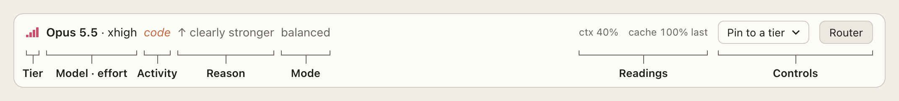
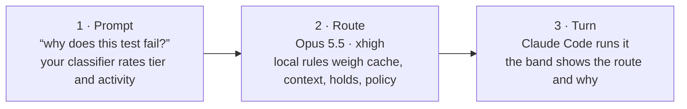
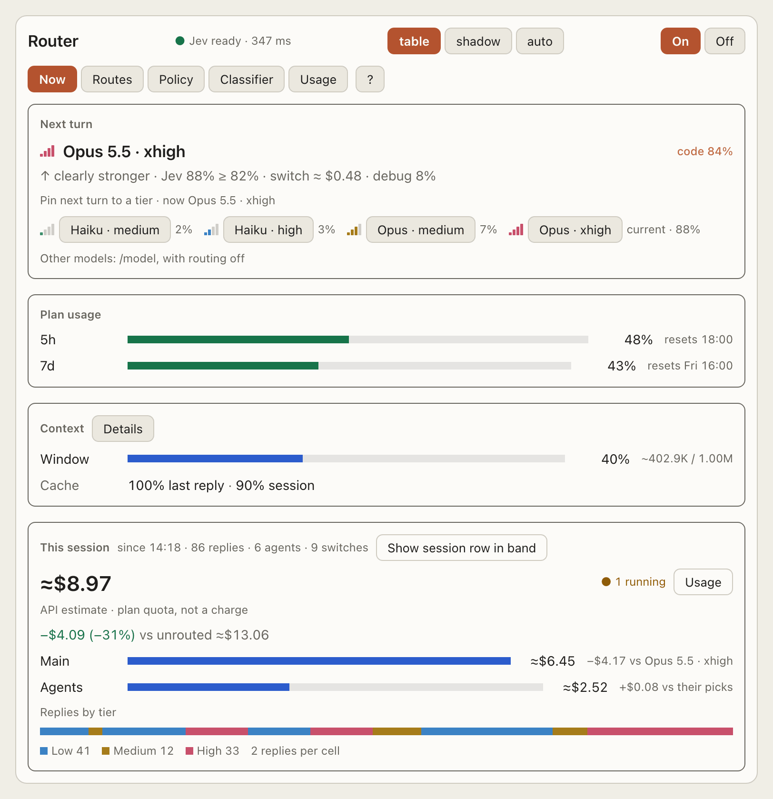
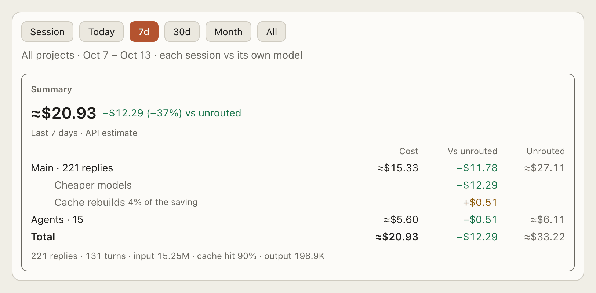

# Claude Model Router

[](https://github.com/alexei-led/claude-router/actions/workflows/ci.yml)
[](https://opensource.org/licenses/MIT)

**For Claude Code users with mixed work: each turn gets a fitting model and effort, picked automatically and shown above your prompt.**

<picture>
  <source media="(prefers-color-scheme: dark)" srcset="docs/images/desktop-band-annotated-dark.png">
  
</picture>



_Illustrative example. No proxy; prompt text goes to the classifier you choose._

## Quick start

You need Claude Code **2.1.332** or newer, and credentials for one [classifier](#classifiers-and-privacy) or a local [Ollama](https://ollama.com) model.

```sh
claude plugin marketplace add alexei-led/claude-router
claude plugin install router@alexei-led-claude-router
claude --model claude-haiku-5-5
```

In Claude Code, run `/plugin configure router` and save the credentials. Jev is the default classifier; to use another, select it on the **Classifier** tab of the `/router` pane. Before the first turn, the band above the prompt shows a dim tier meter, the model, `ready` and the routing mode, such as `balanced`. Send a prompt. `/router off` stops routing. [Desktop app and VS Code set-up](docs/user-guide.md#start-a-session).

## See where your turns went

<table>
<tr>
<td width="50%" valign="top">

<picture>
  <source media="(prefers-color-scheme: dark)" srcset="docs/images/desktop-pane-now-dark.png">
  
</picture>

_Now: the next turn's route and why, plan usage, context, this session. Sample data._

</td>
<td width="50%" valign="top">

<picture>
  <source media="(prefers-color-scheme: dark)" srcset="docs/images/desktop-pane-usage-summary-dark.png">
  
</picture>

_Usage: estimated cost against no routing for the same tokens. Sample data, not a measured saving._

</td>
</tr>
</table>

Anthropic defaults: Haiku 5.5 for the `micro` and `low` tiers, Opus 5.5 for `medium` and `high`; some kinds of work use Sonnet 5.5 or Haiku instead. [All routes](docs/activity-routing.md#the-default-matrix).

Savings and answer quality are not measured; costs shown are list-price estimates. [Evaluation](docs/evaluation.md).

## Control it

| To                                 | Do                                                                                       |
| ---------------------------------- | ---------------------------------------------------------------------------------------- |
| Open the pane                      | `/router`, or **Router** on the band                                                     |
| Turn routing on or off             | `/router on`, `/router off`                                                              |
| Pin the next turn to a tier        | `/router pin <micro\|low\|medium\|high>`, or the pin control                             |
| Lean cheaper or stronger           | `/router mode cost\|balanced\|quality`                                                   |
| Move one turn from the prompt      | Start it with `morethink`, `highthink`, `maxthink`, `lessthink`, `lowthink` or `nothink` |
| See why each turn ran where it did | `/router decisions`                                                                      |

## Classifiers and privacy

| Classifier                                            | Credential                          | Prompt text goes to   |
| ----------------------------------------------------- | ----------------------------------- | --------------------- |
| Jev, the default ([typesafe.ai](https://typesafe.ai)) | Jev API key                         | typesafe.ai           |
| Clef, Clef Flash, Clef Omni                           | Cloudflare API token and account ID | Cloudflare            |
| OpenAI, `gpt-6-luna`                                  | OpenAI API key                      | OpenAI                |
| Ollama, a local model                                 | None                                | Stays on this machine |

Only the active classifier receives text: the prompt and recent dialogue at each new turn and again during long turns, and each routed subagent's task (`"subagentRouting": "off"` keeps that local).

## Go further

**Several providers in one session:** use [claude-proxy](https://github.com/alexei-led/claude-proxy), one local Anthropic API endpoint for Claude Code and multiple native model providers. With it and the `model-proxy` profile, one session can route turns across providers and mix your Claude subscription with API-key providers such as DeepSeek. It is a separate, optional program; the router itself does not proxy traffic. [Mix providers](docs/providers.md#mix-anthropic-and-deepseek-with-model-proxy).

- [Controls: pins, modes, prompt keywords, decisions](docs/user-guide.md#change-routing)
- [Classifiers: where your prompt text goes](docs/configuration.md#classifiers)
- [Other providers](docs/providers.md) (DeepSeek, z.ai, MiniMax, MiMo, Kimi, custom) and [routing engines](docs/configuration.md#routing-engine)
- [Architecture](docs/architecture.md) · [Changelog](CHANGELOG.md) · [Contributing](CONTRIBUTING.md)
