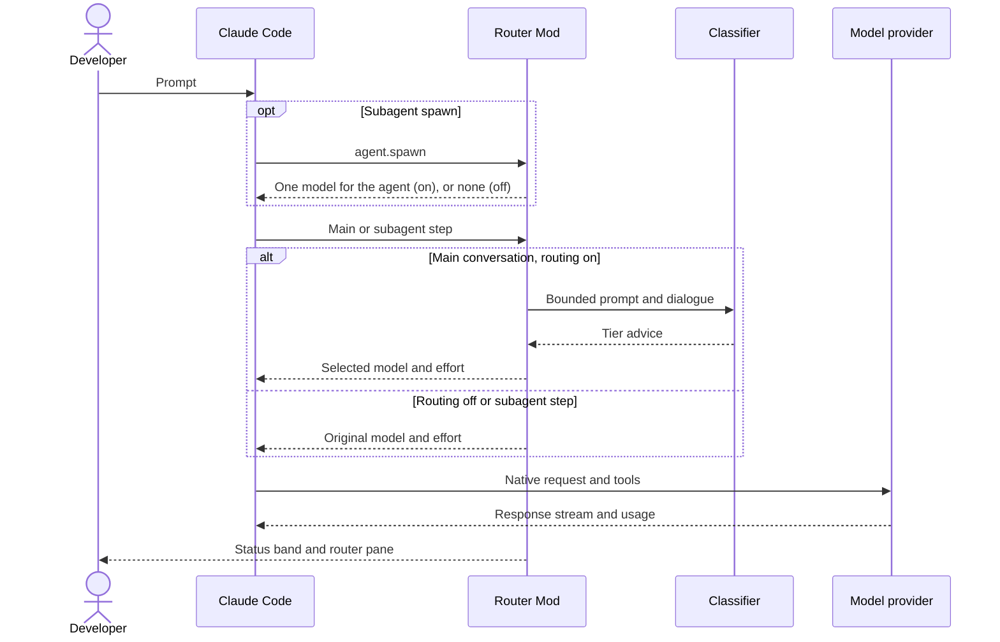

# Claude Model Router

[](https://github.com/alexei-led/claude-router/actions/workflows/ci.yml)
[](https://opensource.org/licenses/MIT)

**A Claude Code Mod that chooses a model and effort for each main-conversation turn, advised by a prompt classifier: Jev; Cloudflare's Clef, Clef Flash or Clef Omni; OpenAI; or a local Ollama model.**

The Mod changes only the model and effort in Claude Code's turn hook. Claude Code sends the request, streams the reply, runs tools, and reports usage. The router does not proxy model traffic or start a local server; an Ollama classifier calls an Ollama server that you run. Subagents get one model each when they start, chosen the same way: every agent whose definition names no model, says `model: inherit`, or sets `modelRouting: auto`. Their steps are never re-routed. See [Subagent routing](docs/configuration.md#subagent-routing).

## Providers

Use the provider that already works with Claude Code. Select its router profile, not a new endpoint:

```sh
CLAUDE_ROUTER_PROVIDER=deepseek claude --model 'deepseek-flash[1m]'
```

Create `~/.claude/deepseek-router.json` containing `{}` to use DeepSeek defaults.
With `CLAUDE_CONFIG_DIR`, put the file in that directory instead.

| Built-in profile | Router file | Default models |
| --- | --- | --- |
| Anthropic, the default | `router.json` | Haiku 5.5, Sonnet 5.5, Opus 5.5 |
| `deepseek` | `deepseek-router.json` | DeepSeek Flash, routed by effort |
| `zai` | `zai-router.json` | GLM-5.3-Flash and GLM-5.3 |
| `minimax` | `minimax-router.json` | MiniMax-M3.1-Flash, routed by effort |
| `mimo` | `mimo-router.json` | MiMo-V2.6-Flash and MiMo-V2.6-Pro, no routed effort |
| `kimi` | `kimi-router.json` | Kimi-K3.1-Pro, routed by effort |

OpenRouter, Ollama, other local servers and other compatible hosted providers use custom `<provider>-router.json` files.
They have no built-in model defaults. A selected file must exist and validate, or the router leaves Claude Code's model unchanged.

See [Providers](docs/providers.md) for **default routes and activities**, **custom profiles**, and the **`--settings` flag alternative**.
Execution provider selection is separate from classifier selection.

## Supported classifiers

The active classifier is asked at the start of each logical turn, for the tier and for the turn's activity, and again in the background every 4 requests while the turn runs (`policy.reviewEveryRequests`). Pick one on the pane's **Classifier** tab or in the selected router file; only the active one receives prompt text. With subagent routing `on` (the default), it is also asked once per routed subagent, with the task's description and prompt; set `"subagentRouting": "off"` to keep that text local.

| Classifier | Service                                    | Credential                          | Prompt text goes to       | How it is asked for the activity                                      |
| ---------- | ------------------------------------------ | ----------------------------------- | ------------------------- | --------------------------------------------------------------------- |
| Jev        | [typesafe.ai](https://typesafe.ai)         | Jev API key                         | typesafe.ai               | A third `choice` question in the same request                         |
| Clef       | Cloudflare Workers AI, 27B                 | Cloudflare API token and account ID | Cloudflare                | The same                                                              |
| Clef Flash | Cloudflare Workers AI, 9B                  | Cloudflare API token and account ID | Cloudflare                | The same                                                              |
| Clef Omni  | Cloudflare Workers AI, 30B MoE             | Cloudflare API token and account ID | Cloudflare                | The same                                                              |
| OpenAI     | OpenAI, `gpt-6-luna` (public beta)         | OpenAI API key                      | OpenAI (`api.openai.com`) | A second `choice` in `questions`, in the same request                 |
| Ollama     | A local [Ollama](https://ollama.com) model | None                                | Stays on this machine     | A second request: letters A to H, one token, if 300 ms or more remain |

Jev is the default. [Configuration](docs/configuration.md#classifiers) gives the endpoints, timeouts, and how to add another service that speaks one of the supported protocols.


The band above the prompt shows the tier, activity, model, and reason for each turn. `/router` opens a pane to pin a tier, edit the model and effort of each tier, and tune the policy. See the [user guide](docs/user-guide.md#read-the-status-band).

The router needs Claude Code 2.1.289 or newer. Savings are not measured. The pane's Usage tab estimates what routing cost against your own model for the same tokens at configured list prices, for this session, today, 7 or 30 days, this month or all; it is not a bill and does not judge answer quality. See the [evaluation](docs/evaluation.md).

## How it works



The active classifier labels each new logical turn, and the router checks the route again while the task runs: a turn labelled `ops` that edits code moves up to the `code` route at once, and a background classifier review every 4 requests can move the tier or the activity either way. A cheaper route on the same task waits for a dwell and a checkpoint its work can show: a passed test, build or lint run, or for commands, docs and read-only work the success the router can see. A task notification is routed as progress on your last request. `/router decisions` lists why each turn ran where it did. See [Changes during a task](docs/user-guide.md#changes-during-a-task). A local policy applies vote, context, failure, and cache-cost rules before the Mod changes the next step. Claude Code owns request construction, model credentials, tools, streaming, and the API cost ledger.

With the Anthropic profile, the base routes are:

| Tier     | Default model | Effort   |
| -------- | ------------- | -------- |
| `micro`  | Haiku 5.5     | `medium` |
| `low`    | Haiku 5.5     | `high`   |
| `medium` | Opus 5.5      | `medium` |
| `high`   | Opus 5.5      | `xhigh`  |

These are routing defaults. They do not claim equal model quality. [Configuration](docs/configuration.md#built-in-defaults) gives the published results behind them and the `router.json` lines that restore the 1.3 Sonnet ladder.

Activity routing adds a second label: what the turn produces (`code`, `debug`, `explore`, `plan`, `review`, `ops`, or `docs`). A route is then picked by tier and activity. It is on by default since 1.7. A `·` cell uses the tier's own route, the base route:

The Anthropic profile uses these activity defaults. Other profiles have [their own defaults](docs/providers.md#activity-overrides).

| Activity                          | `micro`        | `low`             | `medium`         | `high`       |
| --------------------------------- | -------------- | ----------------- | ---------------- | ------------ |
| Base route                        | Haiku · medium | Haiku · high      | Opus · medium    | Opus · xhigh |
| `code`, `debug`, `plan`, `review` | ·              | **Sonnet · high** | ·                | ·            |
| `ops`                             | ·              | ·                 | **Haiku · high** | ·            |
| `explore`, `docs`                 | ·              | ·                 | ·                | ·            |

`/router activities off` stops asking and keeps the base routes. [Activity routing](docs/activity-routing.md) explains each cell and how to change it. The label is optional: on `uncertain` or a weak label the base route is used if the move passes the cache check, when the activity answer fails the running activity stays and the tier answer still applies, and when the classifier fails the running route stays. See [Route by activity](docs/user-guide.md#route-by-activity), and [Evaluation](docs/evaluation.md#activity-routing) for how it is checked. Its default overrides rest on published vendor results and a list-price replay of one developer's sessions, not measured savings.

A [routing mode](docs/routing-modes.md) trades cost against answer quality without new routes: `cost` takes a cheaper model or one effort level less where a turn allows it, `quality` one effort level more or the tier above, and `balanced`, the default, runs the routes as configured. Set it per session with `/router mode cost`, per project in `.claude/router.json`, or for the profile with `"mode"` in `router.json`.

## Install

You need Claude Code 2.1.289 or newer and credentials for one [supported classifier](#supported-classifiers).

```sh
claude plugin marketplace add alexei-led/claude-router
claude plugin install router@alexei-led-claude-router
```

For the default Anthropic profile, start on the full baseline model, for example `claude --model claude-haiku-5-5`. For other providers, [select a provider profile](docs/providers.md#select-a-provider). Run `/plugin configure router` and save the key. For any other classifier, save its credentials, or run `ollama serve` with a pulled model, then pick the classifier on the pane's Classifier tab. A new session on a model that a tier routes to, or with activity routing `on` a model an activity override uses (Sonnet 5.5 on the defaults), starts with routing on; on any other model it starts with routing off and says why, and `/router auto` turns routing on.

Claude Code updates the plugin at startup when auto-update is on for this marketplace. Otherwise run `claude plugin marketplace update alexei-led-claude-router`, then `claude plugin update router@alexei-led-claude-router`.

Upgrading from 0.8? Remove the gateway settings that 0.8 `/router:setup` wrote before the first 1.0 session, or requests go to a gateway that 1.0 no longer starts. Follow the [migration steps](docs/user-guide.md#move-from-v08-gateway-setup).

## Run from a checkout

Start Claude Code with this directory as a local plugin and the full Haiku baseline model:

```sh
claude --plugin-dir "$PWD" --model claude-haiku-5-5
```

In Claude Code, run `/plugin configure router` and save your classifier key in the sensitive plugin option. The Mod adds its status band and `/router` pane. No status-line setup or gateway environment variables are needed.

Run `/router` to open the pane: route status, per-tier controls, tuning, and usage, including routing vs your model. Run `/model` to select a model and turn routing off, and `/router auto` to turn it back on. For controls, metrics, tuning, and troubleshooting, see the [user guide](docs/user-guide.md).

Before a push, run the same checks as CI. `npm run setup` installs Biome and TypeScript into `tools/`; the plugin root keeps no lockfile, so Claude Code installs nothing with the plugin. `npm run validate` and `npm run test:plugin` need the `claude` CLI: they load the Mod in the Claude Code engine, which refuses some faults that lint and unit tests miss.

```sh
npm run setup
npm run check && npm run typecheck && npm test && npm run validate && npm run test:plugin
```

## Documentation

- [User guide](docs/user-guide.md): install, use the controls, read the panel, and troubleshoot.
- [Providers](docs/providers.md): provider names, router files, built-in defaults, and custom profiles.
- [Configuration](docs/configuration.md): router-file settings, classifier keys, cache policies, and migrations.
- [Architecture](docs/architecture.md): Mod event flow, state, safeguards, and runtime boundaries.
- [Activity routing](docs/activity-routing.md): the default matrix by activity, why each cell, and how to change or turn it off.
- [Routing modes](docs/routing-modes.md): `cost`, `balanced` and `quality`, where the mode comes from, and every decision per mode.
- [Native router details](docs/native-router.md): panel semantics, tuning, and accepted limits.
- [Evaluation](docs/evaluation.md): historical gateway results and the native shadow replay.
- [Changelog](CHANGELOG.md): user-visible changes by version.
