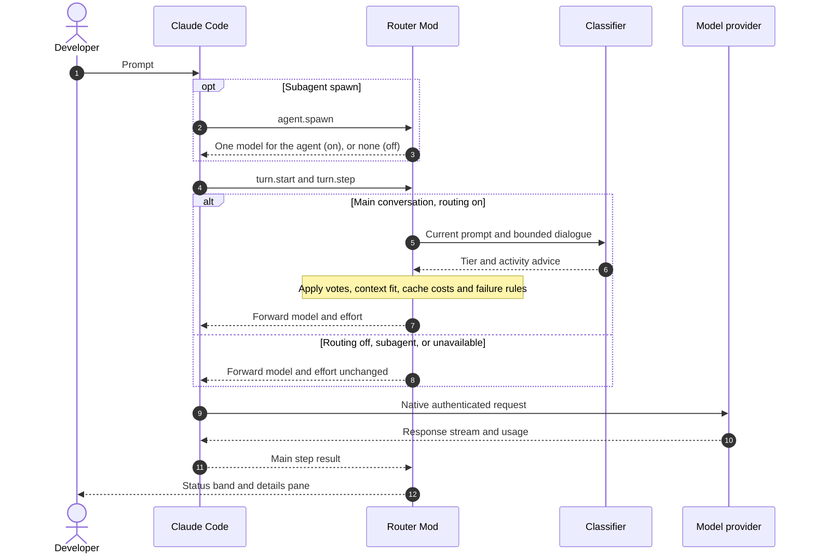

# Architecture

Claude Code owns the model request. The router Mod asks the active classifier (Jev by default; Cloudflare's Clef, Clef Flash or Clef Omni; OpenAI; or a local Ollama model) for tier advice and, unless `activityRouting` is `off`, the turn's activity, applies local routing policy, and changes only the next main-conversation step's model and effort. Subagent steps pass through unchanged; `subagentRouting` may choose a subagent's model once, at `agent.spawn` (see [Subagents](#subagents)).

## Request flow



The Mod does not construct an Anthropic request or proxy its response. Claude Code owns authentication, request fields, streaming, tools, model fallback, and its native usage ledger. No local gateway process or port is part of the runtime. The Ollama classifier calls an Ollama server that you run; the Mod starts none.

The active classifier receives the current prompt, up to six recent user/assistant text messages, and optional bounded active-goal and current-step text. Each text is capped at 1,200 characters. System messages, tool inputs, and tool results are not included. Only the active classifier is asked: Jev sends that text to typesafe.ai, Clef, Clef Flash and Clef Omni to Cloudflare Workers AI, OpenAI to api.openai.com. Ollama runs on this machine, so the text stays here. The Jev, Cloudflare, and OpenAI keys are sensitive plugin options; the Cloudflare account ID is a plain one that fills the endpoint. Ollama takes no key. The Mod does not receive Claude's Anthropic credentials.

Each classifier names its wire protocol, `api`, and `classifier-apis.mjs` holds one adapter per protocol. `system-one` (Jev, Clef, Clef Flash, Clef Omni) sends the typed `state` and `questions` request and reads `answers.route`; Cloudflare's REST API wraps that answer in `{ result, success, errors }`, which the parser unwraps. `openai-decisions` (OpenAI) sends the state as `input` text and reads a `choice` answer plus a `predicate` for the continuation. `ollama` asks for one letter with thinking off and reads the log-probability of each letter from the top 20 candidates. A letter's probability is its share of the letters found there; a letter missing from the list counts as zero. The Ollama adapter asks no continuation question, so `continuation` is null there. Every adapter returns the common advice shape. Ollama has neither phase nor continuity; it uses the goal's route and does not retain a cross-turn goal anchor.

Advice carries `activity` (the task goal) and optional `phase`, each with a choice and probabilities. The effective routing activity can differ from the goal for bounded command phases. Protocols ask them independently:

| Protocol           | How the activity is asked                                                                                                                        |
| ------------------ | ------------------------------------------------------------------------------------------------------------------------------------------------ |
| `system-one`       | Independent `activity` (goal) and `phase` choice questions in the same request.                                                                  |
| `openai-decisions` | Independent goal and phase choices in `questions`.                                                                                               |
| `ollama`           | A second request after the route answer, with the same system message and state prefix so Ollama can reuse its cache. Letters A to H, one token. |

The activity is optional at every layer. An adapter reads a missing, malformed, or unknown activity answer as `activity: null` and keeps the strict parsing of the route answer. With `activityRouting: off` no adapter builds the activity question, so the request bodies are the ones 1.5 sent; a fixture test checks this. The criteria and instructions live in `classifier-contract.mjs` beside the tier ones, and describe the final task deliverable separately from the current step. Unknown phase answers never invent a command-only route. The classifier criteria keep showing the base route of each tier, not the activity overrides: the tier question is about difficulty.

Claude Code builds each request for the model the Mod selects, so no request rewriting is needed. Checked on builds before 2.1.321, with Haiku 4.5, which no route runs now: Haiku 4.5 got its own thinking mode and a 32K output cap. On Claude Code 2.1.289, a billed chain of pinned turns (Opus, Haiku 4.5, Sonnet at `xhigh`, Sonnet, Haiku 4.5) used a tool on every turn over the previous models' history, and no request was rejected. Sonnet and Opus accepted histories above 589K input tokens. These checks cover tested requests. They do not prove every Claude Code feature combination.

## Responsibilities

| Component                                             | Responsibility                                                                                                                              |
| ----------------------------------------------------- | ------------------------------------------------------------------------------------------------------------------------------------------- |
| [Native hooks](../hooks/native-router.mjs)            | Turn identity, controls, lifecycle, per-step rewrites, response observation, pane actions, and every host call.                             |
| [Classifier contract](../lib/classifier-contract.mjs) | Route criteria and instructions shared by every protocol, credentials and endpoint filling, and retry rules.                                |
| [Classifier APIs](../lib/classifier-apis.mjs)         | One adapter per wire protocol: request payload, answer validation, and the shared advice shape.                                             |
| [Classifier client](../lib/classifier-client.mjs)     | Classifier HTTP, deadline, in-flight admission, and circuit breaker.                                                                        |
| [Failover](../lib/failover.mjs)                       | What an API failure is, what it holds and for how long, which holds still run, and when one is retried.                                     |
| [Holds](../lib/holds.mjs)                             | The running holds as rows for the pane, the band, the toast and `/router holds` and `/router release`.                                      |
| [Router controller](../lib/route.mjs)                 | Context fit, model identity, engine fallback, cache observations, one-turn pins, and the tier-and-activity cell.                            |
| [Activity rules](../lib/activity.mjs)                 | Which activity applies, how two routes compare, and when a route change inside a tier is worth it.                                          |
| [Activity stats](../lib/activity-stats.mjs)           | Session and stored activity counts, the tool-agreement table, and the per-turn record.                                                      |
| [Facts](../lib/facts.mjs)                             | The turn's facts for policy, and the bucket of a finished turn from its tool calls.                                                         |
| [Policy](../lib/policy.mjs)                           | Tier votes, escalation, and switching gates, for routes as well as tiers.                                                                   |
| [Costs](../lib/cost.mjs)                              | Cache uncertainty bounds and switching estimates.                                                                                           |
| [Session cost](../lib/costs.mjs)                      | One cost per period for every readout: main and subagents, against no routing, and how it is paid.                                          |
| [Prices](../lib/prices.mjs)                           | Built-in list prices with each vendor's page and check date; rewritten by `scripts/check-prices.mjs`.                                       |
| [Router view](../lib/view.mjs)                        | The view's initial shape and the usage readings each reply adds to it.                                                                      |
| [Project routing](../lib/project-routing.mjs)         | Validation and composition of read-only project JSON and scoped plugin-store overrides; edit and conflict helpers.                          |
| [Auto engine](../lib/auto-engine.mjs)                 | The pure `auto` engine: demand, target and move from the classifier's answer and the costs. See [Automatic routing engine](auto-engine.md). |
| [Auto route](../lib/auto-route.mjs)                   | The stateful main-turn adapter of the `auto` engine; table and shadow never enter it.                                                       |
| [Modes](../lib/modes.mjs)                             | The routing modes: how `cost` and `quality` move each tier's route by one step.                                                             |
| [Providers](../lib/providers.mjs)                     | The built-in provider presets (models, routes, subagent routes) and model-ID mapping.                                                       |
| [Subagents](../lib/subagents.mjs)                     | One model per subagent at spawn, why a spawn passes through, and the counts that show what it saved.                                        |
| [Subcommands](../lib/subcommands.mjs)                 | The words `/router` takes: one table for the command, its argument hint and the prompt's typeahead.                                         |
| [Route line](../lib/route-line.mjs)                   | Which turns leave a route line in the transcript, and what it records.                                                                      |
| [Panel](../lib/panel.mjs)                             | The tab table (id, hotkey, label, model, renderers) and `renderPanel`, which draws the pane for the surface.                                |
| [Router band](../lib/band.mjs)                        | `renderBand` and `renderRouteLine`, which draw the band and the route line for the surface, and route-change toasts.                        |
| [UI](../lib/ui/)                                      | What the band and the pane show: models (plain data), one renderer per surface kind, and every colour. See [UI layout](#ui-layout).         |
| Claude Code                                           | API requests, tools, authentication, stream output, and usage ledger.                                                                       |

Every function that takes the engine interface `$` lives in the hooks module: the engine does not follow `$` across an import, so the modules in `lib/` stay pure.

Node.js is not part of routing. It is used for development, the optional configuration migration, and the classifier probe.

## UI layout

The band, the pane and the route line are built in three steps: the router state becomes a model, a renderer turns the model into elements, and the host draws them. All of it is under `lib/ui/`, with two entry points, `renderPanel` in `lib/panel.mjs` and `renderBand` (and `renderRouteLine`) in `lib/band.mjs`.

```
lib/ui/tokens.mjs        every colour, by tone, and the surface helpers (isGraphical, toneColor)
lib/ui/fallback.mjs      orTerminal: the terminal tree when a graphical renderer throws
lib/ui/model/            plain data, no elements and no widths: now, routes, policy, classifier, usage (with
                         usage-breakdown, usage-agents, usage-shared), frame (notices, save bar, help, key help),
                         draft (the Routes and Policy draft), band (segments, fitting, agent rows), format
lib/ui/terminal/         kit.mjs, frame.mjs, band.mjs, wrap.mjs and one renderer per tab
lib/ui/graphical/        kit.mjs, frame.mjs, band.mjs, charts.mjs, meter.mjs, squares.mjs and one renderer per tab
```

**Surface dispatch.** Every `ui.render` event carries `e.surface`, which the hook passes on. `terminal`, or no surface, picks the terminal tree. `desktop`, `vscode` and `mobile` pick the graphical tree, which is one tree for all three. If a graphical renderer throws and the caller passed `onFallback`, `orTerminal` hands it the error and draws the terminal tree; the hook's callback writes the error to the debug log. Without `onFallback` the throw propagates, so a test sees a broken renderer instead of the terminal tree standing in for it. The terminal's own throw is never caught.

**Data flow.** `renderPanel` builds a context from the config, the stored view, the usage readings and `e.surface`. The selected tab's `modelOf` turns it into a model in which every condition, word and number format is already decided; where the words differ by surface the model holds a `{ terminal, graphical }` pair. The renderer only lays the model out with its kit. On the terminal, `kit.panel` puts a section (a Now block, the Policy controls, the active classifier) in a single-line box from 72 columns (`PANEL_COLUMNS`) or with no width, and `kit.inner` gives its lines the box's inner width; a narrower pane gets the plain lines. A tab renderer never reads `view` or the config; if it needs a fact, the model carries it. The frame (header, tabs, notices slot, save bar) has its own model, `frameOf`, and its own renderer per surface kind. The band follows the same idea with less separation: `lib/ui/model/band.mjs` returns segments of parts with a priority (`bandSegments`, `sessionSegments`, `agentSegments`, `routeLineSegments`), and `fitSegments` drops them by priority to fit `columns`. The terminal band draws the segments, adds Router in brackets only where that costs no reading or hover control, adds the hover controls as absolutely placed Boxes, and still takes `config` and `view` for those controls; the graphical band splits the segments into a left group that shrinks and a right group that never does. A graphical band never adds anything on hover.

**State.** `lib/ui/` keeps no module state. A function takes the elements it draws with (`$.ui.resolve(e)` in the hook), the model, and the actions it binds to a `Button` or `Select`; the hook owns the view, the config and every host call.

**Colour.** `lib/ui/tokens.mjs` is the one place a colour is written. A model names a tone (`primary`, `muted`, `accent`, `success`, `warning`, `danger`, `activity`, `tier:<tier>` or `model:<family>`); the kit turns it into a colour with `toneColor(tone, surface)`. The terminal and the graphical surfaces draw the six theme tones as Claude Code theme keys (`text`, `subtle`, `suggestion`, `success`, `warning`, `error`), so the person's theme, light or dark, decides them. Tiers, model families and the activity have no theme key and are hexes, with a mid-lightness set on a graphical surface so each reads on a white and a dark ground. An `Svg` cannot take a theme key, so its colours are hexes from the same file (`svgColor`). A renderer that wrote its own colour would escape the theme and the contrast checks in `test/ui-tokens.test.mjs`.

## Decision and context

A logical turn is classified at its first step, and again every `reviewEveryRequests` requests in the background (see Review inside a turn below). Other tool continuations reuse the decision and add no votes. Before each step, the controller checks whether the selected model still fits after new tool output.

Repeated tool-error escalation needs matching non-empty error output and an intervening edit attempt within a 40-message lookback. An edit attempt is an Edit, Write, MultiEdit or NotebookEdit call, or a Bash command that writes a file (`sed -i`, `perl -i`, a redirect, `tee`, `patch`, `git apply`), made after the first error and before the call that produced the second, including one earlier in the same step. Rerunning, reading or installing does not count, and the failing call itself is never the attempt. A bounded fingerprint covers the full output, not only the runner header. It removes ANSI colors, normalizes line endings, and normalizes source positions in stack frames and TAP `location` fields. TAP durations and Jest `✕ ... (N ms)` timings are also normalized. Other test names, case, whitespace, and numeric error values are kept. Unrecognized runner noise remains part of the signature: changed output can miss a repeat rather than trigger a false escalation.

An upgrade or downgrade needs a streak of supporting votes (`upgradeVotes`, `downgradeVotes`), because staying keeps a warm cache. A downgrade lands on the cheapest tier from the choice up to just below the incumbent whose mass at or below it, with its streak, clears that tier's bar: a split answer (micro 0.63, low 0.3) on `high` moves to `low` rather than waiting for `micro` alone, and a cold candidate can give way to a warm one in between, such as the same model at a lower effort. Before the first measured reply of a history (session start, clear, rewind, committed compaction), no cache from it exists yet, so one vote is enough. The mass bars, the cash gate, escalation and holds apply as usual. On the same task (`sameTaskOf`: a review inside a turn, a turn whose prompt has a progress origin, or a prompt with advice `continuation` at or above `continuationMass`) an upgrade proceeds as usual, but a downgrade that has its votes stays as `downgrade-held` until `facts.downAllowed`: at least `minDwellRequests` requests since the last model change (`loop.switchedAt`), and a checkpoint since then (`completedSince`). The last verification command (`verifiedSince`: a Bash test, build, lint or type-check run) passing always counts. Without one, the running route's activity decides: for `ops` the last command that ran something succeeded with no edit or delegation since, for `docs` the last edit succeeded and touched only doc paths with no command run beside it, and for `explore`, `plan` and `review` a turn finished with nothing edited, written, run or delegated and no error as the last tool result. `code`, `debug` and a route with no activity need the passed check, and a check that ran in any form (chained, redirected, piped, after `;` or `||`, in the background) without passing last blocks every shortcut (`runsAnyCheck`). Each rule asks for a success it can see; the absence of an edit alone is never evidence.

A move to a smaller context window needs a main-response measurement from the current history and Claude's local context estimate. The router uses the larger available reading and reserves 20% of the model window. If it cannot establish fit, it keeps the current model with `context-unknown`. It does not infer token count from character count.

An explicit context-window failure marks that model ineligible until the next history reset. An engine fallback suspends rewriting for the rest of the turn. The router sends a request again only for a model on probation (below).

A main turn that ends on an API error (`classic.StopFailure`) is classified (`classifyFailure`, `lib/failover.mjs`) from the plan readings, the error's text (`error_details`, else `last_assistant_message`) and the error word, into one of four kinds. A text that names a plan window is never read as a spend cap or a balance (a `billing_error` stays `balance`); a spend cap is matched before a balance. An `availability` failure (`overloaded`, `server_error`, `model_not_found`, a `rate_limit` with no quota signal, or a plan `rate_limit` that names credits) holds the model of the last main request in `loop.held` for a fixed time that doubles per consecutive failed retry, to an hour. A `window` needs the failed model on the plan account and every plan-billed model in that one account (`planAccountsOf`), since only the Claude plan reports window readings; a session that also pays credits qualifies. A `window`, `calendar` or `balance` failure holds the model's account instead, written to `$.store` under `holds/<account>` so a new session and a restart see it; the hook reads these holds at turn start and `lib/` receives them as data. Other errors are not the model's and hold nothing. A `calendar` or `balance` hold also carries `probeAt`: once it passes (`dueProbes`), the hook leaves that account out of the holds it gives main routing, while spawns and the views still read it. A main request sent to it is the probe: one that resolves with no reply writes `probeFailed` (the wait doubles from an hour to a day, counted in `streak`; a later failure on the running hold keeps that wait, and one after the probe is due counts as a failed probe). A main or agent reply from a model of an account whose hold the turn has read ends the hold, unless the hold was set after that request was sent. A reply that ends no hold reads no store; one that ends a hold reads it once, and keeps a hold another session set since. Under `table` and `shadow`, a step whose request resolves with no reply (`stopReason` and `usage` null, not aborted) is sent once more when the model was on probation: its account's probe was due, or `loop.held` kept an ended `availability` hold for it. The hook holds it again (`probeFailed`, or `holdModel`, which doubles the time), routes the step around it with `continueRoute`, sends that request, and observes its reply with the new hold; the turn gets a `failure` row with the stand-in's `route` and no error word. With no other usable model the empty reply stands. A model with no failure history is not sent again: a step does not see the error, and a request the provider refused must not move to another model. `auto` never sends a step again. A main failure that held something is also remembered with its turn id, and so is a main `turn.complete` with reason `error`: the engine raises the two in either order (on 2.1.332 live, `turn.complete` came first). Whichever comes second queues one `$.prompt.submit` naming the model and the cause, under every engine, when routing is on and some configured model is not held; at most 2 in a row, a count any other main turn end resets. The submission is not awaited, since it resolves only when the queued turn starts. A `StopFailure` hook cannot submit, so when it comes second a `$.clock.after(0)` timer submits. In an interactive session Claude Code opens its usage-limit menu once per limit (`rateLimitType` and reset), and the menu holds the prompt queue: Stop and Esc both drop the router's prompt, and its `submit` never settles. The hold stands, so the person's next prompt runs on the stand-in; a later failure on the same limit in that session gets no menu and is run again. The `StopFailure` event carries neither the model nor a retry-after, so the hook keeps the last request's model, the stand-in's after a second try. At the next turn a cell whose route runs a held model (or a model of a held account) takes the first usable target of its `fallbacks` chain, a route that need not be in any tier; with no chain, or every target skipped, it falls back to the nearest tier, the stronger of two as near, at the turn's activity, skipping any switch into or out of a `requiresOwnHistory` model. The reason is `model-held`, and a chain's step is recorded in `decision.fallback`. That fallback serves the turn only, as a pin does: `lastRoute` and `loop.route` keep the held route, so the turn after the hold runs it again with no switching gate. That is so only when the cell's configured route runs a held model too. A held `loop.route` is not usable, so `routeTurn` rebuilds the incumbent from config; where `loop.route` was kept apart from config (a routing-mode change or a route edit since it was chosen, or `ownRoute` for a session model no tier routes to) and the configured route runs another model, the turn runs that route with its usual reason, `chooseRoute` stores it as `loop.route`, and the held route does not come back. The policy state also stays as it was, only the turn counted, so a failure whose escalation the hold turned away still escalates once it ends. A compaction keeps the holds. Inside a turn no move lands on a held model: `observedMove` keeps the running route, and `continueRoute` skips a held route for a context fit or an image tier as it skips an ineligible one. A running model that cannot run falls back to the session model unless that model is held; then the nearest tier that runs stands in, with reason `model-unavailable` and no fallback chain. Every engine writes holds; the reaction differs. The `auto` engine never selects a held model as its target and moves off a held incumbent with reason `forced`; the held ids it reads are named as candidates are priced, so a hold on the requested id also covers the dated snapshot a reply resolved it to, and a subagent spawn whose routed model is held keeps Claude Code's own model. Its fallback space is the catalog, not the `fallbacks` chains; when the hold ends, the ordinary gates decide whether the route moves back.

## Activity routing

The router decides on a _cell_: a tier and an activity. The route is `{ ...routes[tier], ...activities[activity][tier] }`; the (model, effort) pair, not the label, is what Claude Code receives and what owns a cache. Two cells that resolve to the same route never switch.

`chooseRoute` decides at a turn's first step, and again on each review answered inside the turn:

1. **Pin.** A pinned tier wins, with no activity: the pin's tier route.
2. **Keyword.** A prompt keyword (`lib/keywords.mjs`), read at the turn's first step from a prompt whose origin is not a progress origin, never with a pin. `chooseCell` decides the cell as below, then moves its tier (`keywordTier`: one up or down, the top or the bottom) with the reason set to the keyword and no lateral rule. The cell's route comes from the turn's config, so the mode and the activity apply, and the incumbent's route is not kept. Fit and availability (step 6) still apply. `chooseRoute` moves the sent effort one listed level for `morethink` and `lessthink` (`keywordEffort`), except on a route that sends the session's effort, and so does `continueRoute` when a fit or a stand-in moves the turn. It records `decision.keyword` and keeps `lastRoute`, `loop.route` and the policy state as a pin does: `decide`'s votes, escalation and hold judged the pick the keyword replaced. `servesOneTurn` keeps reviews and observed moves off the turn. With `auto`, `autoRoute` runs the turn as a pin to the tier the keyword moves the advanced demand to, with the bounded-execute discount for a relative keyword (`pinDiscount`), keeps the mode margin and the activity, and saves the keyword and the discount with the pin for the turn's continuations. Its decision keeps the selected route and moves only the effort sent (`keywordSent`), and only to an eligible candidate: a hard constraint on the moved route, such as the cash cap, keeps the selected effort. Each continuation runs that route again while it stays eligible (`keepKeywordRoute`), so the move applies once, also where each effort keeps its own cache and the moved route is the warm one. Shadow traces record the keyword; the table replay passes it to `chooseRoute`, and the Auto replay runs the turn through the same `keywordPin`, `keepKeywordRoute` and `keywordSent` as `autoRoute`.
3. **Activity.** Only in `on`; derive the route activity from the goal and a supported phase, with bounded verify/execute using `ops`. For goal `ops`, accepted reason/produce uses same-tier debug/code; report or unclear phase keeps an eligible continuation or considers the fresh generic baseline, without a new ops discount. Other goals keep goal routing when phase is unclear. Progress origins cannot justify downgrades. `off` uses none, and ignores the activity a turn in `on` ran with before the mode changed. With no advice, or advice without an activity answer, the incumbent's activity stays. On the same task (`sameTaskOf`; reviews and progress origins count as same-task even without a continuation answer, including Ollama) a label whose route at the incumbent tier is stronger applies at once, and a weaker one only with at least `downgradeMass` probability once `facts.downAllowed` holds; an unclear label keeps the running activity. Otherwise the activity with probability at least `activityMass` applies; below that, or for `uncertain`, there is none and the tier's base route is used.
4. **Tier.** The tier policy runs as before, with every candidate tier priced at its route for the activity and the incumbent at the route it runs. Repeated tool errors move to the lowest tier above whose route is stronger than the running one, or sends a request that cannot be ordered against it. With no activity that is one tier up, as in 1.5. If no tier above helps, nothing escalates and the failure signature is kept.
5. **Lateral move.** If the tier stays and the route would change, `lateralMove` decides. Routes order by declared model strength, then effort. Unknown ranks stay unordered regardless of tariffs; prices remain economics inputs. A session effort counts as the effort handed to Claude Code, not verified API-transmitted effort. Two routes that send the same request do not switch. A pair that cannot be ordered (unknown model strength or an unresolved/numeric effort) counts as a move up, so the base route is always reachable. A stronger route needs the activity's probability to clear the upgrade bar for its switching tax (a base route with no activity counts as probability 1). A cheaper route needs its downgrade tax to be paid back within `downgradeHorizonTurns`, except before the first measured reply of a history, when there is no cache to protect. The cash gate applies to both. The result is `activity-up`, `activity-down`, `activity-pending` (stay on the running route and its activity), `cash-gate`, or `hold`. While an escalation hold lasts, only a stronger route may be taken. One vote is enough for a proposed activity cell, but the labels remain model estimates, not observed facts. If the tier changes, the tier gates have already priced the new route, and no lateral rule applies.
6. **Fit.** Context fit and model availability resolve through `route(tier, activity)`. A fallback tries the last cell, the native model's cell, then each tier with the activity. The last and the native cell count only when they carry no activity or the turn's; otherwise, or when nothing fits, the native model runs at the session effort.

`decision.floorActivity` retains accepted ops reasoning/code intent separately from a protected physical ops cell.
Equal physical pairs can adopt the semantic preference without a switch before tier policy. Nomination carries
provenance through `chooseCell`/`decideCell`; lateral refusal restores the incumbent's accepted floor, not the proposed
role. Same-label physical changes introduced by a new phase projection use min(goal, phase) support, not the support
of 1 reserved for operator mode/config changes. Context/availability refits consume the post-gate accepted projection.
Every configured alternative resolves its own floor provenance, including after an unmeasured-window restore or a
last/native fallback. The existing rule for keeping the actual incumbent request remains separate and unchanged.
`continueRoute` projects that accepted preference per tier when context/modality requires a new eligible route. The field belongs to the accepted
turn decision: new advice recomputes it; history reset, observed upward supersession, pin/off and native-unavailable
fallback clear it. Existing host session/generation/review fences still own when a decision can apply.

**Observed move.** On each later step of the turn, `observedMove` reads the turn's tool calls since its prompt, or since the transcript snapshot of the last review applied inside the turn (`loop.observedFrom`), since the review already judged the earlier ones, (`observedActivity`: `code` after an edit to a non-doc file, `docs` after edits to doc files only, else `ops`, `read` or `talk`). When that activity's route at the decision's tier is stronger than the running one, the remaining steps take it, with reason `activity-up` and `lastActivity` set, so the next turn starts there. The tier is fitted to the context first, so the gates price the route that will run. It goes through `lateralMove` with probability 1: the tools are the evidence, so the switching tax never holds it back (the upgrade bar tops out near 0.9), and only the cash gate can. The turn's reply label (`turnActivities.label`) follows the move; the classifier's answer stays as recorded. It never moves down, and skips pinned turns and `off`. `canMoveUp` skips the transcript read when no activity's route at the tier is stronger, so a step on the strongest route costs nothing. A move to a smaller window waits for a measured context, as in `routeTurn`. Context fit and model availability then apply as for any continuation.

**Failed steps.** A `turn.step` failure before the request goes out sends the request as Claude Code built it; so do settings that cannot be read and a transcript that cannot be read at a turn's first decision. Only a decision that produced a route serves the turn's later steps; a failed, aborted or lost decision is made again at the next step. A hook failure at `session.start` or `turn.complete` passes the event through.

**Review inside a turn.** Every `reviewEveryRequests` requests after the last classifier answer (`loop.reviewedAt`, counted in `loop.requests`), `reviewMidTurn` reads the transcript and asks the active classifier in the background, with the turn's prompt and recent dialogue and `facts.midTurn` set. The classifier reads text only: the dialogue holds user and assistant text, not tool calls, results or edits. The policy reads those itself (`observedMove`, repeated failures, `completedSince`). The step does not wait. Reviews ask through their own client per classifier, with their own failure count, 60-second pause and in-flight slot, so a review left in flight never makes the next turn's decision skip as busy, and review failures do not pause turn decisions. The first step after the answer arrives runs `chooseRoute` on it, before the observed move, with only the advice taken from the review: the checkpoint, context and cache facts are read at that step. Tier and activity move by the same rules as a continuation prompt: up on votes, down only past `downAllowed`. A pinned turn, a failed read or ask, an answer without advice, and an answer about a replaced history (another `generation`) change nothing; turn completion and session end abort a review in flight. `observeResponse` counts each request and records the request and message count at which the requested (model, effort) last changed (`switchedAt`), which the dwell and the verification window start from. A failed transcript read keeps the running route. A verification is a Bash command whose status is the check's: a checker (`pytest`, `tsc`, `eslint`, …) or a launcher whose subcommand names a check (`npm test`, `npm run lint`, `go test`, `make lint`, `uv run pytest`), alone or in an `&&` list. A pipeline, `;`, `||` or background job does not count, since its status can hide a failed check; neither do a `--version` or `--help` run, an option before the subcommand (`npm --prefix test install`), package names, paths and file names, nor a command Claude Code sent to the background, by request or after a timeout. The first response a loop serves also sets `switchedAt`, so checks from before the router chose a route do not count. When compaction or a rewind shortens the history, `prepareLoop` moves `switchedAt.messageCount` and `observedFrom` back to its end and keeps the request-based dwell.

At session start the incumbent is the session's model. `cellForModel` looks for it in the base routes, baseline first, and only with `activityRouting: on` in the activity overrides too, so a session that starts on an override route keeps its cell until the classifier says otherwise. The start mode uses the same lookup: with `on`, a start model that only an override uses (Sonnet 5.5 on the defaults) starts with routing on. A session model with no cell (Fable 5.2 on the defaults, turned on with `/router on`) starts at `baselineTier`, but `emptyLoop` records the model itself, at the session's effort, as the route in use (`ownRoute`). So escalation, the switching tax and cache state compare against what ran, and the session leaves it through a gate: failure escalation to a stronger route, a tier switch the classifier supports (a jump or the upgrade votes, which carry no dwell), or `lateralMove` for a cheaper route, which waits for the dwell and a checkpoint on the same task. Until the first routed decision, a manual reply replaces that record with the model that served it (a model with a cell records none), so `/model` before `/router on` starts from the model in use. After routed turns, `/model` then `/router on` resumes the last routed route, as for any model.

## Routing modes

The routing mode (`lib/modes.mjs`) is a fixed transform of the configured routes, applied before policy. At `turn.start` the hook resolves the mode (session override in `$.store` `routing-mode:<session id>`, then the scoped store patch, hand-edited project-local patch, shared `.claude/router.json`, profile `mode` and `balanced`) and stores `applyMode(router.config, mode)` as the turn's config: every tier's and activity's route as `modeRoute` gives it, and `modes[mode].policy` over `policy`. Every later read of the turn (policy, escalation, cache keys, activity order, the request) uses that one table. `modeRoute` always starts from the configured routes, so a turn never steps from a route a mode already moved. `cost` takes the route of the tier below (at `low`, the `low` route without its activity override; never `micro`) when its model is cheaper per turn (`cheaperPerTurn` in `lib/cost.mjs`: the cache-read price, then the input price; the same order holds a same-task lateral move in `lib/activity.mjs`), else one listed effort level less, and `high` always keeps its model; `quality` one listed effort level more, else the tier above's route. `micro` and pins keep the configured route.

**Route in use.** The loop keeps the route the last decision ran (`loop.route`, models key and effort) instead of rebuilding it from config. The incumbent's price, cache key and order come from it, and a decision that stays on the incumbent's cell keeps running it. So a mode change, or a route edit, reaches the request only through a gate: a tier switch, a taken lateral move, or a pin. A loop saved before 1.15 has no `loop.route` and rebuilds it once.

**Same-tier gate.** A mode can change the route without changing the tier or the activity. `lateralMove` therefore holds a cheaper route on the same task with `downgrade-held` until `facts.downAllowed` (dwell and a checkpoint), as a tier downgrade does, and the downgrade tax must still be paid back.

The turn-start decision (`decideTurn`) writes `router decision {mode, modeSource, origin, classified, tier, reason, route, pinned}`, with `keyword` on a keyword turn, to the debug log (`$.ui.log`, `to: 'debug'`), with no prompt text, and the turn record, view and usage cells carry the mode.

**Prompt origin.** `turn.start` carries the prompt text but not its origin; `prompt.submit` carries `origin` (`PromptOrigin`), stamped by the engine. The hook keeps the kind (`originKind` in `lib/decisions.mjs`). An idle submission starts its turn inside `next(e)`, so that turn takes it; a submission queued behind a running turn waits (`queueOrigin`, at most 16 for at most 10 minutes) and names the later turn that starts with its text (`takeOrigin`), or expires when it was delivered into the running turn. Unmatched turns are `unknown` and route as before. A progress origin (`task-notification`, `observer`, `observer-activity`, `auto-continuation`) sets `facts.progress`, so the turn is the same task (`sameTaskOf`), and `progressInput` asks the classifier about the session's active goal, with the notification as the newest dialogue line. The goal is the last prompt from a goal origin (`composer`, `peer`, `plugin`, …), held in memory for the session only: after a resume or a reload a notification is asked about as it reads. `unclassified` and kinds a later engine adds route as before and leave the goal.

**Decision record.** Each routed turn collects rows (`decisionRow`): its start, each applied review, each observed move, at most 10 per turn (`addTurnRow`), and at `turn.complete` an end row (`endRow`) with the turn's tool bucket, routed requests, priced requests and unpriced ones by cause. `flushDecisions` adds them to the session's own `decisions:v1:<session id>` record (newest 60 rows) under the reset marker, like the usage records. Session start deletes other sessions' records past 30 days or beyond the 20 newest (`prunedDecisions`), each read again before its delete. A start or review row whose reason is `upgrade`, `upgrade-pending`, `downgrade`, `downgrade-pending`, `downgrade-held`, `activity-up` or `activity-pending` also keeps the estimate's mass and threshold as `mass` and `bar`, rounded to two decimals, when the estimate has both. The mass is the one above the incumbent for a move up; for a move down the one at or below the target, and on `downgrade-pending` at or below the classifier's choice (`decide` reports that estimate, though a tier between the choice and the incumbent can be closer to its bar); for an activity move up the label's share, or 1 when the move needs no label (back to the tier's route, a route the config changed). A pending or held row can show a mass at or above its bar: the values are rounded, and the move can wait for its vote streak or its checkpoint. Other rows keep neither: a `jump` is weighed against `jumpConfidence`, a context or availability override keeps the estimate of the decision it replaced, an observed move takes no classifier mass, and a hold, a cash gate and a cheaper activity route judged on its cache write compare none. A lateral outcome replaces the reason and the estimate of a tier stay (`decideCell`), so a tier move held on a turn that also weighed an activity route shows the activity's reason and numbers, not its own. Rows hold labels, shares and counts, never prompt, tool or path text. A row names the route the router chose, not the request that ran: on Claude Code 2.1.322 an effort changed inside a turn was not sent in the 6 cases found (see [What we do not know yet](activity-routing.md#what-we-do-not-know-yet)). `/router decisions [n]` prints them; **Delete history** deletes them. `experiments/mod-router/scripts/trace-eval.mjs` replays the gateway trace once per mode at tier level; it cannot replay moves inside a tier.

## State and controls

At session start the hook resolves the launch root and active profile directory through `$.fs.stat({ resolve: true })`.
It excludes home and profile aliases, and checks `.claude` and the two optional settings files separately before reading.
The supported host checks and reads by path in separate calls. Link rejection is best effort, not a trust boundary
against concurrent filesystem changes.
`lib/project-routing.mjs` validates and applies sparse overrides over the already validated, evidence-enriched profile.
The hook uses a versioned SHA-256 key over root, profile and provider in `$.store`, with a separate identity digest in
the record. Only explicit pane or command actions mutate that record, never render or turns. The acknowledged config is
held in memory and snapshotted for the next turn. Refresh reads the store; reload also re-reads files. Delete history
never touches project preferences. Read/merge/write is serialized only within the Mod instance. Save and Undo check
the revision or values they read, but the store has no conditional write. If two processes read before either writes,
the last replacement wins, even for unrelated changes. The floor's host store can fall back from a rename to an
in-place write and does not promise atomic replacement or crash durability.

`$.state` stores route decisions, response observations, and UI state for the active session. Version-checked writes reject stale turn results. A private in-memory view merges state writes during one dispatch because state reads are frozen for that dispatch.

Clear, branch, rewind, and committed compaction clear cache evidence and votes. A turn in progress keeps its route, pin, and any engine fallback. `/clear` starts the new session with routing on. A fresh session on a model that a configured tier routes to, or with activity routing `on` a model an activity override uses, starts with routing on. A fresh session on any other model starts with routing off, and the band names the reason. A saved mode the store cannot read counts as no saved mode: the start rule applies for the session, and the saved value is not overwritten. Session start sets the mode; the band and pane only read it, even when they draw first. Resume restores the selected session's saved mode. Hot reload retains valid `$.state`. Running `/model` turns routing off, including an explicit choice of the baseline. `/router on` resumes routing. `/router off` also turns routing off. Pins apply to the next turn and its tool continuations. The prior route resumes afterward.

### Observed activity and stats

Completed turns have tool buckets (`code`, `docs`, `shell`, `ops`, `check`, `read`, `talk`).
They describe tools, not the semantic goal. Shell-written code, delegated work and unknown tools limit this oracle.
[Evaluation](evaluation.md#tool-agreement) describes the many-to-many compatibility check.

- **Session**: `activityStats` in the view counts turns, requests, tokens, priced replies/routes, switches and
  tool compatibility. Its activity breakdown is the effective route activity, not necessarily the task goal.
  The `activityContract` marker starts a fresh session counter series when the label contract changes.
- **Across sessions**: `activity:goals:v1:<session id>` stores the raw goal-vs-tool confusion counts,
  bounded run-length buckets, lateral moves and `since`. Records under the old
  `activity:stats:v1` namespace remain stored but are not merged into this new series. They are removed only
  by **Delete history**. Goal and old turn-label percentages are not one accuracy series.
- **Metrics**: `activity:metrics:v1:<session id>` retains the existing latency histograms, cheaper moves and
  following escalations, and unpriced replies by cause. These are operational readings, not semantic accuracy.

Each key has one session writer. The view's `activityStore` and `activityMetrics` are read at session start
and when the pane opens, then updated after a turn writes its record. The shared reset marker prevents an
older held record from undoing another session's reset, subject to the existing millisecond/clock limits.
**Delete history** clears old and new counters, metrics, usage and subagent records. No prompt text is stored.
A failed transcript/store read loses that turn's counts and never fails generation. Activity routing off records
no activity counters.

### Routing vs no routing

After each main reply, where the response is observed, `savings.mjs` prices the reply on the model that served it and the same tokens on "your model": the session's model and the effort Claude Code sent on the turn's first request. `compareModels` prices each reply against every model in `router.json` as "your model", at the session effort. Each keeps a simulated single cache in the loop under its models key in `yoursBy` (`{ total, at, onYours, model, effort }`), which a history reset clears; after an effort change the next reply finds it cold. Each reply also becomes a `replyEntry` in `usage.mjs`: its time, its cell `mode|activity|tier|modelId@effort` with the model that served it, its prices against the model selected then, its input, cache-read and output tokens, and what the same tokens cost on each model as yours. Models are kept by id, not by models key, because a key can later name another model. Until the turn ends its entries are also the view's `usageLive`; every readout (the two-row band, the Now and Usage tabs, `/router`) adds them to the record with `withReplies`, so they count the same replies at the same moment. At turn completion the entries leave `turnUsage` in the same tick they enter the held record, and every view write of the records carries `usageLive` with them, so a pane opened mid-write, a failed store write or a Reset counts a turn once or not at all, never twice. At turn completion `recordUsage` adds the turn's entries to the session's own `$.store` key `usage:v1:<session id>`, by local calendar day: per day the cells' nine sums, the what-if sums, the replies per your model, the routed cost per hour, the turns, and the route switches by tier and by activity, with `since`, the record's first write. Days older than 400 days leave the record when it is written. Each key has one writer, and Claude Code 2.1.296 writes one key under a file lock (observed in its code; the `$.store` types do not promise it), so sessions that finish turns at the same moment do not overwrite each other. The view's `usageStore` adds up two parts: every other session's key, read after a session starts and after the pane opens, both from a timer, so neither the start nor the press waits on it (one read at a time: a pane opened during one shares it; a turn writes its own record without waiting for it, and asks for one from a timer when the others were never read), and this session's record (`usageSession`), which the router reads once, holds in memory, adds each finished turn to and then writes, so a pane opened during that write counts the turn once. The kinds and the rules for that held record are in `lib/ledgers.mjs`; the hook only reads and writes. A stored record is checked against the store right before it is written (`checkDue`, `checkOwn`, `checkedHeld`) unless this session wrote it within the last day (`RECHECK_MS`, far less than the fold's settle window), which gave it a recent day; an activity or metrics record, which has no days, unless this session wrote its usage record within the last day, or, with no usage record stored, unless this session has written the record since it read it (a fold planned before may have deleted the usage record first). The check reads the record's stored value and the archive keys of its kind fresh, as only an archive lists what it holds. A record a fold took, or one an archive holds (a fold cut off after its write, below), starts over, and the archive keeps the old counts; otherwise the stored value is the record the turn adds to. On that read, `prunedUsage` names other sessions' records with no day in the last 400 days and, past 1,000 records, those whose last day is oldest; a record that does not read whole, such as one a later version wrote, is never named. Each named record is read again and deleted only if it has not changed, so a session that wrote its record since keeps it; with no conditional delete in `$.store`, a write between that read and the delete is still lost. A day that does not read is dropped, and the others stay. Claude Code reads the whole store file for every `$.store` call and runs one plugin's calls one at a time, so a read per session ever run grew slow and held every other store call behind it: bulk reads go 20 keys at a time (`getMany`), and after a session start (`refreshAfterStart`, from a timer), holding the lease `ledger:fold:v1`, the router folds other sessions' settled records of each kind into its own `<prefix>archive:<session id>` (`lib/ledger-fold.mjs`): records that read whole, of a dated kind (usage, subagents) with no day in the last 30 days, of an undated kind only for sessions whose usage record reads whole and has no such day (a session with no usage record is never folded), oldest first, up to 100 per kind and only when at least 8 qualify, in chunks of 10 one second apart. Each record is read again and left out if it changed; the archive is written before the records are deleted and lists them as `folded` (`[key, since, size]`) until their deletes are seen to finish, so a reader leaves a listed record still in the store out of the sums (`absorbedKeys`) and the next fold deletes it, and a fold skips a record another archive has come to hold since it planned; an archive taken into another keeps listing a record while that record's key is anywhere in the store, a session's own included, and a dated archive keeps only the last 400 days, as a session's own record does; the chain stops at a Reset. Every reader and merge takes an archive without that list (`withoutFolded`), as the activity and savings readers take no record with another field. The archive format and the plan (`foldChunks`) are pure, in `lib/ledger-fold.mjs`. A session that finds its stored record gone before it writes starts the record over, so a record folded while its session ran is not counted twice. The same chain deletes all but the newest 100 per-session `mode:` keys. The Usage tab sums the days of the chosen period (`summarize`); the period is kept across sessions in `usage:period`. Before these records each session kept undated totals in `savings:v1:<session id>`; they are no longer written, and the view's `savingsStore`, their sum, is added to the All period. **Delete history** first writes the time in `savings:reset:v1`, then deletes this session's own usage, savings, activity stats, metrics, subagent, decision and trace records at once, with the shared activity record from before 1.10.3, which has no first count for the marker to hide, and every other session's from a timer, a key at a time (`historyKeys`, `deleteUnless`), as the marker already empties them for every reader; each of those is read again first, and one whose `since` (a trace's `startedAt`) is at or after the reset, a session's record started over since, stays. A trace export leaves out traces that started before the marker, so one the timer has not reached is not exported. A record whose first reply is older than that time reads as empty, and each session reads the time before it adds a turn, so a session that still holds its record from before a Reset in another session drops it instead of writing it back. The comparison is by milliseconds: a record whose first reply has the reset's millisecond, or one written while the clock had moved back, still counts. A stored value of any other shape reads as empty. A reply with routing off or after an engine fallback is not counted, but it still moves your model's cache. A reply whose cache lifetime cannot be read loses its prices only, and your model's cache still follows it; a usage without rate limits prices writes at five minutes. No failure here fails the turn. `costs.mjs` turns a period's usage summary and its subagent summary into the one cost every readout shows (`periodCost`): the main thread and the subagents, their total, what no routing would have cost (your model on the main thread, Claude Code's pick for each subagent), and how the session pays, from the configured models' `billing` and Claude Code's plan windows. The band, the Now and Usage tabs and `/router` read it, so they show the same numbers at the same moment. [Evaluation](evaluation.md#routing-vs-no-routing) gives the method and its limits.

Usage storage is version 3 under the same `usage:v1:<session id>` keys. Each day separates comparable `cells`
from observed-only `uncompared` cells. Both retain reply counts, served-model cost and tokens; only comparable cells
contribute to savings and What if. The unused comparison fields in observed-only arrays are zero placeholders,
never a zero-cost baseline. `summarize().observed` combines both lanes for spend, counts and breakdowns while the
existing top-level comparison totals remain separate. Live replies, daily/hourly trends, periods, merges and resets
use the same separation. Version 1/2 records migrate on read without losing their comparison history. Previously
omitted observed-only replies cannot be reconstructed. Older releases do not read version 3 records; they do not
prune unreadable newer records.

### Subagents

A subagent's model is chosen once, in the `agent.spawn` hook, before its cache exists. Its `turn.step` events pass through unchanged: a subagent runs on the 5-minute cache lifetime by default, and a switch between its steps would rewrite a 50,000–300,000-token context cold. The facts below are from the Claude Code 2.1.296 types (`AgentSpawnInput`, `HookBudget`) and a probe Mod's observed events, `experiments/mod-router/results/agent-spawn-probe.json`. The [plan](plans/2026-10-10-subagent-routing-plan.md#2-verified-facts) cites each one.

- A model the hook sets beats the agent's `model:` frontmatter and `CLAUDE_CODE_SUBAGENT_MODEL`. Frontmatter is not in the spawn input. The Agent call's own `model` is, as `e.model`.
- Workflow `agent()` calls raise `agent.spawn` with `e.workflow`, and a model rewrite there applies (2.1.321, checked live). A resumed subagent raises it with `e.resume`; a hook can only refuse that, so `spawnAgent` returns `next(e)` at once.
- The hook has 10 seconds of its own time. `$` calls do not count against it, but a `$.clock.sleep` does.

`spawnAgent` in `hooks/native-router.mjs` passes the spawn through unchanged for a resume, a fork, a workflow agent that sets its own model (checked before the explicit test, since a workflow `agent({ model })` has `e.model` set) or whose `workflow-subagent` entry in `subagents.types` is `null`, which is routed by default, an explicit `e.model`, or a teammate (`passReason` in `lib/subagents.mjs`). Then `typeRoute` decides. A `subagents.types` entry wins; a key without a colon matches only the engine's built-in of that name. An unlisted built-in passes (`unlisted`), since its definition is not on disk. Any other agent is routed by its definition. `agentDefinition` finds the file once per provider and type in a session; a read that fails is tried again at the next spawn of the type. A plugin agent's `provider.plugin` is `plugin@marketplace`, the key of `<profile>/plugins/installed_plugins.json`, whose `installPath` entries hold `agents/*.md`. Other agents are looked up under the session's `.claude/agents`, then `<profile>/agents`. `agentFrontmatter` reads `name`, `model` and `modelRouting` from YAML or a one-line JSON object. No model, `inherit`, or `modelRouting: auto` is routed; any other model passes (`pinned`); a file not found, unreadable, or matches that disagree pass (`unknown`). A routed agent's type uses its models key, or for `classify` the active classifier is asked with the description and prompt alone, clipped to `context.maxTextChars`, with no history and no tool results. The answer maps to `subagents.heavy` when `P(high) ≥ heavyMass`, to `light` for an `explore` activity above `activityMass` or tier `micro`, else to `standard`. The spawn path has its own classifier client per classifier: its own failure count and pause, and no in-flight slot, so parallel spawns each get an answer and spawn failures never pause main-turn routing. Its deadline is the classifier's, capped at 3 seconds. That bounds how long a subagent waits to start. No advice, a missing key, a model `availableModels` blocks, or settings that cannot be read keep core's model. The router sends the configured full id, never an alias, because a family alias resolves to the parent's exact model when the families match. A `.catch` runs `next(e)`, so a failing hook spawns the agent as Claude Code would. Routing off (`/router off`, `/model`) or unavailable passes every spawn through and records nothing.

Every spawn in `on` gets a record keyed by `agentId`, from `next(e)`'s answer. Its replies are priced in `turn.step` (`addAgentReply`), on the model they ran on and on core's model as `coreModelOf` estimates it (the definition's own model, else `CLAUDE_CODE_SUBAGENT_MODEL` except for Explore and Plan without `CLAUDE_CODE_SUBAGENT_MODEL_FORCE`, else `parentModel`). Cache writes are priced at the subagent lifetime (`subagentCacheTtl`). The spawn record also keeps `move` (`moveOf`): `up` or `down` when the routed model's declared strength rank is above or below core's, `moved` when either rank is unknown or both are equal, null for the same model. The record's counts go to this session's `$.store` key `subagents:v1:<session id>` at each of the agent's `turn.complete`s, and at session end for agents still running. Since 1.14.0 the value is version 2, by local calendar day like the usage records, and days past 400 leave it when it is written: per day, per type and per pass-through reason, the agents, requests, priced requests, respawns (a spawn of the type its parent loop finished one of in the last 10 minutes) and classifier failures, and per model id the agents ran on, the agents, the agents moved, up and down, the routed cost and core's. An agent counts on the day of its first flush; its later requests and cost on the day of each flush. A version 1 value has no days or models: it reads as `undated` agents and cost, which only the Session and All periods add. The records follow the usage records: one writer per key, the view's `subagentStore` is every session's sum and `subagentSession` this session's, and the same reset marker applies. **Delete history** clears them too. The view's `subagentsRunning` counts the agents with a record between a spawn or a step and their turn's end; it is in memory, so a reload starts it over. The band in a subagent's transcript reads the agent's record from memory too.

## Classifier deadline and failure handling

Each advice attempt has a total deadline, including any transient retry: 1,500 ms for Jev, 3,000 ms for Clef, Clef Flash, Clef Omni and OpenAI, and 5,000 ms for Ollama by default. Ollama's first call after its model unloads can exceed that while the model loads. A timeout does not retry. `Retry-After` is honored only when it fits the remaining budget. Three launched failures pause the classifier for 60 seconds. Missing-key, missing-account, busy, and paused skips do not count as failures. The Ollama activity request is a second call inside the same deadline and the same in-flight slot. It is sent only when the route answer parsed and at least 300 ms remain, gets one attempt and no retry, and a timeout or error there returns the route advice with `activity: null`. It counts as no failure and never opens a pause. Each classifier has its own failure count, pause, and in-flight slot for turn decisions, and a separate slot with its own count and pause for mid-turn reviews. A turn that started under one classifier finishes with it, even if the pane switches meanwhile. Switching the classifier, or starting a session with another one, starts the new one from a clean count.

The pinned host API does not expose a per-request abort option for `$.http.fetch`. The Mod returns to the incumbent at its own deadline and blocks another advice request while that wire call remains pending. Claude Code's observed host timeout is about 30 seconds. Recorded reload and unload checks closed pending sockets after 24.7 and 28.5 seconds. Replacement closed one after 31.6 seconds. These runs do not show immediate per-call cancellation. A plugin network-policy refusal degrades routing and is never bypassed with a subprocess.

In a 20-process loopback test, timeout fallback had 1,504 ms p95 and 1,505 ms worst case. A 20-call burst made one wire request. The other 19 calls skipped as busy. The live Team canary reached Jev and received advice. See the [native acceptance records](../experiments/mod-router/results/native-http-acceptance.json) and [interruption record](../experiments/mod-router/results/native-interrupt-acceptance.json).

## Cache and cost

Execution profile selection is fixed at session start by `CLAUDE_ROUTER_PROVIDER`: unset/`anthropic` reads `router.json`, another validated ID reads `<provider>-router.json` in the same profile directory. Missing or invalid selected files pass requests through, never fall back to the default file. The Mod reads but does not change that file. Provider presets replace execution routes, activities, models and subagent defaults, not classifier credentials. See [Providers](providers.md).

The explicit-cache rules below describe Anthropic. Automatic prefix-cache providers instead use observed hit/miss input rates, no write premium and no guaranteed TTL. Their future price bounds allow a full miss; counterfactual cache comparisons are omitted unless the observed route is identical. Same-model effort downgrades skip input-only payback, which cannot value generated thinking-token changes, but retain the vote, dwell and cold-input guards. Their cache observations remain effort-specific until sharing is established. `disabled` cache mode uses the uncached input rate throughout.

Cache identity uses the response model ID with the `[1m]` context hint removed, plus the effective effort on models that keep one cache per effort. Opus 5.5, Sonnet 5.5, Haiku 5.5 and Fable 5.2 (and Fable 5.1, which Claude Code can still run as a session model) keep one cache across efforts with an API key or a Claude subscription (code.claude.com/docs/en/prompt-caching, "Changing effort level"), so an effort-only move costs no cache write there. Transcripts show the cache kept in 102 of 104 same-model effort changes, with limits; see [What we do not know yet](activity-routing.md#what-we-do-not-know-yet). The hook gives every effort its own cache when the session runs on Amazon Bedrock, Google Cloud, Microsoft Foundry, a custom `ANTHROPIC_BASE_URL`, or with `CLAUDE_CODE_DISABLE_EXPERIMENTAL_BETAS` (`effortSplitsCache`). A HIPAA configuration is not visible to a Mod; there the router prices effort moves as free. The Haiku 4.5 dated snapshot has an explicit mapping; Haiku 5.5 has no dated ID. An unrecognized substituted model gets no cache credit for the requested route.

The cached prefix is observed `cache_read + cache_creation`. Output tokens count only toward the next context size. Freshness uses the configured five-minute lifetime with its safety margin. Claude's usage counters do not prove one-hour cache lifetime.

Every estimate prices tokens through `ratesAt` in `cost.mjs`, which applies a model's `longContext` multiplier when the prompt (input, cache read and cache write) is over its threshold, and its `offPeak` multiplier outside its peak hours: Haiku 5.5 bills every rate at 5x above 100,000 tokens, and DeepSeek Flash at half outside its peak. A time the router does not know prices at peak. The built-in rates live in `prices.mjs`, which `scripts/check-prices.mjs` checks against each vendor's page. Routing vs no routing prices cache writes at the lifetime Claude Code gives the main conversation, since the usage it reports to a Mod has no 5m/1h split: `FORCE_PROMPT_CACHING_5M`, then `CLAUDE_CODE_PROMPT_CACHE_TTL`, then the `promptCacheTtl` setting, then `ENABLE_PROMPT_CACHING_1H`, then one hour when replies report plan rate limits, else five minutes.

The switching policy prices the candidate at a conservative cache-write bound and the incumbent at its best supported input bound. The pane shows the configured-price range and a conditional payback estimate. These are estimates, not measured savings. Claude's native `/cost` ledger owns total API cost. Classifier spend is not included.

## Deployment

Install the plugin from the `alexei-led/claude-router` marketplace, or load a checkout with `--plugin-dir`. Load only one copy of the router in a session. The plugin ships the Mod, its pure `lib/` modules, type declarations, and the configuration migration script. It starts no process and opens no port.

Use the [configuration guide](configuration.md) for optional settings and migration, and the [native guide](native-router.md) for panel and control behavior.
