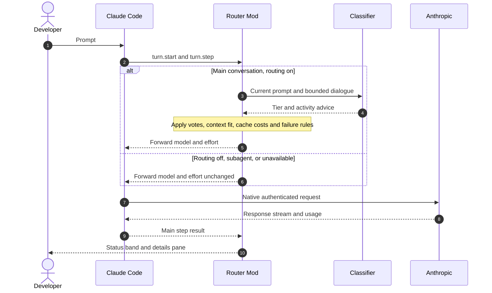

# Architecture

Claude Code owns the model request. The router Mod asks the active classifier (Jev by default; Cloudflare's Clef, Clef Flash or Clef Omni; OpenAI; or a local Ollama model) for tier advice and, unless `activityRouting` is `off`, the turn's activity, applies local routing policy, and changes only the next main-conversation step's model and effort. Subagent steps pass through unchanged; `subagentRouting` may choose a subagent's model once, at `agent.spawn` (see [Subagents](#subagents)).

## Request flow

The Mod does not construct an Anthropic request or proxy its response. Claude Code owns authentication, request fields, streaming, tools, model fallback, and its native usage ledger. No local gateway process or port is part of the runtime. The Ollama classifier calls an Ollama server that you run; the Mod starts none.

The active classifier receives only the current prompt and up to six recent user or assistant text messages. Each text is capped at 1,200 characters. System messages, tool inputs, and tool results are not included. Only the active classifier is asked: Jev sends that text to typesafe.ai, Clef, Clef Flash and Clef Omni to Cloudflare Workers AI, OpenAI to api.openai.com, and Gateway to the host of your gateway URL. Ollama runs on this machine, so the text stays here. The Jev, Cloudflare, OpenAI, and gateway keys are sensitive plugin options; the Cloudflare account ID is a plain one that fills the endpoint. Ollama takes no key. The Mod does not receive Claude's Anthropic credentials.

Each classifier names its wire protocol, `api`, and `classifier-apis.mjs` holds one adapter per protocol. `system-one` (Jev, Clef, Clef Flash, Clef Omni) sends the typed `state` and `questions` request and reads `answers.route`; Cloudflare's REST API wraps that answer in `{ result, success, errors }`, which the parser unwraps. `openai-decisions` (OpenAI) sends the state as `input` text and reads a `choice` answer plus a `predicate` for the continuation. `ollama` asks for one letter with thinking off and reads the log-probability of each letter from the top 20 candidates. A letter's probability is its share of the letters found there; a letter missing from the list counts as zero. The Ollama adapter asks no continuation question, so `continuation` is null there. Every adapter returns the same advice shape, so the routing policy is unchanged.

The advice also carries `activity`: `{ choice, probabilities }` over the seven activities and `uncertain`, or null. Each protocol asks for it differently:

| Protocol           | How the activity is asked                                                                                                                        |
| ------------------ | ------------------------------------------------------------------------------------------------------------------------------------------------ |
| `system-one`       | A third question, `activity`, of type `choice` in the same request.                                                                              |
| `openai-decisions` | A second `choice` in `questions`, named `activity`.                                                                                              |
| `ollama`           | A second request after the route answer, with the same system message and state prefix so Ollama can reuse its cache. Letters A to H, one token. |

The activity is optional at every layer. An adapter reads a missing, malformed, or unknown activity answer as `activity: null` and keeps the strict parsing of the route answer. With `activityRouting: off` no adapter builds the activity question, so the request bodies are the ones 1.5 sent; a fixture test checks this. The criteria and instructions live in `classifier-contract.mjs` beside the tier ones, and name each activity by what the turn produces. The classifier criteria keep showing the base route of each tier, not the activity overrides: the tier question is about difficulty.

Claude Code builds each request for the model the Mod selects, so no request rewriting is needed: Haiku 4.5 got its own thinking mode and a 32K output cap. On Claude Code 2.1.289, a billed chain of pinned turns (Opus, Haiku 4.5, Sonnet at `xhigh`, Sonnet, Haiku 4.5) used a tool on every turn over the previous models' history, and no request was rejected. Sonnet and Opus accepted histories above 589K input tokens. These checks cover tested requests. They do not prove every Claude Code feature combination.

## Responsibilities

| Component                                             | Responsibility                                                                                                   |
| ----------------------------------------------------- | ---------------------------------------------------------------------------------------------------------------- |
| [Native hooks](../hooks/native-router.mjs)            | Turn identity, controls, lifecycle, per-step rewrites, response observation, pane actions, and every host call.  |
| [Classifier contract](../lib/classifier-contract.mjs) | Route criteria and instructions shared by every protocol, credentials and endpoint filling, and retry rules.     |
| [Classifier APIs](../lib/classifier-apis.mjs)         | One adapter per wire protocol: request payload, answer validation, and the shared advice shape.                  |
| [Classifier client](../lib/classifier-client.mjs)     | Classifier HTTP, deadline, in-flight admission, and circuit breaker.                                             |
| [Router controller](../lib/route.mjs)                 | Context fit, model identity, engine fallback, cache observations, one-turn pins, and the tier-and-activity cell. |
| [Activity rules](../lib/activity.mjs)                 | Which activity applies, how two routes compare, and when a route change inside a tier is worth it.               |
| [Activity stats](../lib/activity-stats.mjs)           | Session and stored activity counts, the tool-agreement table, and the per-turn record.                           |
| [Facts](../lib/facts.mjs)                             | The turn's facts for policy, and the bucket of a finished turn from its tool calls.                              |
| [Policy](../lib/policy.mjs)                           | Tier votes, escalation, and switching gates, for routes as well as tiers.                                        |
| [Costs](../lib/cost.mjs)                              | Cache uncertainty bounds and switching estimates.                                                                |
| [Router view](../lib/view.mjs)                        | The view's initial shape and the usage readings each reply adds to it.                                           |
| [Config file](../lib/config-file.mjs)                 | Pane writes to `router.json`: the validated rewrite and what Undo restores.                                      |
| [Panel](../lib/panel.mjs)                             | Tabbed pane: route status, tier pins, the route editor, tuning, and usage.                                       |
| [Router band](../lib/band.mjs)                        | Status band segments fitted to the band's width, and route-change toasts.                                        |
| Claude Code                                           | API requests, tools, authentication, stream output, and usage ledger.                                            |

Every function that takes the engine interface `$` lives in the hooks module: the engine does not follow `$` across an import, so the modules in `lib/` stay pure.

Node.js is not part of routing. It is used for development, the optional configuration migration, and the classifier probe.

## Decision and context

A logical turn is classified at its first step, and again every `reviewEveryRequests` requests in the background (see Review inside a turn below). Other tool continuations reuse the decision and add no votes. Before each step, the controller checks whether the selected model still fits after new tool output.

Repeated tool-error escalation needs matching non-empty error output and an intervening edit attempt within a 40-message lookback. A bounded fingerprint covers the full output, not only the runner header. It removes ANSI colors, normalizes line endings, and normalizes source positions in stack frames and TAP `location` fields. TAP durations and Jest `✕ ... (N ms)` timings are also normalized. Other test names, case, whitespace, and numeric error values are kept. Unrecognized runner noise remains part of the signature: changed output can miss a repeat rather than trigger a false escalation.

An upgrade or downgrade needs a streak of supporting votes (`upgradeVotes`, `downgradeVotes`), because staying keeps a warm cache. A downgrade lands on the cheapest tier from the choice up to just below the incumbent whose mass at or below it, with its streak, clears that tier's bar: a split answer (micro 0.63, low 0.3) on `high` moves to `low` rather than waiting for `micro` alone, and a cold candidate can give way to a warm one in between, such as the same model at a lower effort. Before the first measured reply of a history (session start, clear, rewind, committed compaction), no cache from it exists yet, so one vote is enough. The mass bars, the cash gate, escalation and holds apply as usual. On the same task (`sameTaskOf`: a review inside a turn, or a prompt with advice `continuation` at or above `continuationMass`) an upgrade proceeds as usual, but a downgrade that has its votes stays as `downgrade-held` until `facts.downAllowed`: at least `minDwellRequests` requests since the last model change (`loop.switchedAt`), and the last verification command since then (`verifiedSince`: a Bash test, build, lint or type-check run) passed.

A move to a smaller context window needs a main-response measurement from the current history and Claude's local context estimate. The router uses the larger available reading and reserves 20% of the model window. If it cannot establish fit, it keeps the current model with `context-unknown`. It does not infer token count from character count.

An explicit context-window failure marks that model ineligible until the next history reset. An engine fallback suspends rewriting for the rest of the turn. The router does not retry an Anthropic request.

## Activity routing

The router decides on a _cell_: a tier and an activity. The route is `{ ...routes[tier], ...activities[activity][tier] }`; the (model, effort) pair, not the label, is what Claude Code receives and what owns a cache. Two cells that resolve to the same route never switch.

`chooseRoute` decides at a turn's first step, and again on each review answered inside the turn:

1. **Pin.** A pinned tier wins, with no activity: the pin's tier route.
2. **Activity.** Only in `on`; `off` uses none, and ignores the activity a turn in `on` ran with before the mode changed. With no advice, or advice without an activity answer, the incumbent's activity stays. On the same task (`sameTaskOf`; Ollama gives no continuation answer, so only reviews count for it) a label whose route at the incumbent tier is stronger applies at once, and a weaker one only with at least `downgradeMass` probability once `facts.downAllowed` holds; an unclear label keeps the running activity. Otherwise the activity with probability at least `activityMass` applies; below that, or for `uncertain`, there is none and the tier's base route is used.
3. **Tier.** The tier policy runs as before, with every candidate tier priced at its route for the activity and the incumbent at the route it runs. Repeated tool errors move to the lowest tier above whose route is stronger than the running one, or sends a request that cannot be ordered against it. With no activity that is one tier up, as in 1.5. If no tier above helps, nothing escalates and the failure signature is kept.
4. **Lateral move.** If the tier stays and the route would change, `lateralMove` decides. Routes order by configured output price, then effort; a session effort counts as the effort Claude Code sends. Two routes that send the same request do not switch. A pair that cannot be ordered (an unpriced model, a numeric effort, two models at one price) counts as a move up, so the base route is always reachable. A stronger route needs the activity's probability to clear the upgrade bar for its switching tax (a base route with no activity counts as probability 1). A cheaper route needs its downgrade tax to be paid back within `downgradeHorizonTurns`, except before the first measured reply of a history, when there is no cache to protect. The cash gate applies to both. The result is `activity-up`, `activity-down`, `activity-pending` (stay on the running route and its activity), `cash-gate`, or `hold`. While an escalation hold lasts, only a stronger route may be taken. One vote is enough: an activity is a fact about the turn, not a noisy estimate. If the tier changes, the tier gates have already priced the new route, and no lateral rule applies.
5. **Fit.** Context fit and model availability resolve through `route(tier, activity)`. A fallback tries the last cell, the native model's cell, then each tier with the activity. The last and the native cell count only when they carry no activity or the turn's; otherwise, or when nothing fits, the native model runs at the session effort.

**Observed move.** On each later step of the turn, `observedMove` reads the turn's tool calls since its prompt, or since the transcript snapshot of the last review applied inside the turn (`loop.observedFrom`), since the review already judged the earlier ones, (`observedActivity`: `code` after an edit to a non-doc file, `docs` after edits to doc files only, else `ops`, `read` or `talk`). When that activity's route at the decision's tier is stronger than the running one, the remaining steps take it, with reason `activity-up` and `lastActivity` set, so the next turn starts there. The tier is fitted to the context first, so the gates price the route that will run. It goes through `lateralMove` with probability 1: the tools are the evidence, so the switching tax never holds it back (the upgrade bar tops out near 0.9), and only the cash gate can. The turn's reply label (`turnActivities.label`) follows the move; the classifier's answer stays as recorded. It never moves down, and skips pinned turns and `off`. `canMoveUp` skips the transcript read when no activity's route at the tier is stronger, so a step on the strongest route costs nothing. A move to a smaller window waits for a measured context, as in `routeTurn`. Context fit and model availability then apply as for any continuation.

**Review inside a turn.** Every `reviewEveryRequests` requests after the last classifier answer (`loop.reviewedAt`, counted in `loop.requests`), `reviewMidTurn` reads the transcript and asks the active classifier in the background, with the turn's prompt and recent dialogue and `facts.midTurn` set. The step does not wait. The first step after the answer arrives runs `chooseRoute` on it, before the observed move, with only the advice taken from the review: the checkpoint, context and cache facts are read at that step. Tier and activity move by the same rules as a continuation prompt: up on votes, down only past `downAllowed`. A pinned turn, a failed read or ask, an answer without advice, and an answer about a replaced history (another `generation`) change nothing; turn completion and session end abort a review in flight. `observeResponse` counts each request and records the request and message count at which the served (model, effort) last changed (`switchedAt`), which the dwell and the verification window start from. A failed transcript read keeps the running route. A verification is a Bash command whose status is the check's: a checker (`pytest`, `tsc`, `eslint`, …) or a launcher whose subcommand names a check (`npm test`, `npm run lint`, `go test`, `make lint`, `uv run pytest`), alone or in an `&&` list. A pipeline, `;`, `||` or background job does not count, since its status can hide a failed check; neither do a `--version` or `--help` run, an option before the subcommand (`npm --prefix test install`), package names, paths and file names, nor a command Claude Code sent to the background, by request or after a timeout. The first response a loop serves also sets `switchedAt`, so checks from before the router chose a route do not count. When compaction or a rewind shortens the history, `prepareLoop` moves `switchedAt.messageCount` and `observedFrom` back to its end and keeps the request-based dwell.

At session start the incumbent is the session's model. `cellForModel` looks for it in the base routes, baseline first, and only with `activityRouting: on` in the activity overrides too, so a session that starts on an override route keeps its cell until the classifier says otherwise. The start mode uses the same lookup: with `on`, a start model that only an override uses (Sonnet 5.5 on the defaults) starts with routing on.

## State and controls

`$.state` stores route decisions, response observations, and UI state for the active session. Version-checked writes reject stale turn results. A private in-memory view merges state writes during one dispatch because state reads are frozen for that dispatch.

Clear, branch, rewind, and committed compaction clear cache evidence and votes. A turn in progress keeps its route, pin, and any engine fallback. `/clear` starts the new session with routing on. A fresh session on a model that a configured tier routes to, or with activity routing `on` a model an activity override uses, starts with routing on. A fresh session on any other model starts with routing off, and the band names the reason. Session start sets the mode; the band and pane only read it, even when they draw first. Resume restores the selected session's saved mode. Hot reload retains valid `$.state`. Running `/model` turns routing off, including an explicit choice of the baseline. `/router auto` resumes routing. `/router off` also turns routing off. Pins apply to the next turn and its tool continuations. The prior route resumes afterward.

### Observed activity and stats

When a turn completes, the Mod labels it from the tool calls the assistant made after the prompt: `code` for an edit to a non-doc path, `docs` for edits only to doc paths, `ops` for a Bash command that is not read-only, `read` for other tool use, and `talk` for none. `facts.mjs` reads tool names and file paths; it keeps no text. [Evaluation](evaluation.md#tool-agreement) explains how this is compared with the classifier's answer.

Two stores hold counts:

- **Session**: `activityStats` in the view, reset when the session ends. It has turns, requests, tokens, the list price of priced replies with their count, and routed replies by `model@effort` per activity, switches by tier and by activity, lateral moves taken and refused, and tool agreement. The label counted per activity is the applied activity in `on`. Tool agreement compares the answer that cleared `activityMass`, so it measures the classifier in both modes. The view also keeps `strip`, every reply since Claude Code started the session by tier in at most 48 cells that merge in pairs, with when its first reply arrived, and `lastSwitch`, the last route change with its tiers, routes and activity.
- **Across sessions**: two `$.store` records per session. Each session's `activity:stats:v1:<session id>` holds a confusion matrix of the classifier's raw answer (including `uncertain` and `none`) against the observed bucket, run lengths per activity in five buckets, lateral switches taken and refused (from the decision's `lateral` field, so a hold or the cash gate counts), and `since`, its first count. A value with an unknown key or shape reads as empty; the `shadow` key that versions before 1.10.1 wrote is dropped on read and the rest is kept. Before 1.10.3 every session shared one `activity:stats:v1` key, read-modified-written each turn, so two sessions finishing turns together could lose a count and a stale write could undo a reset; that key now counts as one more record in the sum until **Delete history** deletes it, and 1.10.2 and earlier read only it. Each session's `activity:metrics:v1:<session id>` holds a classifier latency histogram per classifier id (22 buckets, at most 8 ids), the cheaper activity moves taken in `on` with the escalations that followed one, and `since`, its first reading; each part reads as empty on its own when its shape is wrong, as after a change of buckets. Both follow the usage records below: one writer per key, so sessions that finish turns at the same moment do not overwrite each other; this session's record held in memory and written after each turn that adds a count; the readout the sum of all records, latency kept to the first 8 classifier ids; and the same reset marker. Each record is bounded, and the records grow by one per session that recorded a count until **Delete history**. The view keeps the last sums read or written as `activityStore` and `activityMetrics`: read at session start and when the pane opens, replaced after each turn's write and after a reset. The open run is written when the session ends. **Delete history** clears the session counts, every stats and metrics record, and the usage records below.

Nothing is recorded with `activityRouting: off`. Stats run inside a guard: a failed transcript read or store access loses that turn's counts and never fails the turn. Readings already in the session's metrics record stay in memory after a failed write and go out with the next turn that adds a reading. A turn from a session that has since changed is dropped.

### Routing vs your model

After each main reply, where the response is observed, `savings.mjs` prices the reply on the model that served it and the same tokens on "your model": the session's model and the effort Claude Code sent on the turn's first request. `compareModels` prices each reply against every model in `router.json` as "your model", at the session effort. Each keeps a simulated single cache in the loop under its models key in `yoursBy` (`{ total, at, onYours, model, effort }`), which a history reset clears; after an effort change the next reply finds it cold. The session's totals per model are `savingsBy` in the view, and `updateView` sets `savings` to the entry for the model `/model` selects whenever the model or the totals change, so a `/model` change re-prices the whole session without a replay. Each reply also becomes a `replyEntry` in `usage.mjs`: its time, its cell `activity|tier|modelId@effort` with the model that served it, its prices against the model selected then, its input, cache-read and output tokens, and what the same tokens cost on each model as yours. Models are kept by id, not by models key, because a key can later name another model. At turn completion `recordUsage` adds the turn's entries to the session's own `$.store` key `usage:v1:<session id>`, by local calendar day: per day the cells' nine sums, the what-if sums, the replies per your model, the routed cost per hour, the turns, and the route switches by tier and by activity, with `since`, the record's first write. Days older than 400 days leave the record when it is written. Each key has one writer, and Claude Code 2.1.296 writes one key under a file lock (observed in its code; the `$.store` types do not promise it), so sessions that finish turns at the same moment do not overwrite each other. The view's `usageStore` adds up two parts: every other session's key, read at session start and when the pane opens, and this session's record (`usageSession`), which the router reads once, holds in memory, adds each finished turn to and then writes, so a pane opened during that write counts the turn once. On that read, `prunedUsage` names other sessions' records with no day in the last 400 days and, past 1,000 records, those whose last day is oldest; a record that does not read whole, such as one a later version wrote, is never named. Each named record is read again and deleted only if it has not changed, so a session that wrote its record since keeps it; with no conditional delete in `$.store`, a write between that read and the delete is still lost. A day that does not read is dropped, and the others stay. The Usage tab sums the days of the chosen period (`summarize`); the period is kept across sessions in `usage:period`. Before these records each session kept undated totals in `savings:v1:<session id>`; they are no longer written, and the view's `savingsStore`, their sum, is added to the All period. **Delete history** first writes the time in `savings:reset:v1`, then deletes every usage, savings, activity stats, metrics and subagent record. A record whose first reply is older than that time reads as empty, and each session reads the time before it adds a turn, so a session that still holds its record from before a Reset in another session drops it instead of writing it back. The comparison is by milliseconds: a record whose first reply has the reset's millisecond, or one written while the clock had moved back, still counts. A stored value of any other shape reads as empty. A reply with routing off or after an engine fallback is not counted, but it still moves your model's cache. A reply whose cache lifetime cannot be read loses its prices only, and your model's cache still follows it; a usage without rate limits prices writes at five minutes. No failure here fails the turn. [Evaluation](evaluation.md#routing-vs-your-model) gives the method and its limits.

### Subagents

A subagent's model is chosen once, in the `agent.spawn` hook, before its cache exists. Its `turn.step` events pass through unchanged: a subagent runs on the 5-minute cache lifetime by default, and a switch between its steps would rewrite a 50,000–300,000-token context cold. The facts below are from the Claude Code 2.1.296 types (`AgentSpawnInput`, `HookBudget`) and a probe Mod's observed events, `experiments/mod-router/results/agent-spawn-probe.json`. The [plan](plans/2026-10-10-subagent-routing-plan.md#2-verified-facts) cites each one.

- A model the hook sets beats the agent's `model:` frontmatter and `CLAUDE_CODE_SUBAGENT_MODEL`. Frontmatter is not in the spawn input. The Agent call's own `model` is, as `e.model`.
- Workflow `agent()` calls raise `agent.spawn` with `e.workflow`, but a model rewrite there is ignored.
- The hook has 10 seconds of its own time. `$` calls do not count against it, but a `$.clock.sleep` does.

`spawnAgent` in `hooks/native-router.mjs` passes the spawn through unchanged for a fork, a workflow agent (before the explicit check, since a workflow `agent({ model })` has `e.model` set), an explicit `e.model`, or a teammate (`passReason` in `lib/subagents.mjs`). Then `typeRoute` decides. A `subagents.types` entry wins; a key without a colon matches only the engine's built-in of that name. An unlisted built-in passes (`unlisted`), since its definition is not on disk. Any other agent is routed by its definition. `agentDefinition` finds the file once per provider and type in a session; a read that fails is tried again at the next spawn of the type. A plugin agent's `provider.plugin` is `plugin@marketplace`, the key of `<profile>/plugins/installed_plugins.json`, whose `installPath` entries hold `agents/*.md`. Other agents are looked up under the session's `.claude/agents`, then `<profile>/agents`. `agentFrontmatter` reads `name`, `model` and `modelRouting` from YAML or a one-line JSON object. No model, `inherit`, or `modelRouting: auto` is routed; any other model passes (`pinned`); a file not found, unreadable, or matches that disagree pass (`unknown`). A routed agent's type uses its models key, or for `classify` the active classifier is asked with the description and prompt alone, clipped to `context.maxTextChars`, with no history and no tool results. The answer maps to `subagents.heavy` when `P(high) ≥ heavyMass`, to `light` for an `explore` activity above `activityMass` or tier `micro`, else to `standard`. The spawn path has its own classifier client per classifier: its own failure count and pause, and no in-flight slot, so parallel spawns each get an answer and spawn failures never pause main-turn routing. Its deadline is the classifier's, capped at 3 seconds. That bounds how long a subagent waits to start. No advice, a missing key, a model `availableModels` blocks, or settings that cannot be read keep core's model. The router sends the configured full id, never an alias, because a family alias resolves to the parent's exact model when the families match. A `.catch` runs `next(e)`, so a failing hook spawns the agent as Claude Code would. Routing off (`/router off`, `/model`) or unavailable passes every spawn through and records nothing.

Every spawn in `on` gets a record keyed by `agentId`, from `next(e)`'s answer. Its replies are priced in `turn.step` (`addAgentReply`), on the model they ran on and on core's model as `coreModelOf` estimates it (the definition's own model, else `CLAUDE_CODE_SUBAGENT_MODEL` except for Explore and Plan without `CLAUDE_CODE_SUBAGENT_MODEL_FORCE`, else `parentModel`). Cache writes are priced at the subagent lifetime (`subagentCacheTtl`). The spawn record also keeps `move` (`moveOf`): `up` or `down` when the routed model's output price is above or below core's, `moved` when either has no price, null for the same model. The record's counts go to this session's `$.store` key `subagents:v1:<session id>` at each of the agent's `turn.complete`s, and at session end for agents still running. Since 1.14.0 the value is version 2, by local calendar day like the usage records, and days past 400 leave it when it is written: per day, per type and per pass-through reason, the agents, requests, priced requests, respawns (a spawn of the type its parent loop finished one of in the last 10 minutes) and classifier failures, and per model id the agents ran on, the agents, the agents moved, up and down, the routed cost and core's. An agent counts on the day of its first flush; its later requests and cost on the day of each flush. A version 1 value has no days or models: it reads as `undated` agents and cost, which only the Session and All periods add. The records follow the usage records: one writer per key, the view's `subagentStore` is every session's sum and `subagentSession` this session's, and the same reset marker applies. **Delete history** clears them too. The view's `subagentsRunning` counts the agents with a record between a spawn or a step and their turn's end; it is in memory, so a reload starts it over. The band in a subagent's transcript reads the agent's record from memory too.

## Classifier deadline and failure handling

Each advice attempt has a total deadline, including any transient retry: 1,500 ms for Jev, 3,000 ms for Clef, Clef Flash, Clef Omni and OpenAI, and 5,000 ms for Ollama by default. Ollama's first call after its model unloads can exceed that while the model loads. A timeout does not retry. `Retry-After` is honored only when it fits the remaining budget. Three launched failures pause the classifier for 60 seconds. Missing-key, missing-account, busy, and paused skips do not count as failures. The Ollama activity request is a second call inside the same deadline and the same in-flight slot. It is sent only when the route answer parsed and at least 300 ms remain, gets one attempt and no retry, and a timeout or error there returns the route advice with `activity: null`. It counts as no failure and never opens a pause. Each classifier has its own failure count, pause, and in-flight slot. A turn that started under one classifier finishes with it, even if the pane switches meanwhile. Switching the classifier, or starting a session with another one, starts the new one from a clean count.

The pinned host API does not expose a per-request abort option for `$.http.fetch`. The Mod returns to the incumbent at its own deadline and blocks another advice request while that wire call remains pending. Claude Code's observed host timeout is about 30 seconds. Recorded reload and unload checks closed pending sockets after 24.7 and 28.5 seconds. Replacement closed one after 31.6 seconds. These runs do not show immediate per-call cancellation. A plugin network-policy refusal degrades routing and is never bypassed with a subprocess.

In a 20-process loopback test, timeout fallback had 1,504 ms p95 and 1,505 ms worst case. A 20-call burst made one wire request. The other 19 calls skipped as busy. The live Team canary reached Jev and received advice. See the [native acceptance records](../experiments/mod-router/results/native-http-acceptance.json) and [interruption record](../experiments/mod-router/results/native-interrupt-acceptance.json).

## Cache and cost

Cache identity uses the exact response model ID, plus the effective effort on models that keep one cache per effort. Opus 5.5, Sonnet 5.5, Haiku 5.5 and Fable 5.1 keep one cache across efforts with an API key or a Claude subscription (code.claude.com/docs/en/prompt-caching, "Changing effort level"), so an effort-only move costs no cache write there. The hook gives every effort its own cache when the session runs on Amazon Bedrock, Google Cloud, Microsoft Foundry, a custom `ANTHROPIC_BASE_URL`, or with `CLAUDE_CODE_DISABLE_EXPERIMENTAL_BETAS` (`effortSplitsCache`). A HIPAA configuration is not visible to a Mod; there the router prices effort moves as free. The Haiku 4.5 dated snapshot has an explicit mapping; Haiku 5.5 has no dated ID. An unrecognized substituted model gets no cache credit for the requested route.

The cached prefix is observed `cache_read + cache_creation`. Output tokens count only toward the next context size. Freshness uses the configured five-minute lifetime with its safety margin. Claude's usage counters do not prove one-hour cache lifetime.

Every estimate prices tokens through `ratesAt` in `cost.mjs`, which applies a model's `longContext` multiplier when the prompt (input, cache read and cache write) is over its threshold: Haiku 5.5 bills every rate at 5x above 100,000 tokens. Routing vs your model prices cache writes at the lifetime Claude Code gives the main conversation, since the usage it reports to a Mod has no 5m/1h split: `FORCE_PROMPT_CACHING_5M`, then `CLAUDE_CODE_PROMPT_CACHE_TTL`, then the `promptCacheTtl` setting, then `ENABLE_PROMPT_CACHING_1H`, then one hour when replies report plan rate limits, else five minutes.

The switching policy prices the candidate at a conservative cache-write bound and the incumbent at its best supported input bound. The pane shows the configured-price range and a conditional payback estimate. These are estimates, not measured savings. Claude's native `/cost` ledger owns total API cost. Classifier spend is not included.

## Deployment

Install the plugin from the `alexei-led/claude-router` marketplace, or load a checkout with `--plugin-dir`. Load only one copy of the router in a session. The plugin ships the Mod, its pure `lib/` modules, type declarations, and the configuration migration script. It starts no process and opens no port.

Use the [configuration guide](configuration.md) for optional settings and migration, and the [native guide](native-router.md) for panel and control behavior.
