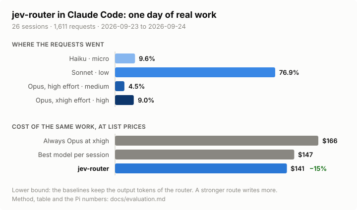

# Evaluation

The native Mod has no measured savings result. The pane reports Claude's own usage and configured-price scenarios. Its one counterfactual is [routing vs no routing](#routing-vs-no-routing), an estimate at configured list prices, not a bill or a measured saving.

This page separates an older gateway experiment from a shadow replay of native policy. Neither result measures answer quality or proves lower real spend. [Activity routing](#activity-routing) adds two checks of the activity label, with no savings result either.

## Automatic-routing shadow proposals

Opt-in `routingEngine: "shadow"` records a demand and target proposal against the real table incumbent for each
applicable decision. It does not run the proposed route or maintain a simulated route history. These rows do not
establish savings or answer quality; a next-turn cost estimate is not an observed cost or a counterfactual saving.
The bounded decision records are not replay traces. See [Configuration](configuration.md#routing-engine).

### Shadow agreement

Do not compare a row's `alt.route` (the target, before any move gate) with its `route` (the table's, after its gates):
a held table move then counts as a disagreement of the engines. Compare the would-serve route `alt.serve` with `route`:

1. Take `start` and `review` rows with `engine: "shadow"`. A merged review row counts `n` times.
2. `alt.serve` names a models key and `route` a model ID: map `opus@xhigh` through the profile's
   `models.opus.id` before comparing. `session` stands for a route that sends no effort of its own.
3. Exclude rows with no `alt.serve` (no route to serve, `move: "unavailable"`, a failed proposal, or a row written
   before this field) and rows with no `alt.incumbentCap` (the incumbent declares no capability, so the move gates had
   no level to compare). Report how many each rule removed.
4. Split by `alt.profile` and by `mode`. Rows of different profiles describe different catalogs and must not be
   pooled. Report pinned rows (`pinned: true`, no `mode`) separately: a pin passes no move gate.

`alt.move` says why a disagreement held or moved, and `alt.blocked` which hard constraint kept a capable candidate
out. Agreement is a one-step comparison from the table's own route
([limits](auto-engine.md#shadow-rows)), not an estimate of how an auto session would behave, and not a quality or
savings result. The Now pane's `shadow agrees` count compares `alt.serve` too, and `alt.route` only on a row written
before these fields. It is a quick reading, not this measure: it skips rows with no would-serve route, but keeps rows
with no `alt.incumbentCap`, pools profiles, modes and pins, and covers only this session's rows.

## Replay trace recorder

In `routingEngine: "shadow"`, the main-turn hooks also keep text-free replay inputs separately from decision rows:
the initial configured and mode-transformed routing policy, provider/cache semantics and model prices; classifier
tier/activity/phase vectors; failure fingerprints and occurrence indexes; pins, modes, resets, context/availability
facts and observed moves; and correlated request/reply model, effort and token counters. Checkpoint evidence uses
message indexes and success flags, not commands, tool results or filesystem-path fields, so a later replay can use
its own switch cursor. Validated routing aliases and model IDs are preserved exactly, including path-shaped IDs;
classifier endpoints, credentials and the config file's nativePath are not copied.

### Budgets and storage

Records use `trace:v3:<session id>`: 30-day retention, 512 KiB per session, 1 MiB total trace budget and a measured
3 MiB guard on the shared plugin store. Each flush reads only the trace records; the rest of the store is measured
once per session, again after 15 minutes, and again whenever the guard would come within 256 KiB of its limit, so a
store that grew between measures can pass the guard by that much. A turn's flush runs after the turn, from a timer,
one at a time; the exit flush waits for the last. Pending turns are bounded too.

A request repeats most of what the one before it said, so a record stores each event as its difference from the last
one of its kind ([`lib/trace-codec.mjs`](../lib/trace-codec.mjs)): unchanged fields are left out, whole numbers are
kept as differences and long field names are shortened. Nothing is lost. On one profile's recorded sessions (12
sessions, 508 requests, about 11 requests a turn) this took a request from about 1.7 KB to 0.3 KB, after an initial
snapshot of about 9 KB. At that size one session holds about 1,600 requests: some 200 turns at 8 requests a turn, or
150 at 11. A larger model catalog, frequent mid-turn reviews or long model allowlists that change hold fewer.

Version 2 and 1 records (`trace:v2:`, `trace:v1:`), which store events whole, are still read, exported, replayed and
retired. Export files hold the packed form; read one with `readTrace` from `lib/replay-trace.mjs`. A session open
during the upgrade starts an unusable `trace:v3:` record, as any session first recorded after it began.

The 1 MiB budget holds two full sessions, or about ten of 100 KB. Recently active sessions have a one-hour last-write
lease against budget eviction; stale activity cannot defeat 30-day retention. Store scans, quota checks and deletion
are best effort across processes, not atomic reservations.

### What ends a recording, and what makes a session unusable

A **capped** or cut-short trace is usable: replay covers the turns it holds.

| Event | Result |
| --- | --- |
| The session reaches 512 KiB, or one turn alone would pass it | The whole turn and every later one are left out and counted as capped |
| Reload (`/reload-plugins`, plugin update) or resume (`--continue`) of a recorded session | Recording stops; later turns are counted as capped. The earlier process's unwritten turn cannot be recovered |
| A write is refused (store guard, trace budget full of active sessions) or fails | The turn stays in memory and the next flush writes it. If none succeeds, the stored turns remain |
| The record was evicted while the session was idle | The session writes it again |
| A request is interrupted, or its API call fails, before any reply, and that step is not sent again | It is recorded as unanswered; replay observes no reply and its cost stays unpriced |
| A turn is still running when the session ends | It is left out |

These mark the whole session **incomplete**, and replay excludes it:

| Reason | Cause |
| --- | --- |
| `mid-session` | Recording began after the session did: late switch to `shadow`, a resumed or reloaded session with no stored trace, an unreadable history, or a Delete history in another session |
| `gap` | A main step went out without a record (unreadable settings, a dropped or retried decision, a failed hook), a step was sent again at the same index after a request that got no reply, or a routing state write lost to a newer one |
| `mode-gap` | A turn ran outside `shadow` between recorded turns |
| `aborted` | A reply arrived under another session ID, a request was stopped before it was recorded, or a turn that never finished sits behind a recorded one |
| `conflict` | Another writer's record under the same session diverged, or the stored record cannot be read |
| `lost-write`, `recorder-error` | The recorder itself threw, or could not read the store when it started, so events may be missing |
| `store-guard` | The initial configuration snapshot alone exceeds the session budget |
| `reset` | Delete history cleared a trace the session was still writing |
| `reload`, `resume` | The stored record could not be read. Records written before version 3 also carry these, `store-guard` and `lost-write` for any reload, resume or refused write |

Freshness requires the first main request (index 0), no saved loop or trace, and readable normalized request
history with no assistant messages. Injected startup reminders are user rows and do not make a trace incomplete;
`classic.SessionStart` is not required. Unreadable or malformed history, a reload with no stored trace and late enable are conservative.
Compaction preserves an existing trace with an explicit reset; `/clear` permits fresh history under a new session ID.

Run `/router trace export` to merge retained traces into `router-traces.json` beside the selected profile's
router config. The command also works after switching back to `table`; ordinary table turns do no trace I/O.
Exports overwrite their previous JSON after merging; near 3 MiB, a new dated `router-traces-*.json` file receives
the retained snapshot instead. Keep all export files for offline replay. Known taint is never erased by a longer
or newer clean prefix. **Delete history** clears stored traces in any mode, this session's at once and other sessions' in the background, and an export leaves out any trace from before it, but exported files remain user-owned:
the host filesystem API has no unlink operation.

There is no live exposure, routing-quality result or savings claim from this recorder yet.

## Offline automatic-engine replay

Run the tool from a checkout with **all** incremental exports (shell-expanded file arguments, no implicit profile
access). It reads only those files and writes anonymous JSON to stdout; it never changes a router or provider profile.

```sh
node scripts/replay-traces.mjs /exports/router-traces.json /exports/router-traces-*.json > replay-report.json
node scripts/replay-traces.mjs --reversal-window 3 test/fixtures/replay-traces.json
node --test test/replay.test.mjs
```

Omit the dated-file argument when there are no rollover files. The second command uses only synthetic data.
The implementation follows [design §5.1 and §6 step 5](plans/2026-11-16-auto-routing-design.md#51-replay-traces-and-offline-replay).

1. Merge sessions with the recorder's `mergeTraceExport`: preserve lost-write taint, overlap conflicts and capped
   counts. Keep usable capped contiguous prefixes; report their omitted turns/events separately. The reasons that
   exclude a session are [listed above](#what-ends-a-recording-and-what-makes-a-session-unusable).
2. Replay the table chain from **only** its initial header, applying config, controls, history preparation/resets,
   choose/observed/continue operations and responses. Compare every recorded decision and request model/effort.
   An unexplained mismatch on any otherwise usable prefix returns `status: "blocked"`, exits 1 and prints **no**
   auto/session totals. It remains in the fidelity denominator. Taint/gaps/incompleteness are explained exclusions.
3. Only after fidelity passes, validate independent-replay evidence. Missing checkpoints, required boolean facts,
   unconditional continuation modality or activity indexes produce `auto-input-incomplete` and exit 1, without
   silently excluding a usable fidelity session. Earlier exports can lack these fields.
4. Simulate auto with its own demand/votes, incumbent, cache, routed-demand/provenance and switch/dwell cursors.
   Classifier decisions advance votes; continuations reevaluate constraints and pending moves without adding votes.
   Checkpoints and observed activity are reconstructed from text-free indexes against its own cursor. Only an
   accepted bounded execute phase discounts demand; observed edits can remove it. No activity route table is used.

**Mode meaning:** fidelity and both comparisons follow the recorded mode-change history. Output is partitioned by
the mode active on each request, not three artificial reruns. Table uses the recorded transformed config; auto
uses the recorded base policy, with mode only as the capability margin. There is no forced-mode option.

The report has `fidelity`, `coverage`, `exposureDiagnostic` and anonymous numbered `sessions[].modes`. Each mode
contains both engines' conditional cost range, priced/unpriced request counts, effort mix, switches and disagreement
counts grouped by effective demand/activity. Unknown catalog capabilities are counted explicitly. Anthropic seeds four balanced base-route pairs as
user-derived policy judgments; other pairs and provider presets remain unknown. These seeds and their replay are not
quality-calibration evidence.

Switches are computed on the full session before mode partitioning and attributed to the **destination** mode.
A reversal closes A→B→A within the explicit `--reversal-window N` main turns (default 3); `reversals` counts closing
legs, `reversalMoves` counts participating legs, and `oneWay` counts unpaired moves. Rates are per 100 captured turns
in that mode. Pins do not count as switches and restore the pre-pin route/demand/dwell baseline; every pinned
continuation still checks eligibility. Manual intervals, history resets and external native interventions break the
policy-switch chain, including reversal pairing.

### Coverage and estimate limits

- `coverage.exportCohort` ratios describe **only captured/exported sessions**, a lower-bound cohort. Exports do not
  count evicted or untraced sessions; `coverage.allSessions` denominators and its 80% gate stay unavailable.
  Sufficient future metadata would include capture-eligible session starts (including untraced/evicted sessions),
  total main turns and per-mode eligible routed turns over the same capture window. This tool invents none of it.
- Exposure thresholds (30 complete sessions, 1,000 main turns, 200 per evaluated mode) are diagnostics only.
  Captured main turns are separate from eligible unpinned classifier-decision turns; manual-only sessions/turns
  do not count as engine exposure. Freshness is unverified and the exposure gate remains `not-established`.
- Cost freezes observed total prompt/output lengths, timestamps, failures and tool calls. Auto simulates its own
  full-prefix cache scenario, never the table's cache-hit tokens. Explicit cache warmth uses the existing conservative
  five-minute helper; automatic caches retain hit/miss bounds, with no invented TTL guarantee. Effort-specific,
  disabled, long-context and off-peak pricing use the existing pure cost helpers. These are **conditional estimates**,
  not counterfactual savings, actual bills or paired quality results.
- Missing usage/prices and substituted replies make the affected total range `null`, not free. An explicitly named
  `knownPricedRange` is only the priced subtotal. No transcript-length/quality change from a hypothetical request
  is modeled.
- Fidelity distinguishes table echoes from genuine third-model/native fallbacks. Auto freezes actual external
  interventions, response substitutions and routed null-stop suspension, rather than misreading a table echo as
  its own fallback. It cannot predict a provider's fallback for a different hypothetical auto request.
- Default output includes no session IDs, prompts, tool text, model identifiers or paths. Input errors name the
  numbered file/structural field, not its path. The CLI cannot discover omitted exports or verify their provenance.

## Paired benchmark proposal

The [automatic-routing design §5.3](plans/2026-11-16-auto-routing-design.md#53-paired-benchmark-smoke-gate-for-quality)
requires paired `table`/`auto` runs, three modes and two repeats, with per-task checks and discordances. The
24 synthetic expected-output cases in `test/fixtures/benchmark-routing.json` are harness fixtures, not calibrated
engineering tasks or a quality result. Their activity labels are fixture metadata, not reference classifications.
Eight are marked held out in the fixture split. The separate engineering proposal below needs fixtures and review
before any evaluation; shadow-disagreement sources are pending.

```sh
node scripts/benchmark-routing.mjs --dry-run
node scripts/benchmark-routing.mjs --dry-run --smoke
node --test test/benchmark-routing.test.mjs
```

The dry run prints a SHA-256, run counts, serialized token/rate assumptions and a configured-price scenario.
Dry-run planning uses the built-in catalog maximum prices through `ratesAt`; a live smoke preflight reads the selected
work profile's catalog without changing it. Cold-write multipliers apply only to explicit caches. The 10,000-input
assumption is not a limit; live smoke sets `CLAUDE_CODE_MAX_OUTPUT_TOKENS=512`, one agentic turn and a $0.40
CLI budget per call. These are not a proxy-price quotation or a bill. A run estimates before launching and reserves
$1.20 for three calls. An exclusive reservation file under `.pi/` refuses automatic reruns; further spending needs
review, not a hidden retry. The 288 planned task runs are for the toy mechanics fixtures, not an engineering benchmark cost estimate.
An engineering task run may use multiple inference calls, tools and retries; it needs new token, request, effort
and provider budgets plus lead approval before any run. No full matrix is authorized or run.

`--live --smoke` is limited to the three development tasks, `table`/`balanced`, one repeat, using the existing
installed release through `zsh -ic` and `claude-mp-work -p`. It loads no checkout plugin. The selected profile must
still be `table`; `--setting-sources user`, strict empty MCP and no tools limit the surface. Init metadata must
identify exactly one router at the installed user path. Profile contents are hashed before/after each call. The
wrapper's normal MCP housekeeping is permitted; the original active-environment bytes/existence are restored and
verified after success, failure, timeout or handled interrupt. SIGKILL, power loss and independently detached
processes are not covered. Process-group cleanup is best effort; Windows cannot kill a descendant tree via Node
alone. The smoke establishes harness mechanics only, not evaluation of this checkout or either engine.

Offline system-boundary tests exercise independent directories, output checks, deadlines, output limits, budgets,
unknown costs and paired discordance reporting. The harness checks its own and the manifest's hashes around child
execution; this detects persistent changes, not transient same-user writes or an OS sandbox. The checks run in the
parent outside the child's working directory. Unknown/zero total or per-model CLI prices stop further calls rather
than implying free usage. Reports sum every supplied attempt, including failures, and leave missing/unpriced
totals unknown. Duplicate attempts within a paired cell are reported as ambiguous, never silently replaced by a
passing rerun.
CLI-reported USD can use rates different from the selected catalog and may omit proxy retries, classifier spend or
upstream failed calls: actual billing remains unknown.
No comparison of quality, savings or measured routing performance follows from these checks.

The checked-in [installed-release smoke record](../experiments/mod-router/results/benchmark-harness-smoke.json)
contains three passing external checks, 19,298 ms summed subprocess wall time and $0.0098816 CLI-reported price
estimates. It records the manifest/config hashes and successful restoration/provenance checks without prompts,
profile paths or credentials. CLI usage metadata names DeepSeek Flash for two calls and GLM Flash for one; backend
identity is not independently verified.
These are harness-validation observations on installed Router 1.23.1, not a paired result for this checkout.

### Engineering task set: draft only

The following 24 synthetic engineering tasks are a proposed **separate** evaluation set, not implemented fixtures.
Difficulty and activity are author hypotheses, not classifier references. Each row needs a self-contained repository
fixture and an independently held-out automatic oracle outside model control. Freeze the fixture/manifest hash and
split before capability or margin tuning; do not run or inspect held-out outcomes during tuning. All rows are authored
examples: shadow-disagreement sourcing is **pending** and must be added or documented before the set is finalized.

| ID | Split | Activity / demand hypothesis | Task | Independent automatic oracle |
| --- | --- | --- | --- | --- |
| E01 | dev | code / low | Add integer clamping to a small library | Boundary and type tests |
| E02 | dev | debug / medium | Repair a parser that mishandles escaped delimiters | Existing tests plus hidden escaped and empty cases |
| E03 | dev | code / medium | Add pagination to a small service across handler and storage modules | Fixture API and deterministic pagination tests |
| E04 | heldout | code / medium | Implement stable deduplication across a CLI and helper | Output and duplicate-order tests |
| E05 | dev | security / high | Reject traversal and symlink escapes in an archive extractor | Traversal, symlink and valid-path tests |
| E06 | dev | debug / high | Fix a cross-module stale cache invalidation defect | Concurrent update and expiry regression tests |
| E07 | heldout | debug / medium | Fix time boundary logic for expiry at exact deadline | Fake-clock boundary tests |
| E08 | dev | ops / medium | Repair CI script so test and lint failures reach the exit status | Controlled subprocess exit-code matrix |
| E09 | dev | review / medium | Identify seeded unsafe defaults in a short configuration | Exact structured findings against injected defects |
| E10 | heldout | debug / high | Repair nondeterministic retry handling after partial network failures | Deterministic mocked-service request and retry tests |
| E11 | dev | code / high | Add idempotent transaction handling across API and persistence | Duplicate/concurrent request and rollback tests |
| E12 | dev | debug / medium | Diagnose and fix an off-by-one token budget after a tool continuation | Transcript fixture and boundary tests |
| E13 | heldout | code / low | Add case-insensitive header lookup preserving original values | Mixed-case and missing-header tests |
| E14 | dev | code / medium | Migrate a versioned configuration while preserving unknown fields | Old/new config round-trip and rejection tests |
| E15 | dev | debug / high | Fix matching failure signatures after an edit and repeated tool failure | Scripted transcript with a failure, an edit, then the check failing again |
| E16 | heldout | security / high | Correct authorization checks across two endpoints sharing a store | Cross-user read/write and allowed-access tests |
| E17 | dev | refactor / medium | Replace duplicate parsing in two modules without changing behavior | Characterization and randomized input tests |
| E18 | dev | ops / low | Correct shell quoting for filenames containing spaces | Subprocess tests on spaces and metacharacters |
| E19 | heldout | code / high | Implement bounded parallel workers with cancellation and cleanup | Deterministic concurrency and child-cleanup tests |
| E20 | dev | debug / medium | Fix a multi-file regression after two failed test attempts and an edit | Scripted tool history plus external final tests |
| E21 | dev | docs / low | Correct a documented CLI example for a real edge-case flag | Execute example against fixture CLI |
| E22 | heldout | ops / medium | Repair a build pipeline that masks errors in a chained command | Failure-injection exit-code tests |
| E23 | dev | review / high | Find seeded race and missing transaction rollback | Machine-readable findings with location and defect checks |
| E24 | heldout | debug / medium | Fix Unicode normalization inconsistency across reader and index | Composed/decomposed matching and preservation tests |

These are not yet the §5.3 benchmark: the tasks, initial repositories, test oracles, tool-history presentation,
permissions and expected output need independent implementation and review. No engineering benchmark or held-out
outcome has been collected. Difficulty does not establish a capability value.

### Full paired-run isolation: proposal only

Auto routing is available by opt-in in 1.24.0. The full paired benchmark adapter remains disabled pending checkout/profile
isolation and approval; a full live matrix always refuses. A native pass-through or table
run is never relabeled `auto`. The current hook reads `routingEngine` from the selected profile file, a hand-edited
`.claude/router.local.json` (or `.claude/<provider>-router.local.json`) and a stored project override; see
[project routing settings](configuration.md#project-routing-settings). There is **no** run-scoped environment/settings
override. The shared project `.claude/router.json` can set mode only.

Before the real paired evaluation, choose and implement one code-provenance path:

- Add an explicit supplied-router option to `ce`'s model-proxy path, matching its normal launch behavior. This can
  preserve existing implicit authentication but needs wrapper maintenance and must disable the marketplace copy.
- Launch `claude-proxy` directly with per-run settings that disable the marketplace router and a checkout
  `--plugin-dir`. This gives precise code provenance but must reuse an approved authentication interface, never
  copy credentials or silently bypass account policy.
- Run after a release that includes the evaluated implementation. This avoids two plugin copies but does not
  itself isolate the engine selection or establish checkout provenance.

Every path **also** needs a separately approved run-scoped engine override or safely isolated profile configuration
that keeps existing implicit authentication without copying secrets. Only then can each child select its own
`table` or `auto` without editing the user's real router file. No wrapper modification, new engine override,
authentication mechanism, live auto wiring or cutover is implemented here.

## Provider profiles

[Provider defaults](providers.md#built-in-defaults) are starting policies, not measured per-activity quality or savings results.

The model and effort choices use official [DeepSeek controls](https://api-docs.deepseek.com/guides/thinking_mode), [z.ai controls](https://docs.z.ai/guides/capabilities/thinking.md), and [Coding Plan mappings](https://docs.z.ai/devpack/latest-model.md).
The model-cards knowledgebase supplied model-specific controls and prompting constraints.

Artificial Analysis profiles informed activity choices:

- [GLM-5.3](https://artificialanalysis.ai/models/glm-5-3)
- [GLM-5.3-Flash](https://artificialanalysis.ai/models/glm-5-3-flash)
- [DeepSeek-V4.1-Flash](https://artificialanalysis.ai/models/deepseek-v4-1-flash)

Terminal engineering and SRE results differ. Neither GLM model leads every activity.
Measured max-effort results do not establish low/high performance or an optimal routing matrix.
The original DeepSeek benchmark profile does not establish the quality of its newer hosted 1017 snapshot.

MiniMax, MiMo and Kimi have [separate sourced research and live checks](provider-experiments.md), including
all activity/mode routes, retained output-format failures and native streaming tool continuations.
Those small synthetic checks do not establish repository-quality rankings or optimal efforts.

### Compatibility checks

On 2026-10-28, six synthetic live requests per provider returned HTTP 200.
The requests covered `low`, `high`, and `max` on DeepSeek Flash and both GLM models.
DeepSeek reported 2,688 cache-read tokens on repeated requests. z.ai reported zero hits in that sample.

These checks establish accepted request and usage-counter shapes.
They do not establish a guaranteed cache hit rate, cross-effort cache sharing, answer quality, or savings.
Claude Code 2.1.312 supplied zero when the z.ai-style response omitted cache-creation tokens.

`npm run test:providers` checks the production Mod against a loopback API with synthetic credentials.
It covers provider selection through a `--settings` environment layer, model/effort switches, tool continuations, and missing/invalid profiles.
It also covers omitted cache-creation counters. The command makes no paid provider calls.

OpenRouter, Ollama and other [custom profiles](providers.md#add-another-provider) have no provider-specific acceptance result here.
A valid configuration does not establish backend compatibility or model quality.

## Historical gateway experiment

These figures are retained from the earlier gateway implementation. They do not evaluate the native Mod or its current routes. The snapshot covers 26 Claude Code sessions and 1,611 requests from 2026-09-23 09:05 UTC through 2026-09-24 06:00 UTC. Jev advised on 111 prompts.



The original list-price comparison was:

| Scenario                                        | Estimated cost | Difference from router |
| ----------------------------------------------- | -------------: | ---------------------: |
| Always Opus at `xhigh`                          |        $166.26 | Router was 15.5% lower |
| Strongest model selected for each whole session |        $146.54 |  Router was 4.1% lower |
| Earlier gateway router                          |        $140.55 |                      — |

The session-level baseline assumes a user knows the strongest tier needed by each session and uses it for every request. All scenarios reuse the router's token and output counts. The estimate holds stronger-model output constant, so it does not capture any change in output length. The [original evaluation method](#historical-method-and-limits) lists the limits.

This is one developer's short trace at configured list prices. It does not include a quality review. Do not use these values as expected results for the native Mod.

## Native shadow replay

The native replay uses an aggregate Team-session trace from 2026-09-23 through 2026-10-04. The checked-in result is [`trace-evaluation.json`](../experiments/mod-router/results/trace-evaluation.json), produced by [`trace-eval.mjs`](../experiments/mod-router/scripts/trace-eval.mjs).

| Coverage item                                               |                            Result |
| ----------------------------------------------------------- | --------------------------------: |
| Team rows                                                   |        24,408 across 112 sessions |
| Main-conversation decision rows                             |                            11,619 |
| Main decisions with Jev advice                              |                                37 |
| Advised decisions replayed at both cache-prefix bounds      |                          37 of 37 |
| Decisions with a different route or reason between policies |                           0 of 37 |
| Differing switches and estimated switch cost                | 0; no switch cost can be computed |

The legacy replay matched the logged tier and reason for 1,704 of 1,704 replayable decisions. On the 37 advised main decisions, both policies produced the same route and reason. This replay therefore shows no native routing difference and cannot support a savings claim.

Eight advised decisions reached a switching-cost threshold calculation. The native configured-price tax ranged from $0.028660 to $3.471293 and the threshold from 0.860483 to 0.953675. These are shadow estimates for individual next requests, not bills or additive savings.

The old log records cache reads but not uncached input or cache-creation tokens. The native replay tests two prefix bounds: cache reads alone and the full observed input. All 37 decisions matched at both bounds. That is a bound-stability check, not an exact reconstruction of native cache state.

### Reproduce the native replay

Run this command with the Team `decisions.jsonl` log available in its usual Claude Code profile:

```sh
node experiments/mod-router/scripts/trace-eval.mjs
node --test experiments/mod-router/scripts/trace-eval.test.mjs
```

The script writes aggregate counts, reason histograms, route transitions, and shadow estimates. It excludes prompts, session identifiers, agent names, error text, headers, keys, and filesystem paths from the result. It reads the local profile log and writes the JSON result file.

## Activity routing

Goal/phase routing has no measured answer-quality or savings result. The activity contract changed from a turn's result to a task goal, so older goal/phase and tool-compatibility counts cannot be compared as one accuracy series. The results below are historical turn-label evidence, not evaluation of the new contract. The replay above predates it and covers tiers only. It is `on` by default since 1.7, with defaults chosen from Anthropic's published benchmarks and a list-price replay of one developer's sessions; [Activity routing](activity-routing.md#what-the-estimates-mean) gives that replay and its limits. The pane counts turns, requests, switches, and the turns `on` would route differently, with a configured list-price estimate of those turns' next requests, not a measured saving. Two checks look at the classifier's activity label.

The figures plan §11 tracks (tool agreement of at least 80% on `code` against `ops` and `explore`, Jev p95 latency of at most 450 ms, at most 1 tool-error escalation in 10 cheaper activity moves, the number of activity switches) are read from the Classifier tab's **ACROSS SESSIONS** block, which shows the counts kept since the last reset: **Code/ops/explore** for the tool agreement on turns the classifier answered `code`, `ops` or `explore`, **Tool compatibility** and **Mismatch** for all of them, **Activity moves** for moves inside a tier taken and refused (a refusal by a hold or the credits cap included), **Escalations** for the tool-error escalations that followed a cheaper activity move in `on` while the turns stayed on its route in `on` (turning routing off, a turn with routing off, or a turn in `off` ends the watch, a pin in between does not, and an escalation the credits cap held counts), **Unpriced** for the routed replies the usage record left out, by cause: no usage in the reply, a model without a configured price, an unknown cache lifetime, or a failed comparison. Before 1.16 those replies were dropped without a count, so usage covered only the priced part of the routed traffic, and a session whose replies were all unpriced left no usage record at all. The active classifier's p95 wait is on its **Deadline** line on the same tab, above that block. Latency is kept in fixed buckets, so the p95 reads as a bound (`≤ 350 ms`); it is the wait for the classifier's answer, transient retries included, without the routing after it, so it compares with the probe's p95 below, and is not recorded with activity routing `off`. `/router` without a UI surface prints both agreements. The underlying counts are the per-session `activity:goals:v1:<session id>` and `activity:metrics:v1:<session id>` records described in [Architecture](architecture.md).

### Tool agreement

Each finished turn is labelled from the tools the assistant used, locally and at no cost. Only the bucket and counts are kept; no text or path is stored.

| Observed bucket | Rule, first match                                                                                                                           |
| --------------- | ------------------------------------------------------------------------------------------------------------------------------------------- |
| `code`          | An edit tool (`Edit`, `Write`, `MultiEdit`, `NotebookEdit`) on a path that is not a doc path                                                |
| `docs`          | Edits only to paths ending `.md`, `.mdx`, `.rst`, or `.txt`, or under a `docs/` directory                                                   |
| `shell`         | A Bash command that writes a file's content: an output redirect to a file, `tee`, `sed -i`, `perl -i`, `patch` or `git apply`. A candidate for code, docs or routine work, not proof of code |
| `ops`           | A Bash command that runs something else: `git commit`, `rm`, `mv`, `mkdir`, a deploy, a check followed by another command                     |
| `check`         | Bash commands that are only checks (`npm test`, `tsc`, `npm run lint && npm test`) or reads                                                   |
| `read`          | Other tool use: reads, searches, web fetches, Task, TodoWrite, MCP tools, and Bash commands that only read, such as `ls`, `grep`, `cat`, or `git status` and `git diff` |
| `talk`          | No tool calls                                                                                                                               |

A subagent's edits and commands never reach the main transcript, so a turn that delegates its coding to a Task reads as `read`: agreement on `code` is understated for delegated work. A Bash command counts as read-only only when every command in the pipeline or list is on a short list of readers. Redirects, command substitution, and `find` with `-exec` or `-delete` are not read-only, and neither is any command the list does not name.

The classifier's activity agrees with the turn when the bucket is one it allows:

| Activity  | Allowed buckets                            |
| --------- | ------------------------------------------ |
| `code`    | `code`, `shell`                            |
| `debug`   | `code`, `shell`, `ops`, `check`, `read`    |
| `explore` | `read`, `talk`                             |
| `plan`    | `talk`, `read`, `docs`                     |
| `review`  | `read`, `talk`, `check`                    |
| `ops`     | `ops`, `shell`, `check`, `read`            |
| `docs`    | `docs`, `shell`                            |

Before 1.16 a shell write, a check run and any other command were all `ops`. A `code` turn that edited through the shell therefore read as a miss, and so did a review that ran the tests. The finer buckets keep that apart. Because a shell write cannot be told from routine work, it agrees with every activity that may produce it, so it cannot catch a cheap route on shell-written code. Agreement from before 1.16 and after it is not comparable, and a store holding the new buckets reads as empty in an older version. Routing reads `shell` and `check` as `ops`, as before.

Tool compatibility is a weak check, not classification accuracy or a quality score. A task goal can remain `code` while a step only runs tests, and the tool bucket cannot establish the goal. Shell edits, delegated work and unknown tools create additional blind spots. It cannot reliably identify every cheap route on a coding task. The Classifier tab shows the session's count as `Tool compatibility` under **THIS SESSION**, over the turns where the classifier gave an activity at or above `activityMass`, in `on` too when the route kept another activity. The counts kept across sessions hold the classifier's raw answer, `uncertain` and no answer included, against the bucket. The pane's **ACROSS SESSIONS** block counts agreement over the answers that name an activity; `uncertain` and no answer appear only in **Labelled**.

### Goal/phase development checks

An earlier 24-case synthetic development pilot separated schema changes from goal-anchor context and compared Jev
1.13 with 1.14. A work-account Sonnet label check agreed with the 24 supplied goal/phase references, without seeing
those labels. This is model agreement under a contract, not human ground truth.

A later eight-case check through the production Jev 1.14 adapter returned eight usable goal/phase answers and matched
seven author reference pairs. The missing-brief case returned goal `uncertain`, phase `reason`, where the reference
phase was `uncertain`. This development result is retained, not relabeled as a success. Subsequent parser, rubric and
lifecycle changes mean it is not a benchmark of the final release commit.

Run `node --env-file=/path/to/private.env test/goal-phase-live.mjs --live` for a billed synthetic check.
It is not run in CI and sends no private conversation text. Offline regression tests cover the actual request,
parser, effective route and hook lifecycle. No paired real-task completion, calibration or savings study was run.

### Activity probe set

`test/fixtures/activity-probe.json` holds 70 synthetic prompts, ten for each activity, weighted to the boundary cases: "fix the deploy script" against "deploy the fix", "why does the test fail" against "make the test pass", short replies after a dialogue, and a review followed by a fix. It holds no real user text.

```sh
node scripts/probe-activity.mjs [classifier]
```

The script sends each prompt to one classifier as the router would ask it, with activity routing forced to `on`. It reads credentials as `probe-classifier.mjs` does and needs a classifier you can reach. The run is billed on a paid classifier, and it is run by hand, not in CI. It writes accuracy, an expected-by-answered confusion matrix, p50 and p95 latency against the classifier's deadline, and error counts to `experiments/mod-router/results/activity-probe-<classifier>.json`. For Ollama the latency covers both requests. It never prints a key.

Five historical turn-activity probe results are checked in, run on 2026-10-09 and 2026-10-10 (UTC) with the synthetic set above: Jev (`jev-1.13.0`) against the live typesafe.ai API, OpenAI against the live Decisions API, Clef and Clef Flash against the live Cloudflare API, Ollama with `qwen3.5:9b` on an Apple M2 Pro laptop:

| Classifier |  Correct | p50 latency | p95 latency | Result file                                                                                          |
| ---------- | -------: | ----------: | ----------: | ---------------------------------------------------------------------------------------------------- |
| Jev 1.13.0 | 70 of 70 |      260 ms |      299 ms | [`activity-probe-jev.json`](../experiments/mod-router/results/activity-probe-jev.json)               |
| OpenAI     | 70 of 70 |      161 ms |      286 ms | [`activity-probe-openai.json`](../experiments/mod-router/results/activity-probe-openai.json)         |
| Clef       | 69 of 70 |      444 ms |      883 ms | [`activity-probe-clef.json`](../experiments/mod-router/results/activity-probe-clef.json)             |
| Clef Flash | 69 of 70 |      470 ms |      874 ms | [`activity-probe-clef-flash.json`](../experiments/mod-router/results/activity-probe-clef-flash.json) |
| Ollama     | 66 of 70 |     2986 ms |     3483 ms | [`activity-probe-ollama.json`](../experiments/mod-router/results/activity-probe-ollama.json)         |

Ollama's latency covers both requests and stays inside its 5000 ms deadline; on slower hardware the activity step is skipped when less than 300 ms remain. They measured the old turn-activity contract on synthetic prompts, not the new goal/phase contract, routing quality or savings. The activity question costs little time: 30 alternating pairs of the same prompts, with and without it, gave Jev p50 259 ms both ways and p95 300 ms without, 306 ms with; OpenAI p50 163 ms and 162 ms, p95 296 ms and 349 ms. OpenAI's first request of a run took about 2.3 s of its 3000 ms deadline. The Classifier tab shows each result under its classifier, such as `activity probe 70/70 · p95 286 ms · Oct 10` (UTC date), when the classifier runs the probed model. The script regenerates `lib/probe-results.mjs` from the result files after each run; `npm run probe:results` does it alone, and a test fails when the two disagree. A run without a single activity answer (an activity or `uncertain`) or without a p95 latency, such as one with a revoked key or a model whose answers all lack the activity, exits with an error and writes neither file. `policy.activityMass` was not tuned on any classifier; run the probe before you trust it with a new one. Clef Omni and the default Jev model, `jev-1.14.0`, have no probe result yet, so their Classifier tab rows show none.

Routing comparisons use the effective configuration for each turn, including any [project routing settings](configuration.md#project-routing-settings). Pane saves change later turns only; Delete history does not clear routing preferences.

## Routing vs no routing

The pane compares what routed replies and subagents cost with what the same tokens would cost without the router: on your model, the model `/model` selected at the session effort when each reply ran, and for each subagent on the model Claude Code would have picked. It answers "at list prices, did routing spend more or less than no routing for this work". It does not answer whether the answers were as good. The main thread's method follows; a subagent is priced on its own tokens on both models, as [Subagent routing](#subagent-routing) describes.

Method, per main reply that routing chose:

- **Routed** prices the usage Claude reported (uncached input, cache read, cache write, output) on the model that served it.
- **Yours** prices the same tokens on each model in `router.json` at the session effort. The Usage tab keeps each reply against the model selected when it ran, and **What if** shows the period against each model alone; the two-row band, the Now tab and `/router` show the same session readout, the running turn's replies included. While this reply and the one before it ran on that model's route, it is the reply's own usage, so a session on your model differs by exactly $0.00. Otherwise each model keeps one cache that never switched: it reads the previous prompt, up to this one less its uncached input, inside the cache lifetime, unless a compaction shrank the history or, on a model that keeps one cache per effort, the effort changed since, and never less than the API actually read; it writes the rest. Output tokens are the same. 
- **Parts**: the served model on your cache against yours is the model price, under cheaper models when negative and stronger than yours when positive; routed against the served model on your cache is the cache the switches cost, never negative. They sum to the difference. The pane rounds to cents and gives the remainder only to a part that is not zero: a surplus to the switch part, else the stronger part, else the cheaper part toward $0.00; a shortfall comes off the stronger part, down to $0.00, then the cheaper part. The shown parts add up, none changes sign, and none appears from rounding alone.
- **Configuration**: comparisons use the effective routing settings frozen for each turn, including any [project overrides](configuration.md#project-routing-settings). A pane save changes later turns only, and **Delete history** does not clear project preferences.
- **Prices**: `router.json` list prices through `ratesAt`, so Haiku 5.5 above 100,000 prompt tokens is priced at 5x. Claude Code reports no 5m/1h split to a Mod, so cache writes use the lifetime Claude Code 2.1.296 gives the main conversation by its own rule: one hour on a Claude plan unless an environment variable or the `promptCacheTtl` setting says otherwise, five minutes with an API key.

Checks:

- Unit tests (`test/savings.test.mjs`) cover a session that saves, one that costs more with Haiku as your model, equal routes at exactly 0, cache expiry at 5m and 1h, a compaction, a change of your model or effort, the 100K surcharge, an unpriced model, and a corrupted store. `test/hook-usage.test.mjs` covers two sessions finishing turns at the same moment, a `/model` change mid-session that keeps each reply against its own model, and a running turn's replies counted once before and after the turn is recorded. `test/usage.test.mjs` covers calendar days across month ends and daylight saving changes, the periods, the record cap and expiry, the trend buckets and what is worth a look; `test/usage-view.test.mjs` covers the Usage tab.
- A one-off replay, not checked in, of this machine's main-conversation transcripts from 2026-10-01 to 2026-10-10 (nine sessions with 10 or more replies) gave $0.00 for every session that ran only on the model it was compared with: three on Opus 5.5, one on Haiku 5.5. Every main-conversation cache write in them was a one-hour write, which is what the lifetime rule gives on this Max plan.
- A live Claude Code 2.1.296 session on 2026-10-10, Opus 5.5 at `high` with turns pinned to Haiku 5.5, showed **Routed replies $0.48** beside **Cost $0.480 reported by Claude** for the same 16 replies; its last Haiku reply had a 114K-token prompt, which agrees only at the 5x rate. A Haiku 5.5 session with a pinned Opus turn showed $0.45 routed against $0.446 reported.

Limits:

- Output length is held the same. A stronger model may write less, or finish in fewer tool steps; a cheaper one may need more. The readout cannot see either.
- Answer quality is not measured. A saving bought with worse answers would read the same.
- Your model's cache is simulated, and a five-minute session that the lifetime rule takes for one hour (a plan subscriber billed as overage) would read too much cache on your side.
- A route that changes only the effort costs the same per token. On Opus 5.5, Sonnet 5.5, Haiku 5.5 and Fable 5.2 it shares your cache and reads $0.00; on a provider that caches each effort apart, it shows its cache writes. [Activity routing](activity-routing.md#what-we-do-not-know-yet) has what transcripts show about the shared cache.
- Classifier charges, replies with routing off, and the side calls the router does not see (titles, compaction, server-side tools) are not counted; Claude Code's `/cost` counts them. On a Claude plan the dollars stand for quota, not cash, and the pane marks them `≈`.
- The usage records keep one record per session, by local calendar day, so sessions finishing turns at the same moment both count. A turn's switch counts on the day it ended, its replies on the days they arrived. Claude Code's store has no atomic update, which leaves these gaps: the same session open in two Claude Code processes at once can lose one's turn; a turn finishing in another process while **Delete history** deletes that process's records in the background can be lost, if its write lands between the router's read of the record and the delete; and a session's total from before a reset comes back if its first saved reply has the same millisecond as the reset, or if the system clock moved back across the reset. The router reads every session's record after a session starts and when the pane opens, from a timer, so neither the start nor the press waits on it; to keep that read short, a session start folds other sessions' settled records into one archive record of its own: dated records with no day in the last 30 days, and the undated kinds' records of sessions whose usage record has no such day, up to 100 per kind per start, 10 at a time. A session checks a record against the store right before it writes it, unless it wrote that record within the last day (an activity or metrics record: unless it wrote its usage record within the last day, or, with no usage record stored, unless it has written the record once already); until that write, its readouts can count its record beside an archive that a cut-off fold left holding it. A session whose record was folded while it still ran starts its record over, so its Session period and the band's session row count only the replies since it resumed, while All still counts the earlier ones. The archive lists the records it took in until their deletes finish, so a fold cut off by an exit or a failed delete still counts each record once, the folded session itself included when it resumes, and the next fold deletes what it left. A lease in `$.store` keeps a second session from folding while one does; it is not an atomic reservation, and a record its session writes between the fold's read and its delete loses that write, or, when that session's check for its record ran before the delete, counts its earlier turns a second time. A session drops its days older than 400 days when it writes its record; on that read, another session's record with no day in the last 400 days is deleted, and past 1,000 records of other sessions those with the oldest last day go too. A record that does not read whole, such as one a later version wrote, counts toward the 1,000 but is never deleted. Totals kept before the dated usage records have no dates: All adds them, and the other periods leave them out.

## Subagent routing

Subagent routing has no measured result over time yet. It is `on` by default since 1.9. The Usage tab's **SUBAGENTS** section shows the counts for the chosen period:

- Every agent by the model it ran on, filled when the router moved it off core's model, and what routing saved or cost on the routed agents.
- **ROUTED**, per type: agents, routed cost, and **vs CC**, the same tokens on core's model. Open, per model: the agents the router kept, moved up or moved down by output price, and their cost; requests per agent, respawns and classifier failures.
- **NOT ROUTED**, the spawns that passed through, by reason (`fork`, `workflow agent`, `explicit model`, `teammate`, `type not routed`, `pinned model`, `no definition`), priced on the model they ran on. This is the share of subagent spend that routing cannot reach.

Method:

- The routed cost is the reply on the routed model and **vs CC** the same tokens on core's model as the router estimates it: `CLAUDE_CODE_SUBAGENT_MODEL`, except for Explore and Plan without `CLAUDE_CODE_SUBAGENT_MODEL_FORCE`, else the parent's model. A subagent starts with a cold cache on one model and keeps it, so its own token counts on another model are a fair counterfactual. `ratesAt` applies Haiku 5.5's 5x rate above 100,000 prompt tokens. Explore agents often pass that, so Haiku can cost more than its base price suggests.
- Cache writes are priced at the subagent lifetime: five minutes unless `FORCE_PROMPT_CACHING_5M`, `CLAUDE_CODE_SUBAGENT_PROMPT_CACHE_TTL`, `subagentPromptCacheTtl` or `ENABLE_PROMPT_CACHING_1H` say otherwise, on a subscription too.
- The counts cannot see quality. Two proxies stand in for it: requests per agent, and **respawns**, a spawn of the same type by the same parent within 10 minutes after one finished.

Checks:

- `test/subagents.test.mjs` covers each pass reason, the pin rule, the classify mapping, core's model estimate, the router's move, the subagent lifetime, Haiku's long-context price, and the store's days, merge, reset, bad values and records from before 1.14.0. `test/hook-subagents.test.mjs` covers `on` (the routed model), a fork, an explicit model, a teammate, a workflow agent and a pinned project agent (each passes), a classifier failure (core's model), parallel spawns, a spawn-path pause that leaves main routing alone, respawns, session end, Delete history, and the Usage and Now tabs. `test/usage-view.test.mjs` covers the block by period, an open row, a narrow pane and undated records; `test/hook-band.test.mjs` the band in a subagent's transcript.
- `experiments/mod-router/results/agent-spawn-probe.json` records what Claude Code 2.1.296 does with a spawn's model, frontmatter and workflow agents. On 2.1.321 a live probe showed that a model rewrite applies to workflow agents, and that a resumed subagent raises `agent.spawn` with `e.resume` and keeps its first model.
- `experiments/mod-router/results/subagent-routing-live.json` is a live `on` run on 2026-10-10 with Sonnet as the parent. Explore was sent Haiku and ran on it. general-purpose was classified `standard`. A pinned project agent and an explicit `opus` call passed through. The store counted each one.

When to turn it `on`:

- **vs CC** is below zero for the routed types, by enough to matter;
- the models look right for the tasks: Haiku for searches and reads, Opus rarely;
- **Not routed** leaves enough routable spend to bother.

Keep it if requests per agent and respawns per type stay no higher than before you turned it on. Otherwise change `types` or `heavyMass`, exclude a type with `null`, or set `subagentRouting` to `off`.

Limits:

- Answer quality is not measured.
- Workflow agents are classified by default (`subagents.types['workflow-subagent']`). In the maintainer's sessions they were 22 of 24 Opus subagents (`workflow-subagent-models.json`), so this reaches most of the inherited Opus spend. The routed effect is not measured yet, and answer quality is not either.
- `on` estimates core's model. It does not apply the family-alias rule or the `availableModels` substitution.
- Respawns are a proxy. A parent may spawn the same type twice on purpose.
- Records follow the savings records' storage, with the same gaps.

## Historical method and limits

- Costs use configured USD list prices per million tokens. They are not subscription cash charges.
- The older gateway baseline uses the router's observed tokens and cache reads. After a route change, the baseline assumes the prior context can be read from cache.
- The native replay uses the current default routes and prices, with recorded model IDs substituted. It compares the native cost bounds with a legacy cost model using the same policy state and trace facts.
- The replay cannot reconstruct exact native cache prefixes or one-hour cache evidence from the old log. The native cache model treats TTL as unknown.
- The replay applies the legacy state chain to both policy arms. It does not simulate later state changes after a different decision.
- Failure signatures and pins are not present in the trace. The relevant route decisions are excluded from comparison.
- Most main rows are tool continuations or have no Jev advice. Only 37 advised decisions support the native comparison.
- Costs cover the next request. They use the last observed output size and do not model effort-dependent output length or future answer quality.

## model-proxy integration

The explicit two-provider profile is covered by custom-profile validation, native hook harness switching, bare response-ID normalization, selected-file saves and automatic-advice cases. There are no built-in mixed-provider model defaults.

A scoped native check on 2026-11-01 used Router 1.19.1 with Claude Code 2.1.316, the new proxy helper and an explicitly selected work account directory. A synthetic conversation completed pinned DeepSeek → Opus → DeepSeek with Read-tool continuation, followed by a successful automatic turn with Jev healthy. The proxy's [verification report](https://github.com/alexei-led/claude-proxy/blob/main/docs/verification.md#two-provider-integration-for-v013) owns this transport evidence.

This is not a routing-quality, savings, full-context or universal provider-history benchmark. Automatic switching in both directions remains covered by controlled harness cases rather than that pinned live sequence.
