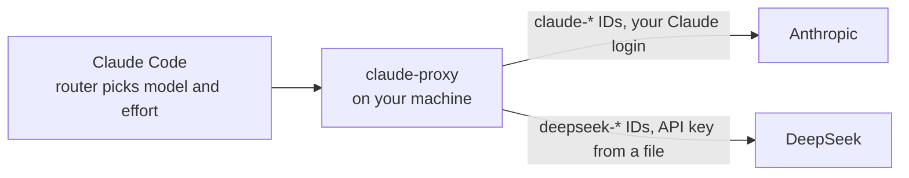

# Providers

Claude Router routes models and effort through the Anthropic-compatible endpoint that Claude Code already uses.
Set a provider name and give the router a matching JSON file. Direct provider profiles need no proxy. The optional `model-proxy` profile uses a separately started local proxy.

**Built-in profiles:** Anthropic, DeepSeek, z.ai, MiniMax, MiMo and Kimi.
**Custom profiles:** OpenRouter, Ollama, other local servers, and other hosted providers with a Claude Code-compatible Anthropic endpoint.
Custom profiles need their own model settings. They do not inherit Claude models.

This guide assumes Claude Code already works with your provider. Endpoint and credential setup are outside its scope.

## Capability evidence

The Anthropic preset seeds `claude-haiku-5-5@medium` at 0, `claude-haiku-5-5@high` at 1,
`claude-opus-5-5@medium` at 2, and `claude-opus-5-5@xhigh` at 3. These are user-derived policy judgments
from the built-in balanced base routes, not model-card benchmarks or quality guarantees. All other pairs, including
Haiku at low and Opus at high, remain unknown, not zero. User-router PR #79 seed values are profile overrides layered
over these built-ins. Other built-in provider presets have no seeds. No rating is inferred from price, ordinal strength, benchmark rank,
or an effort name.
This metadata does not affect the current table router. See [configuration](configuration.md#model-capability-declarations)
for declarations and overrides.

The model-card IDs below identify the reviewed records, not verified served backends. The sources do not give
numeric values on this router's demand scale.

| Preset model / model-card ID | Evidence and gap |
| --- | --- |
| Fable 5.2 / `anthropic-claude-fable-5-2` | [Prompting guide](https://platform.claude.com/docs/en/build-with-claude/prompt-engineering/prompting-claude-fable-5-2): effort guidance, not demand-tier calibration. |
| Opus 5.5 / `anthropic-claude-opus-5-5` | [Prompting guide](https://platform.claude.com/docs/en/build-with-claude/prompt-engineering/prompting-claude-opus-5-5): effort recommendations, not tier adequacy. |
| Sonnet 5.5 / `anthropic-claude-sonnet-5-5` | [Prompting guide](https://platform.claude.com/docs/en/build-with-claude/prompt-engineering/prompting-claude-sonnet-5-5): well-specified agentic coding at medium does not establish all medium-tier work. |
| Haiku 5.5 / `anthropic-claude-haiku-5-5` | [Prompting guide](https://platform.claude.com/docs/en/build-with-claude/prompt-engineering/prompting-claude-haiku-5-5): simple work at low does not calibrate reliability to micro demand. |
| DeepSeek Flash / `deepseek-deepseek-v4.1-flash-1017` | [Provider evaluation](evaluation.md#provider-profiles): earlier benchmark results do not establish the hosted snapshot's per-effort adequacy. |
| GLM-5.3 / `zai-glm-5.3`; GLM-5.3-Flash / `zai-glm-5.3-flash` | [Provider evaluation](evaluation.md#provider-profiles): max-effort results do not establish low/high performance or tier adequacy. |
| MiniMax M3.1 Flash / `minimax-minimax-m3.1-flash`; Kimi K3.1 Pro / `moonshot-kimi-k3.1-pro` | [Provider experiments](provider-experiments.md): small synthetic checks do not calibrate repository tasks per effort. |
| MiMo V2.6 Flash and Pro / no model-card record | [Provider experiments](provider-experiments.md): no granular effort setting; small synthetic checks do not establish demand-tier adequacy. |

The private [evidence overlay](evidence.md#artificial-analysis-overlay) also carries cost data. For each configured
effort with a positive cost per task and output price, the router derives `outputScale`: cost per task divided by
that source's output price, a relative output volume that is comparable across models. A model with no efforts reads
the `default` entry. The [auto engine](auto-engine.md) uses it to scale the output part of its next-turn estimate.
It is not capability policy, so it applies even when your profile declares that model's capability; your declarations
and token prices stay as they are. It cannot be set in the profile file. Without an overlay value, estimates are
unchanged.

The auto engine selects the cheapest eligible unknown when no eligible declaration is known. Neither the seeds nor
unknown-only selections establish quality or escalation-headroom calibration; users can configure their own maps.

## Select a provider

For DeepSeek, create `deepseek-router.json` in your Claude Code profile directory with this content:

```json
{}
```

Then start Claude Code:

```sh
CLAUDE_ROUTER_PROVIDER=deepseek claude --model 'deepseek-flash[1m]'
```

The empty file enables DeepSeek's built-in defaults. Change only the settings you want to override.

If you prefer a command-line flag, use Claude Code's existing `--settings` flag:

```sh
claude --settings '{"env":{"CLAUDE_ROUTER_PROVIDER":"deepseek"}}' --model 'deepseek-flash[1m]'
```

There is no separate `--provider` flag. A launcher can set `CLAUDE_ROUTER_PROVIDER` for each launch.

### Name-to-file mapping

The directory is `CLAUDE_CONFIG_DIR` when set, otherwise `~/.claude`.

| Provider name | Router file | Built-in model defaults |
| --- | --- | --- |
| Unset, empty, or `anthropic` | `router.json` | Haiku 5.5, Sonnet 5.5, Opus 5.5, and Fable 5.2, which no default route runs |
| `deepseek` | `deepseek-router.json` | DeepSeek Flash |
| `zai` | `zai-router.json` | GLM-5.3-Flash, GLM-5.3 |
| `minimax` | `minimax-router.json` | MiniMax-M3.1-Flash |
| `mimo` | `mimo-router.json` | MiMo-V2.6-Flash, MiMo-V2.6-Pro |
| `kimi` | `kimi-router.json` | Kimi-K3.1-Pro |
| `model-proxy` | `model-proxy-router.json` | None. Supply an explicit mixed-provider profile. |
| `openrouter` | `openrouter-router.json` | None. Supply a complete profile. |
| `ollama` | `ollama-router.json` | None. Supply a complete profile. |
| Any other valid name | `<provider>-router.json` | None. Supply a complete profile. |

Names are local profile identifiers, not a provider registry or an endpoint lookup.
For example, `local` or `my-gateway` can name a custom profile.
Names must start with a lowercase letter, contain only lowercase letters, digits and hyphens, and have at most 64 characters.

**Setting the name does not change Claude Code's endpoint, credentials or billing product.**
The router neither detects providers from URLs nor switches endpoints between turns.

### File rules

- A non-Anthropic profile file must exist. Only the Anthropic profile can run without a file.
- Missing or invalid files produce a warning and leave Claude Code's model and effort unchanged.
- The router never falls back from a selected provider file to `router.json`.
- Profiles are independent. Classifier, policy and route overrides in `router.json` do not carry over.
- Selection is fixed for the session. The pane shows the selected file but never edits it. Save and Undo use the local plugin store, scoped to this launch directory, profile and provider.
- Project and local settings cannot redirect the profile with `CLAUDE_ROUTER_PROVIDER`, `CLAUDE_CONFIG_DIR`, or `HOME`.

The optional `.claude/<provider>-router.local.json` applies to profiles of the same provider launched in that directory. It can refer to existing model aliases but cannot select an endpoint, provider or credentials. See [Project routing settings](configuration.md#project-routing-settings).

Select a classifier separately. Using Ollama to run your coding model does not also select Ollama as the classifier.
For an all-local setup, [configure the Ollama classifier](user-guide.md#use-ollama) in your local provider profile.

## Built-in defaults

Anthropic is the default when no provider name is set.
Every non-Anthropic built-in requires its named file, even when you want only defaults.
A file containing `{}` is enough. MiniMax, MiMo and Kimi require Router 1.19.0 or newer.

```sh
# First create the selected profile file containing {}, then launch on a configured model:
CLAUDE_ROUTER_PROVIDER=minimax claude --model 'MiniMax-M3.1-Flash[1m]'
CLAUDE_ROUTER_PROVIDER=mimo claude --model 'mimo-v2.6-flash[1m]'
CLAUDE_ROUTER_PROVIDER=kimi claude --model 'kimi-k3.1-pro[1m]'
```

Remove a fixed `CLAUDE_CODE_EFFORT_LEVEL` override if you want the router's per-turn efforts.
When migrating Kimi, start a **fresh conversation**. Its preserved thinking/signatures are model-specific;
resuming another model's history into K3-family models is not a supported migration.
The default Kimi ladder uses one model throughout, not a K2/K3 mixture.

### Kimi and history

The Kimi preset sets `requiresOwnHistory: true` on `k3`. A model that reads only its own thinking history cannot take over a session that another model ran, and another model cannot take over its session. The router therefore:

- rejects a `fallbacks` chain that holds `k3`, as source or target, together with another model;
- never uses the nearest-tier rule to switch into or out of `k3` from another model when a model is held out.

Cross-provider history is a caveat for every other chain too. Claude Code resends the same history to the stand-in, and thinking blocks and signatures belong to the model that wrote them. A chain from an Anthropic model to GLM or DeepSeek is allowed because you choose it. Not checked live: how each provider handles another model's thinking history in a fallback turn. Set `requiresOwnHistory` on any model you find that needs it ([Configuration](configuration.md#accounts-and-fallback-chains)).

### Model IDs

| Profile | Alias | Model ID |
| --- | --- | --- |
| Anthropic | `haiku` | `claude-haiku-5-5` |
| Anthropic | `sonnet` | `claude-sonnet-5-5` |
| Anthropic | `opus` | `claude-opus-5-5` |
| Anthropic | `fable` | `claude-fable-5-2` |
| DeepSeek | `flash` | `deepseek-flash[1m]` |
| z.ai | `flash` | `glm-5.3-flash[1m]` |
| z.ai | `glm` | `glm-5.3[1m]` |
| MiniMax | `flash` | `MiniMax-M3.1-Flash[1m]` |
| MiMo | `flash` | `mimo-v2.6-flash[1m]` |
| MiMo | `pro` | `mimo-v2.6-pro[1m]` |
| Kimi | `k3` | `kimi-k3.1-pro[1m]` |

`[1m]` is a Claude Code context hint, not a different served model.
Changing Claude Code's model-slot environment variables does not update this catalog.
If you use different models, update their IDs and metadata in the selected router file.

### Default routes

Each cell is `model alias · effort`. All profiles start at tier `low`.

| Profile | `micro` | `low` | `medium` | `high` |
| --- | --- | --- | --- | --- |
| Anthropic | haiku · medium | haiku · high | opus · medium | opus · xhigh |
| DeepSeek | flash · low | flash · high | flash · high | flash · max |
| z.ai | flash · low | flash · high | glm · high | glm · max |
| MiniMax | flash · low | flash · medium | flash · high | flash · max |
| MiMo | flash · none | flash · none | pro · none | pro · none |
| Kimi | k3 · low | k3 · high | k3 · high | k3 · max |

A provider can use one model at several efforts. Two tiers can also share the same model and effort.
`none` for MiMo means **no routed effort**, not thinking off. Claude Code may still send its session effort;
Xiaomi does not document granular reasoning levels for its Anthropic endpoint. The preset lists `efforts: []`.

### Activity overrides

With activity routing on, these cells replace the base route. Other cells keep the base route.

| Profile | Activities | Tier | Route |
| --- | --- | --- | --- |
| Anthropic | `code`, `debug`, `plan`, `review` | `low` | sonnet · high |
| Anthropic | `ops` | `medium` | haiku · high |
| DeepSeek | `code`, `debug`, `plan`, `review` | `medium` | flash · max |
| z.ai | `code`, `debug`, `plan`, `review` | `medium` | glm · max |
| z.ai | `ops`, `explore`, `docs` | `medium` | flash · high |
| z.ai | `ops`, `explore`, `docs` | `high` | flash · max |
| MiniMax | `code`, `debug`, `plan`, `review` | `medium` | flash · max |
| MiMo | `ops`, `explore`, `docs` | `medium` | flash · none |
| Kimi | `code`, `debug`, `plan`, `review` | `medium` | k3 · max |

GLM-5.3 is text-only. Image-bearing history excludes it when the router can select a compatible route.
The default models all have a context window of at least 1M tokens.
The four new model entries support image input at the provider; native image and near-limit context paths have not been tested.

Subagent routing is on for built-in profiles, and every built-in profile classifies workflow agents like `general-purpose`:

| Profile | Light | Standard | Heavy |
| --- | --- | --- | --- |
| Anthropic | haiku | sonnet | opus |
| DeepSeek | flash | flash | flash |
| z.ai | flash | glm | glm |
| MiniMax | flash | flash | flash |
| MiMo | flash | pro | pro |
| Kimi | k3 | k3 | k3 |

Subagents receive a model at spawn, not a routed effort. Their own effort setting still applies.

These defaults are starting policies, not measured quality or savings guarantees.
See [the evidence and limits](evaluation.md#provider-profiles).
For prices and cache settings, see [the configuration reference](configuration.md#provider-profiles).

## New provider modes

These are configured routes by tier and activity, before vote, context, failure, dwell and cache-cost guards.
`base/uncertain` means the tier's base route; an uncertain classifier tier keeps the incumbent tier.
A pin bypasses modes and activities. The ordinary [mode rules](routing-modes.md) apply without provider-specific code.
Generate these tables with `node scripts/provider-matrix.mjs`.

<!-- provider-matrix:start -->
**minimax**

| Tier | Activities | cost | balanced | quality |
| --- | --- | --- | --- | --- |
| micro | base/uncertain, code, debug, explore, plan, review, ops, docs | flash · low | flash · low | flash · low |
| low | base/uncertain, code, debug, explore, plan, review, ops, docs | flash · low | flash · medium | flash · high |
| medium | base/uncertain, explore, ops, docs | flash · medium | flash · high | flash · max |
| medium | code, debug, plan, review | flash · high | flash · max | flash · max |
| high | base/uncertain, code, debug, explore, plan, review, ops, docs | flash · high | flash · max | flash · max |

**mimo**

| Tier | Activities | cost | balanced | quality |
| --- | --- | --- | --- | --- |
| micro | base/uncertain, code, debug, explore, plan, review, ops, docs | flash · no routed effort | flash · no routed effort | flash · no routed effort |
| low | base/uncertain, code, debug, plan, review | flash · no routed effort | flash · no routed effort | pro · no routed effort |
| low | explore, ops, docs | flash · no routed effort | flash · no routed effort | flash · no routed effort |
| medium | base/uncertain, code, debug, plan, review | flash · no routed effort | pro · no routed effort | pro · no routed effort |
| medium | explore, ops, docs | flash · no routed effort | flash · no routed effort | pro · no routed effort |
| high | base/uncertain, code, debug, explore, plan, review, ops, docs | pro · no routed effort | pro · no routed effort | pro · no routed effort |

**kimi**

| Tier | Activities | cost | balanced | quality |
| --- | --- | --- | --- | --- |
| micro | base/uncertain, code, debug, explore, plan, review, ops, docs | k3 · low | k3 · low | k3 · low |
| low | base/uncertain, code, debug, explore, plan, review, ops, docs | k3 · low | k3 · high | k3 · max |
| medium | base/uncertain, explore, ops, docs | k3 · low | k3 · high | k3 · max |
| medium | code, debug, plan, review | k3 · high | k3 · max | k3 · max |
| high | base/uncertain, code, debug, explore, plan, review, ops, docs | k3 · high | k3 · max | k3 · max |
<!-- provider-matrix:end -->

MiniMax uses all four preset effort levels. `xhigh` is omitted because some Claude Code versions send it as `high`;
`max` supplies the deeper setting. Legacy M3 ignores effort and is not a stronger tier by default.
MiMo's cost/quality modes change models where a neighbouring tier permits it, except that `cost` keeps `high` on its model; otherwise the route stays the same.
Kimi uses only `low`, `high`, `max`, the documented controls, and never promotes a session into another model.
These are starting policies, not an optimal activity matrix. See [research and experiments](provider-experiments.md).

## Mix Anthropic and DeepSeek with model-proxy

One Claude Code session can route turns across providers. Two programs share the work:

- **The router** picks the model and effort for each turn from the `model-proxy` profile.
- **[claude-proxy](https://github.com/alexei-led/claude-proxy)**, a separate local program, receives every request and sends each exact model ID to its configured provider, with that provider's own credential.



You can mix a Claude subscription with API-key providers: the Anthropic upstream forwards your Claude Code login, and every other upstream uses a key the proxy reads from a file and never receives your login.
Before you start, know the limits:

- Providers must speak the native Anthropic API. The proxy converts no OpenAI API.
- Every selected provider receives the full request and history. Approve each destination, and do not mix company context into a provider that is not approved for it.
- Compatibility is [verified for specific client and model combinations](https://github.com/alexei-led/claude-proxy/blob/main/docs/verification.md) only; OAuth refresh and billing are not verified. Start with a fresh, non-sensitive conversation.

`model-proxy` is an execution profile, not another classifier or routing engine.

### 1. Install claude-proxy

Use version 0.4.0 or later:

```sh
brew install alexei-led/tap/claude-proxy
claude-proxy --version
```

Release binaries and source builds are described in the [proxy's guide](https://github.com/alexei-led/claude-proxy/blob/main/docs/integration.md).

### 2. Configure the proxy

Save this as `~/.config/claude-proxy/personal.json`:

```json
{
  "version": 1,
  "profile": "personal",
  "listen": "127.0.0.1:43171",
  "access_token_file": "secrets/local-access.key",
  "upstreams": {
    "anthropic": {
      "messages_url": "https://api.anthropic.com/v1/messages",
      "count_tokens_url": "https://api.anthropic.com/v1/messages/count_tokens",
      "auth": { "mode": "oauth_passthrough" }
    },
    "deepseek": {
      "messages_url": "https://api.deepseek.com/anthropic/v1/messages",
      "auth": { "mode": "bearer", "key_file": "secrets/deepseek.key" },
      "retry": { "max_attempts": 3 }
    }
  },
  "models": {
    "claude-opus-5-5": { "upstream": "anthropic" },
    "claude-sonnet-5-5": { "upstream": "anthropic" },
    "claude-haiku-5-5": { "upstream": "anthropic" },
    "claude-sonnet-5": { "upstream": "anthropic" },
    "deepseek-flash": { "upstream": "deepseek" }
  },
  "runtime": { "idle_timeout": "5m", "max_inflight": 32 }
}
```

Create the local access token, add your provider key, and check the file:

```sh
cd ~/.config/claude-proxy
(umask 077; mkdir -p secrets; set -C; openssl rand -hex 32 > secrets/local-access.key)
# Save the DeepSeek key to secrets/deepseek.key with your editor, then:
chmod 600 secrets/deepseek.key
claude-proxy --config personal.json --check
```

Secrets are files only, owned by you, with mode `0600` or `0400`. The [configuration reference](https://github.com/alexei-led/claude-proxy/blob/main/docs/configuration.md) has every field.

### 3. Save the router profile

Save this as `model-proxy-router.json` in the Claude Code configuration directory (`~/.claude` by default). It holds no endpoint and no credential.

```json
{
  "models": {
    "deepseek": {
      "id": "deepseek-flash[1m]",
      "input": 0.3,
      "output": 1.2,
      "cacheRead": 0.006,
      "contextWindow": 1000000,
      "billing": "credits",
      "efforts": [
        "low",
        "high",
        "max"
      ],
      "strength": 3,
      "imageInput": true
    },
    "claude": {
      "id": "claude-opus-5-5",
      "input": 4,
      "output": 20,
      "cacheRead": 0.2,
      "contextWindow": 1000000,
      "billing": "plan",
      "efforts": [
        "low",
        "medium",
        "high",
        "xhigh",
        "max"
      ],
      "strength": 4
    }
  },
  "routes": {
    "micro": {
      "model": "deepseek",
      "effort": "low"
    },
    "low": {
      "model": "deepseek",
      "effort": "low"
    },
    "medium": {
      "model": "deepseek",
      "effort": "high"
    },
    "high": {
      "model": "claude",
      "effort": "xhigh"
    }
  },
  "activityRouting": "off",
  "subagentRouting": "off",
  "cache": {
    "mode": "disabled"
  }
}
```

These are experimental starting routes, not measured quality rankings. Both lower tiers use DeepSeek at low effort; medium uses high effort; high uses Opus at xhigh.
The price fields are API list-price estimates, not subscription charges. DeepSeek values are its peak prices; add DeepSeek's `offPeak` rule from [`lib/prices.mjs`](../lib/prices.mjs) to price its off-peak hours at half.
Cache-cost assumptions, activity routing and subagent routing are off initially; upstream caching remains active.
The default classifier is Jev and needs its existing plugin credential. Select another configured classifier explicitly if needed; no local classifier server is required.

### 4. Start the session

`claude-proxy run` starts the proxy if none is running for this configuration, then starts Claude Code connected to it:

```sh
CLAUDE_CODE_DISABLE_EXPERIMENTAL_BETAS=1 ENABLE_TOOL_SEARCH=false \
  claude-proxy run --config ~/.config/claude-proxy/personal.json -- claude --model 'deepseek-flash[1m]'
```

It sets the proxy URL, a local access header and `CLAUDE_ROUTER_PROVIDER=model-proxy` for that Claude Code process only. Your saved login and settings do not change.
It removes `ANTHROPIC_API_KEY` and `ANTHROPIC_AUTH_TOKEN` from the process, and refuses to start beside another base URL, a cloud backend flag or `CLAUDE_CODE_OAUTH_TOKEN`.
Several sessions share one proxy; it exits after the idle timeout once the last one ends. `claude-proxy status` and `claude-proxy stop`, with the same `--config`, manage it.

Any turn may reach DeepSeek, so set the flags it needs:

| Variable | Why |
| --- | --- |
| `CLAUDE_CODE_DISABLE_EXPERIMENTAL_BETAS=1` | Drops beta request fields that third-party endpoints reject. Opus turns lose those betas too. |
| `ENABLE_TOOL_SEARCH=false` | Tool search sends `tool_definition` blocks; DeepSeek answers `422 unknown variant`. |

Leave `CLAUDE_CODE_ATTRIBUTION_HEADER` at its default here. With it set to `0`, Anthropic answered auto mode's permission checks with `429` on a plan login, so auto mode denied actions (observed in November 2026; the cause was not isolated).

To run the proxy in its own terminal instead, start `claude-proxy --config personal.json` there and use `claude-proxy connect` in place of `run`.

### Match the proxy catalog to the router

The proxy answers `404` for a model ID it does not list, and Claude Code reports `There's an issue with the selected model`. List every ID the session can ask for:

- every model reached through `routes`, `activities`, `subagents` or `fallbacks` in the router profile;
- the `--model` you launch with, and any `fallbackModel` in your settings;
- the models Claude Code calls on its own: `claude-haiku-5-5` for background tasks and Haiku subagents, and `claude-sonnet-5`, which Anthropic's server set as the auto mode classifier at the time of writing (November 2026). It belongs in the proxy catalog only, not in a router route.

Spell each ID exactly, without `[1m]`: that suffix tells Claude Code about the context window, so it stays in the router profile and in `--model`.

To keep a second router profile over the same account, set `"router_provider": "model-proxy-<name>"` in another proxy configuration with its own port. The session then reads `model-proxy-<name>-router.json`.

### Choose the launch model

The `--model` you launch with is your model, as in any profile. It serves the turns routing does not choose, and Usage compares the routed replies against it.
Launch on the model you would otherwise use:

| Launch model | Routing starts | Usage compares with |
| --- | --- | --- |
| `deepseek-flash[1m]` | at `low`, on DeepSeek | DeepSeek: Opus turns show as stronger models, at their API price |
| `claude-opus-5-5` | at `high`, on Opus, until the classifier supports a cheaper tier | Opus: DeepSeek turns show as cheaper models |

A launch model must be a model that some route runs. On any other model, a fresh session starts with routing off.
To start on another Claude model, such as Sonnet, add it to `models`, put it on a route, and map it in the proxy configuration.

Opus uses the plan and DeepSeek uses credits, but the pane estimates both at configured API rates (list/custom): `session ≈$24.10 API estimate   credits ≈$4.10   −$45.90 (−66%) vs Opus 5.5`. The credits subtotal is a configured-rate estimate, not an invoice or attested gateway charge.
See [how dollars are paid](user-guide.md#how-dollars-are-paid).

Open `/router` and check the selected file, classifier health and routing state before use.

### Troubleshooting

| What you see | Cause and fix |
| --- | --- |
| `There's an issue with the selected model`, or turns move to a fallback | The ID is missing from the proxy `models`. Add the bare ID and start a new session; `/router holds` shows a model the router holds out, and `/router release` frees it. |
| `400 Invalid schema for function 'Artifact'` | A proxy older than 0.1.4. Upgrade it. |
| `422 unknown variant 'tool_definition'` | Start with `ENABLE_TOOL_SEARCH=false`. |
| One `400` on the first Anthropic request after turns on another provider | Seen on provider switches; Claude Code retried and recovered. The cause is not confirmed. |
| A provider answers, but with another model | Some providers serve an unlisted ID with a different model. Use IDs from the provider's own model list. |

## Add another provider

No code change or provider registration is needed.
Choose a name, create its file, and set `CLAUDE_ROUTER_PROVIDER` to that name.

Unlike built-in profiles, a custom profile cannot use only `{}`.
Define all four routes and a complete model entry for each model they reference.
Custom profiles start with subagent routing off and automatic-cache accounting.

### Example: two local models

Save the following as `ollama-router.json` in your Claude Code profile directory.
Replace the two placeholder IDs with models installed on your server.
Set each context window to the limit configured for that model.

This example assumes local models with no per-token charge and no exposed effort control.
The zero prices and 32K windows are example settings, not defaults for every Ollama model.

```json
{
  "models": {
    "fast": {
      "id": "your-fast-model",
      "input": 0,
      "output": 0,
      "cacheRead": 0,
      "contextWindow": 32768,
      "billing": "plan",
      "efforts": [],
      "strength": 1,
      "imageInput": false
    },
    "strong": {
      "id": "your-strong-model",
      "input": 0,
      "output": 0,
      "cacheRead": 0,
      "contextWindow": 32768,
      "billing": "plan",
      "efforts": [],
      "strength": 2,
      "imageInput": false
    }
  },
  "routes": {
    "micro": { "model": "fast", "effort": null },
    "low": { "model": "fast", "effort": null },
    "medium": { "model": "strong", "effort": null },
    "high": { "model": "strong", "effort": null }
  },
  "cache": { "mode": "disabled" }
}
```

Start with the fast model, after replacing its placeholder ID:

```sh
CLAUDE_ROUTER_PROVIDER=ollama claude --model your-fast-model
```

`cache.mode` controls the router's cost estimates. It does not disable a server's internal cache.
Here it avoids assuming a billed prompt cache for the local models.

The same profile format works for OpenRouter or another hosted provider.
Use that provider's model IDs, supported efforts, context limits and actual token prices instead of the local example values.
Use `billing: "credits"` for token-billed models.
Set the [cache policy](configuration.md#provider-cache-behavior) to match the provider.

### Model and effort rules

- Alias names such as `fast` and `strong` are yours to choose. Routes refer to aliases, not API IDs.
- `efforts` lists only the effort levels that Claude Code can send and the provider honors.
- With `efforts: []`, use `effort: null` in every route. This omits routed effort, not model thinking.
- With named efforts, use only levels listed for that model. API compatibility does not make effort names equivalent.
- `strength` orders models for routing. A higher price does not prove higher capability.
- Prices are USD per million tokens. Use zero only when there is no token charge.
- `imageInput` describes the model's actual input support, not the provider's general capabilities.

For the full schema, see [Configuration](configuration.md#optional-routerjson).
To enable custom subagent routes, also configure [subagent routing](configuration.md#subagent-routing).

## Check the selected profile

1. Open `/router` and check the provider name and file path.
2. Start on a model used by a configured route, or run `/router on`.
3. Check that the band names the expected model and effort after a prompt.

If routing is unavailable, inspect the selected file first.
A typo in the provider name selects a different filename. It does not choose the default profile.

Changing a provider name requires a new session.
Pane edits stay within the selected profile and apply from the next turn.
