# User guide

## Start a session

The router needs Claude Code 2.1.321 or newer. Install the plugin from its marketplace, or load a checkout with `--plugin-dir /path/to/claude-router`:

```sh
claude plugin marketplace add alexei-led/claude-router
claude plugin install router@alexei-led-claude-router
```

For another execution provider, follow [Providers](providers.md). That guide covers profile names, defaults and custom files.
The following startup example uses the default Anthropic profile.

Start with the full baseline model so routing has a known starting point:

```sh
claude --model claude-haiku-5-5
```

In Claude Code:

1. Run `/plugin configure router`.
2. Enter the credentials of the classifier you use, and save them:
   - **Jev** (the default): the Jev API key from typesafe.ai.
   - **Clef**, **Clef Flash** or **Clef Omni** on Cloudflare Workers AI: the Cloudflare API token and the Cloudflare account ID. One token covers all three models.
   - **OpenAI**: an OpenAI API key. The prompt text goes to OpenAI.
   - **Ollama**: no credential. Run `ollama serve` and pull the model; the prompt text stays on this machine.
3. To use another classifier, open the pane's **Classifier** tab and select its row. See [Choose the classifier](#choose-the-classifier).
4. Check the band above the prompt. Before the first turn with routing on, it shows a dim tier meter, the model, `ready` and the routing mode, such as `balanced`; the effort follows the model once the router has read it, as after `/clear`, and an engine other than `table` adds its name before the mode. With `table` or `shadow`, a model not used by any tier or enabled activity override starts with routing off; the band says why. With `auto`, any model in the selected profile's catalog can start with routing on. `/router on` turns routing on for the current engine if it is off. In `table`, classifier votes and cache economics gate tier changes; in `auto`, the capability target, routed demand and move gates govern changes. See [routing engine settings](configuration.md#routing-engine).

The desktop app, VS Code and mobile cannot open the `/plugin configure` dialog, so their **Set up** and **Credentials → Edit** show a card with a zsh line to run in a terminal: it asks for the key without showing it or keeping it in your shell history and saves it with `claude plugin configure <id> --values-stdin`; **Copy command** copies it, then run `/reload-plugins`. Keys are stored as sensitive plugin options. Do not paste them into a model conversation. The [configuration guide](configuration.md) covers settings and migrations.

<picture>
  <source media="(prefers-color-scheme: dark)" srcset="images/desktop-key-card-dark.png">
  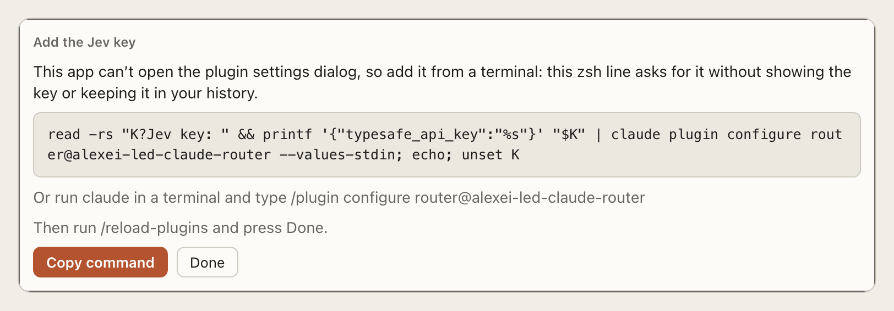
</picture>

In this guide, `router.json` means the active profile's router file. For example, with `CLAUDE_ROUTER_PROVIDER=zai`, that file is `zai-router.json`.
The pane shows its provider and file path; pane edits go to the plugin store, not this file.

## Read the status band

### In the desktop app, VS Code and mobile

<picture>
  <source media="(prefers-color-scheme: dark)" srcset="images/desktop-band-routed-dark.png">
  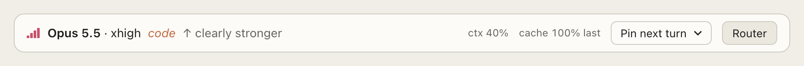
</picture>

_Rendered from the real component tree with a browser's layout and approximate theme colours; not a screenshot of the Claude app._

The band above the prompt is drawn natively as one fixed row. Nothing appears on hover: every control is on the row itself. Colours come from the app's theme, so the band reads in light and dark.

- **Left**: a small tier meter icon, then the route (the model and effort for this turn), the activity, the reason, the engine (when not `table`) and routing mode chips, the classifier's support and the switch cost, in the words of the [terminal band](#in-the-terminal). When the window narrows, the left side gives way first.
- **Right**: the context and cache readings, a **Pin to a tier** dropdown and the **Router** button, which opens the pane. The dropdown lists one entry per tier, not every model; for a model no tier routes to, such as Sonnet on the default routes, turn routing off and use `/model`. With `table` or `shadow` each entry names the route that tier runs, whatever the routing mode; with `auto` it names the tier (`Low tier`), because Auto picks the cheapest capable model when the turn runs. A pin forces that tier for the next turn only. On mobile a pending pin also keeps its own `⏵ next` text and **✕** beside the dropdown, since an app may not draw the dropdown.
- **One control per state**: **Turn on** when routing is off, **Set up** when the active classifier lacks credentials, **Fix** when routing is unavailable. While routing is on, turn it off from the pane's header (**On** / **Off**) or with `/router off`.
- **Session row**: the second row (plan windows and the session's cost against no routing) is no longer a band button. Turn it on with **Show session row in band** on the pane's Now tab; Router remembers the choice across sessions.

While subagents run, a row of buttons under the band lists them, one per agent with the model, type and task (`agents 2  ▸ ■ Haiku 5.5 Explore · retry usages ●`). Press one to open that agent's transcript in the main view. The row lists three agents and then `+N`, and keeps the first agent and the count when the window narrows. It shows only while an agent runs, and never a teammate. In an agent's transcript the band has a **Back** button (`◂ main` in the terminal, **← Main** on these surfaces) that returns to the main conversation. The agent's model and who picked it are described under the terminal band.

<picture>
  <source media="(prefers-color-scheme: dark)" srcset="images/desktop-band-agents-dark.png">
  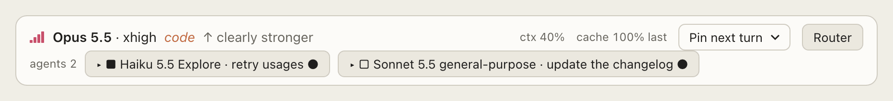
</picture>

<picture>
  <source media="(prefers-color-scheme: dark)" srcset="images/desktop-band-setup-dark.png">
  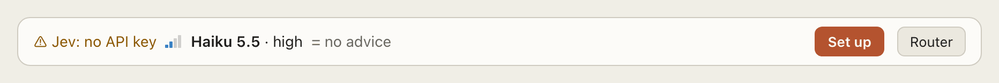
</picture>

<picture>
  <source media="(prefers-color-scheme: dark)" srcset="images/desktop-band-off-dark.png">
  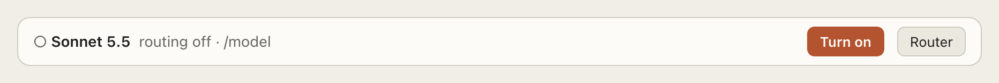
</picture>

### In the terminal

The terminal band is one line above the prompt. Its text, secondary text, accents, success, warning and error colours are your Claude Code theme's own, so a light theme reads as well as a dark one; tiers, models and activities keep their own colours. The line ends with a **Router** button that opens the pane, drawn as `[ Router ]` when the band has room for the brackets without dropping a reading or a hover control, and as a plain `Router` otherwise. A chip names the routing mode (`balanced`, `cost` or `quality`), after the engine's chip when the engine is not `table`. When the band is narrow, the less important parts drop first: classifier figures and the switch cost, then the mode and engine chips, then context and cache, then the activity, then the reason. The meter and the model always stay, except behind a classifier warning: the warning and its **Set up** button come first, and the route gives way to them.

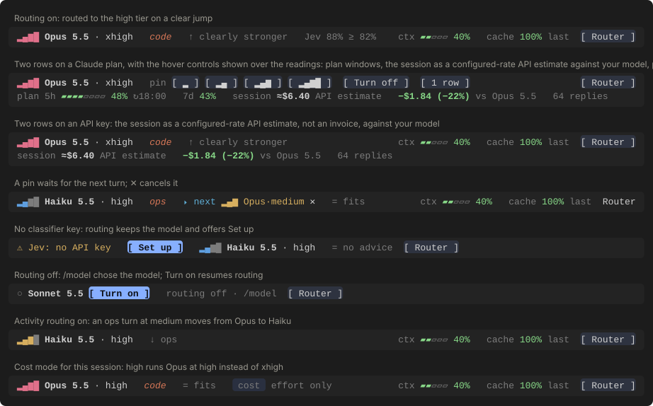

Read the first line from left to right:

- **Tier meter** `▂▄▆█`: one bar per tier, lit up to the current tier in its color, like signal strength. The same bars name the tiers everywhere: `▂` micro, `▂▄` low, `▂▄▆` medium, `▂▄▆█` high.
- **Model**: the model and effort the router chose for this turn, such as `Opus 5.5 · xhigh`; see [Changes during a task](#changes-during-a-task) for when the effort is not the one sent. **fallback** after it means Claude Code answered with another model.
- **Activity**: the kind of work, in orange italic: `code`, `debug`, `explore`, `plan`, `review`, `ops` (commands: git, builds, tests, CI) or `docs`. See [Route by activity](#route-by-activity). When the reason already names the activity, the band does not repeat it.
- **Reason**: a glyph and a few words. `↑` moved up, `↓` moved down, `=` stayed, `…` waits, `!` a problem, `⏵` a pin: `↑ clearly stronger`, `↓ cheaper fits`, `= fits`, `… cheaper, waiting`, `↑ code` for an activity move.
- **Engine and mode**: chips naming the engine, only when it is not `table`, and the routing mode, such as `shadow` and `balanced`.
- **Classifier support**: what the active classifier, such as Jev or Clef Flash, gave the switch against the bar the policy required, such as `Jev 88% ≥ 82%`. When whole percents would read as equal, it shows tenths: `Jev 81.0% < 81.4%`.
- **Switch cost**: `switch ≈ $0.48`, the policy's price for the switch it weighed this turn, mostly the prompt cache the other model must write. For a move to a cheaper model it is net of what that model saves over the next turns. The higher the cost, the higher the bar a stronger model must clear.
- **ctx** and **cache**: a gauge of context use on the model that runs next, and the share of input read from the cache on the last reply. The gauge turns yellow at 60% and red at 80%.

| Band shows                                                | Meaning                                                                                                                    |
| --------------------------------------------------------- | -------------------------------------------------------------------------------------------------------------------------- |
| `▂▄▆█ Haiku 5.5   ready   balanced`                       | Routing is on and ready for the first turn. The meter is dim; `balanced` is the routing mode.                              |
| `▂▄▆█ choosing…   Jev ≤ 1.5 s`                            | The classifier and local policy are running, within the classifier's deadline. The spinner says `Choosing model`.          |
| `⏵ next ▂▄▆ Opus·medium ✕`                                | A pin is set for the next turn. **✕** cancels it.                                                                          |
| `⚠ Jev: no API key [ Set up ]`                            | The active classifier lacks a setting; routing keeps the model (`= no advice`). **Set up** opens the secure plugin dialog. |
| `⚠ Clef: no account ID [ Set up ]`                        | Clef has its API token but no Cloudflare account ID. **Set up** opens the dialog.                                          |
| `⚠ Jev timed out [ Details ]`                             | The classifier failed: timed out, unreachable, rejected the key, or paused. **Details** opens the pane.                    |
| `○ Opus 5.5 · xhigh [ Turn on ]  routing off`             | Routing is off: Claude's model answers every turn. **Turn on** turns it back on. The footer also shows `routing off`.      |
| `✕ Opus 5.5 · xhigh [ Fix ]  routing unavailable`         | Nothing routes: a missing/invalid provider file, an old Claude Code, or leftover v0.8 settings. **Fix** opens the pane.    |
| `agent ■ Haiku 5.5  ↓ from Opus 5.5 (Claude Code’s pick)` | You are viewing a subagent's transcript: the model it runs on, and who picked it; see below.                               |

**Turn on** and **Fix** sit next to the model and stay at any width.

#### The hover controls and two rows

While routing is on, hover over the band and its controls appear on the same row, in the room it has free, over its readings or after **Router**, and in both when one stretch is too small: a pin per tier, low to high, each named by what it runs (`▂▄ Haiku·high`); **Turn off**; and **2 rows** or **1 row**. Nothing moves: the meter and model, any **Set up**, **Details** or ✕ on the band, and **Router** stay where they are. A pin forces that tier for the next turn only. On a narrow band the pins lose their model names first. With one row, **2 rows** goes next, then the pins, and **Turn off** stays longest. With two rows, the pins go, then **Turn off**, and **1 row** stays longest. A band with no room for even one control shows none on hover; the pane's Now tab always has **band: 1 row** or **band: 2 rows** on its SESSION line, which does the same as the band's button. The hover controls need a pointer: from the keyboard, run `/router off`, or open the pane and press `f`; the SESSION line's toggle also takes a press.

**2 rows** adds the session under the route, in the same numbers as the pane's SESSION block. On a Claude plan it leads with the plan windows Claude Code reports:

```text
plan 5h ▰▰▰▰▱▱▱▱ 48% ↻18:00   7d 43%   session ≈$6.40 API estimate   −$1.84 (−22%) vs Opus 5.5   64 replies
```

On a plan, an API key, or a provider billed in credits, the row labels dollars `≈$6.40 API estimate`: observed tokens at configured API rates (list/custom), not an invoice or measured quota use. The difference, `−$1.84 (−22%) vs Opus 5.5`, compares the same tokens with the model `/model` selected. The band names that model while every main reply was priced against it and no subagent ran. Otherwise it reads `vs unrouted`: your model on every main-thread reply and Claude Code's own pick for every subagent. Minus is cheaper, plus is dearer; past double it reads as a ratio, `+$2.48 (×5.0)`. A mixed profile adds the estimated credits subtotal, `credits ≈$4.10`. See [How dollars are paid](#how-dollars-are-paid). Before the tenth routed reply the count reads `3 replies so far`, because one model switch and its cache write can still decide a short run. Some situations change the middle part:

- `effort low 4 · high 2`: the profile runs one model and routing moves only the effort, so no saving is estimated; see [Providers](providers.md).
- `3 of 20 not compared`: some replies have no comparison, such as on a provider whose cache hit rate cannot be known; no saving is shown.

The router's total counts the replies it routes and the subagents. Claude Code's `/cost` also counts side calls the router does not see, such as titles and compaction, and its server-side tools; run `/cost` for the whole session cost.

When the row is short, the reset time, the counts and the words drop first; the 5h window and the session total stay. Router remembers the one- or two-row choice across sessions. When Router changes the model between turns, a toast reads `Model changed: old → new · reason`. A pin does not raise one, and neither does a change of effort alone.

The band steps aside while a survey needs the space.

Inside a turn the router checks the route again as the work changes; see [Changes during a task](#changes-during-a-task). A subagent gets at most one model, when it starts, and keeps it for every step. The Anthropic profile's defaults are Haiku for exploration, Opus for clearly hard tasks, and Sonnet for the rest. Other profiles have [their own defaults](providers.md#activity-overrides). An agent that pins a model in its definition keeps it, unless it sets `modelRouting: auto`. An agent started by a workflow script is routed like any other, unless it sets its own model or you set `workflow-subagent` to `null` under `subagents.types`, as in [Subagent routing](configuration.md#subagent-routing). A resumed agent keeps the model of its first start. The Usage tab's **SUBAGENTS** section shows what each agent type ran on and cost, and the Now tab adds this session's agents to its total. See [Subagent routing](configuration.md#subagent-routing).

In a subagent's transcript the band names the model the agent runs on and who picked it. `agent ■ Haiku 5.5  ↓ from Opus 5.5 (Claude Code’s pick)` means the router chose a cheaper model than Claude Code would have; `↑` means a higher declared strength rank. When ranks are unknown, a model change has no strength direction. A hollow `□` means the agent ran on Claude Code's pick, because the router agreed or did not route it, and says why: `agent □ Opus 5.5  = Claude Code’s pick: the workflow sets it`. A narrow band drops the comparison first. The band falls back to `agent · model chosen at spawn` when the router has no record of the agent, such as after a plugin reload, and to `agent · keeps its own model (subagent routing off)`.

## Open the router pane

Run `/router` or select **Router** above the prompt. Without a UI surface, as in `claude -p`, `/router` prints a short status instead. The pane has five tabs. Select a tab or press its digit (1 to 5) while the pane has focus.

### The pane in the desktop app, VS Code and mobile

The pane is drawn natively. From the top it has:

- a **header**: `Router`, the classifier's status, the engine control (**table** / **shadow** / **auto**), and an **On** / **Off** switch for routing;
- the **tabs**: Now, Routes, Policy, Classifier and Usage, without digits in their labels (the hotkeys 1 to 5 still work);
- one **warnings** slot under the tabs, shown on every tab: an ignored project config, a native fallback, or missing classifier credentials;
- the tab's content, then the **save bar** last.

What each tab shows:

- **Now**: cards for Next turn (the route, the reason, a pin button per tier, named by route or, with `auto`, by tier), Plan usage (on a Claude plan), Context, This session and, with the `shadow` or `auto` engine once the session has routed a turn, Recent decisions. The Next turn and This session cards carry the same facts as the terminal blocks below. The tab also holds the **Show session row in band** setting.

  <picture>
    <source media="(prefers-color-scheme: dark)" srcset="images/desktop-pane-now-dark.png">
    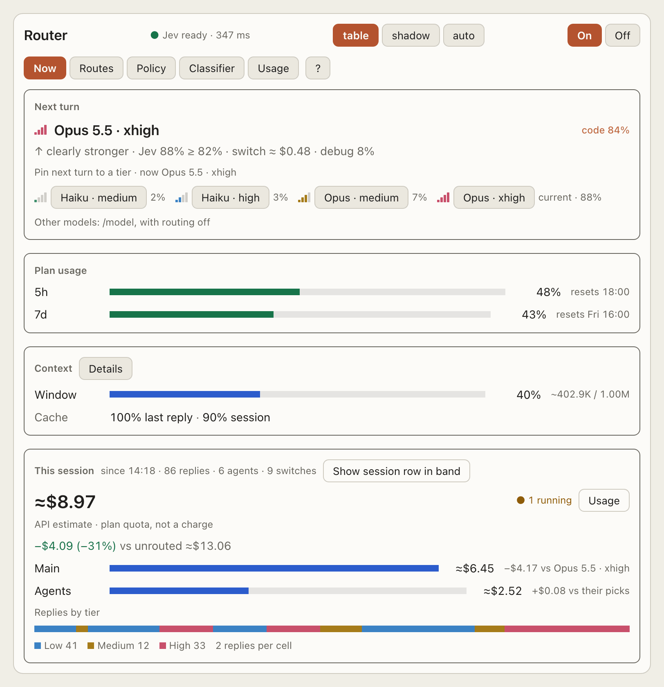
  </picture>

  With the `shadow` engine, the Recent decisions card closes the tab:

  <picture>
    <source media="(prefers-color-scheme: dark)" srcset="images/desktop-pane-now-decisions-dark.png">
    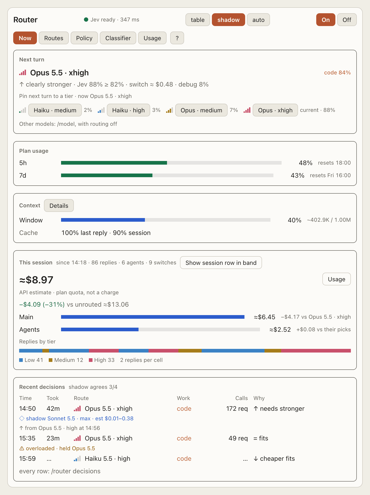
  </picture>

- **Routes**: a grid of tiers by activities, with an edit card under it for the selected cell.

  <picture>
    <source media="(prefers-color-scheme: dark)" srcset="images/desktop-pane-routes-dark.png">
    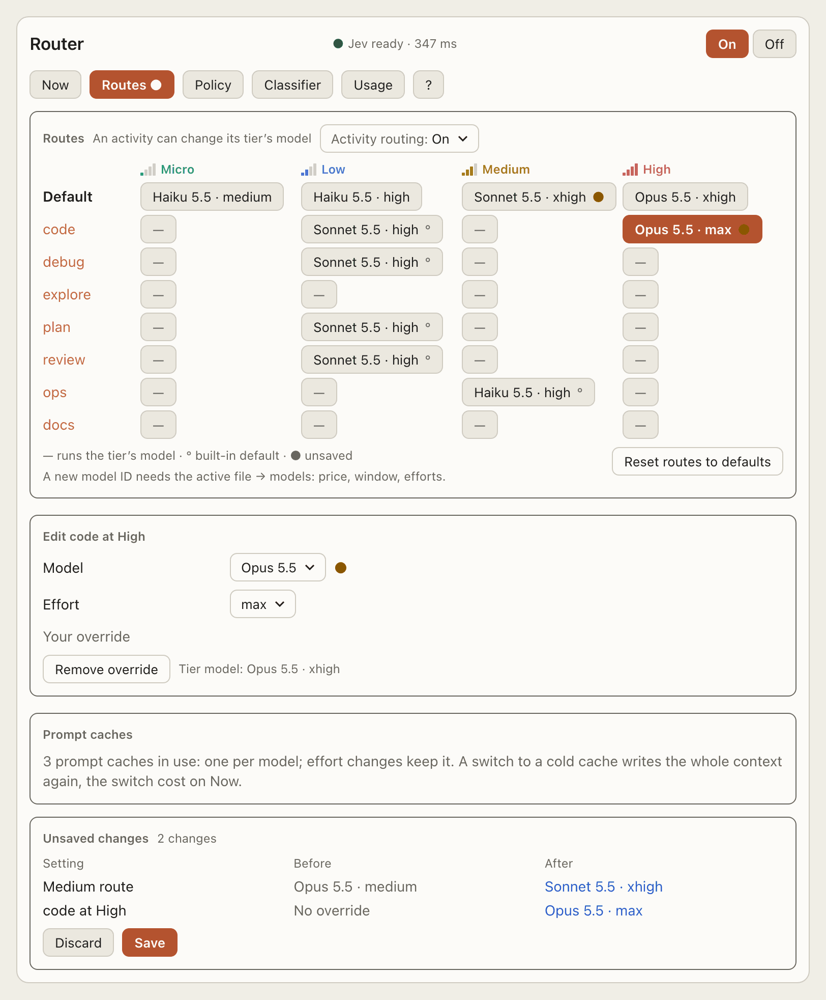
  </picture>

- **Policy**: form cards for Routing mode, Switching down, Switching up, Activities and Credits, plus the scope and controls for stored project overrides.

  <picture>
    <source media="(prefers-color-scheme: dark)" srcset="images/desktop-pane-policy-dark.png">
    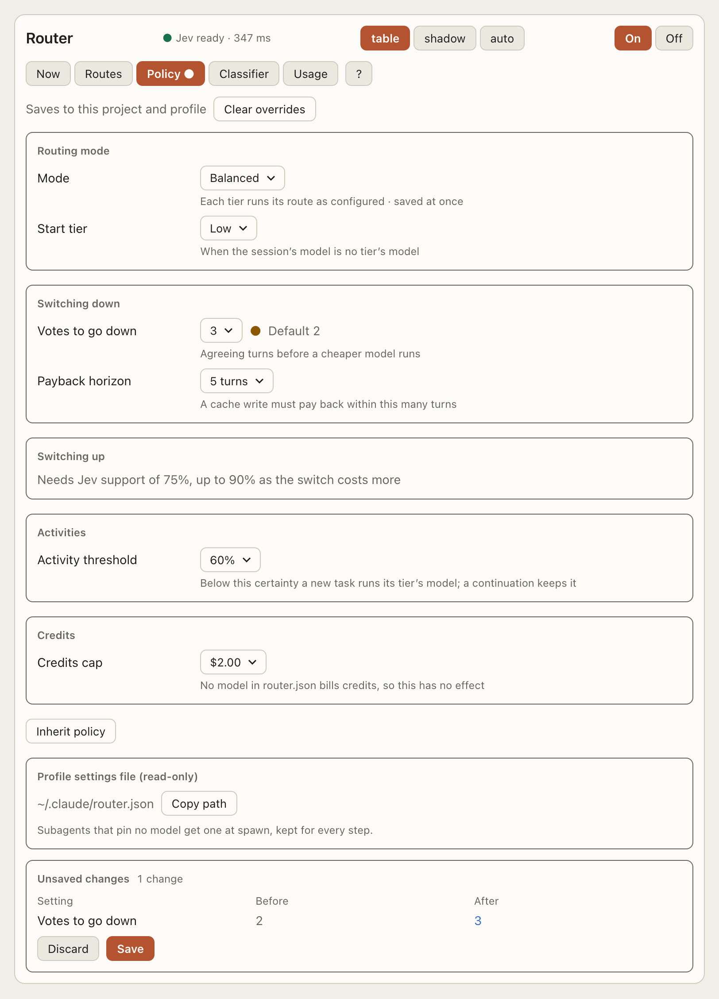
  </picture>

- **Classifier**: a full card for the active classifier (deadline, wait, health, credentials) and compact rows for the others under **Other classifiers**, then **Across sessions**.

  <picture>
    <source media="(prefers-color-scheme: dark)" srcset="images/desktop-pane-classifier-dark.png">
    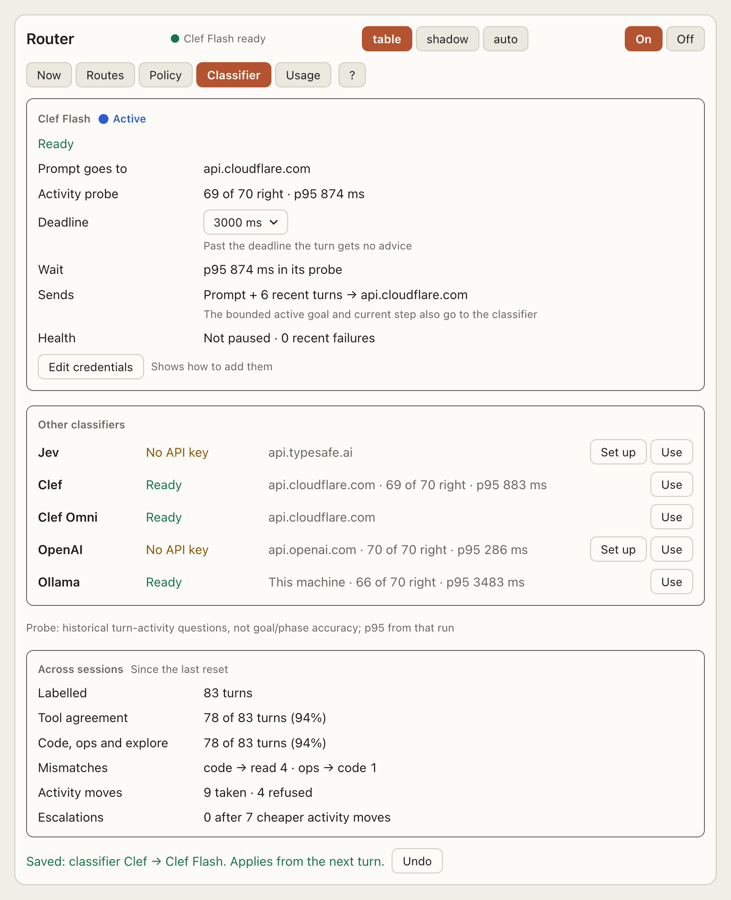
  </picture>

- **Usage**: period buttons, then Summary, Trend, Breakdown, Worth a look, Subagents, About these numbers and **Delete history**.

  <picture>
    <source media="(prefers-color-scheme: dark)" srcset="images/desktop-pane-usage-dark.png">
    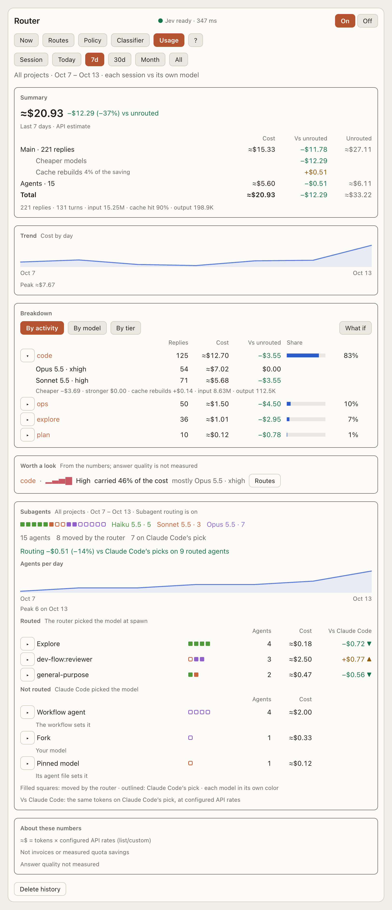
  </picture>

Unsaved Routes and Policy changes sit in an **Unsaved changes** card at the bottom, a table of each setting before and after with **Discard** and **Save**; the last save and **Undo** follow it. **?** opens an **About the router** card. When the classifier needs attention, the header says so and the warning under the tabs says what to do. Saving, undoing and the numbers behind each card follow the terminal descriptions below.

At a phone's width the same trees narrow: the band shortens its route to fit and the cards truncate their notes.

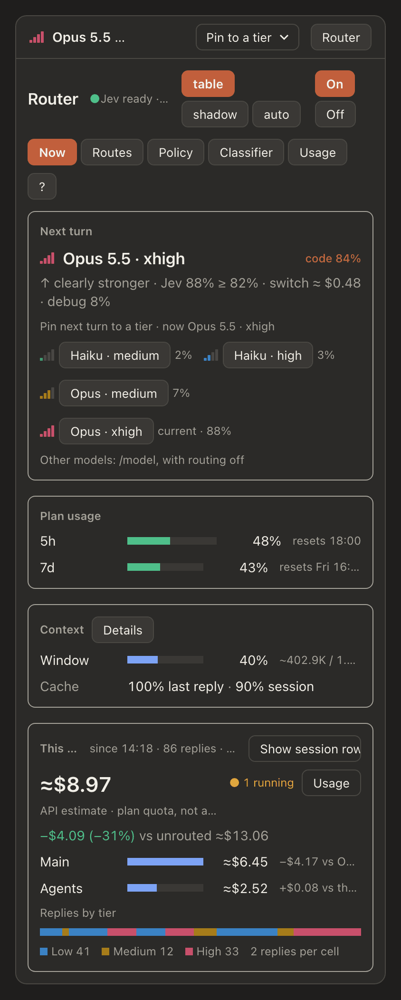

### The pane in the terminal

| Tab          | What it answers                                                                                                                                           |
| ------------ | --------------------------------------------------------------------------------------------------------------------------------------------------------- |
| 1 Now        | What runs next turn, and why, with a **pin** dropdown; held-out models; recent decisions (`shadow` or `auto`); the plan windows; session cost; context.   |
| 2 Routes     | Which model runs: one grid of tiers by activities, the activity routing mode, and an editor for the selected cell.                                        |
| 3 Policy     | How readily the router changes models: mode, start tier, going down, going up, activity threshold and credits cap; controls for project overrides.        |
| 4 Classifier | Which classifier to ask: one row per classifier to compare, the active one's deadline, wait, health and credentials, and the counts kept across sessions. |
| 5 Usage      | What routing cost against no routing this session, today, over 7 or 30 days, this month or in all: by activity, model or tier, and what is worth a look.  |

Under the tab row, one slot shows the warnings on every tab: a project config that was ignored, a native fallback, and missing classifier credentials. They no longer sit inside the Now tab's NEXT TURN block.

The top line of every tab, `ROUTER  [ ◉ on ] [ ○ off ]  engine [ table ] [ shadow ] [ auto ]  Jev ready · 347 ms`, shows the routing mode, switches it, selects the engine, and says whether the classifier is ready. Press `o` or `f` while the pane has focus; an engine press saves a project override at once, with **Undo**. A pane too narrow for the full top line drops the engine control (`/router engine` still works). The tabs under it carry their digits, `[ 1 Now ] [ 2 Routes ] …`, and **?** shows what the numbers mean above the tab. In a pane too narrow for them, the tabs drop the digits (the keys still work), and then **?** moves to the end of the top line. While the warnings under the tabs name missing classifier credentials, the top line says `see below` instead of repeating them. When routing is unavailable, the top line reads `ROUTER  unavailable  Claude’s model is kept` with the reason under it, and offers no on or off: see [Troubleshooting](#troubleshooting).


The **Now** tab has up to six blocks, each with its name in capitals: **NEXT TURN**, **SESSION** and **CONTEXT** always; **HELD OUT** while something is held (see [When a model fails](#when-a-model-fails)); **RECENT DECISIONS** with the `shadow` or `auto` engine; and **PLAN** on a Claude plan. From 72 columns wide each block sits in a single-line box with its name as the first line; a narrower pane draws them as plain lines. The Policy controls and the active classifier on the Classifier tab are boxed the same way.

**NEXT TURN** answers "what runs next turn, and why". The first line is the tier meter, the model and effort, and the classifier's activity with its share, such as `code 84%  debug 8%`. When an activity override runs, a line under it names the tier's own route. **why** gives the reason in the band's words and, beside it, the classifier's support against the bar the policy set and the switch cost: `↑ clearly stronger   Jev 88% ≥ 82% · switch ≈ $0.48`. **pin next turn to a tier** names the model that runs now, and one dropdown under it pins: **Pin to a tier**, then one entry per tier, low to high, each named by what it runs, such as `▂▄ Haiku·high 3%`, with the support the classifier gave it on the last turn; `▶` marks the tier that runs now. Picking a tier forces it for the next turn only, and the dropdown shows the pending pin until it applies; pick **No pin** to drop it. A line under the dropdown points to `/model`, with routing off, for models no tier routes to. With routing off, the block names Claude's model, `routing off · /model choice`, and the pins say they need routing on; nothing from an earlier routed turn stays.

**RECENT DECISIONS** appears with the `shadow` or `auto` engine once the session has routed a turn. Each turn is one line: when it started, how long it ran, the tier and route that ran last, its activity, its routed requests and why, in the band's words, with the support against the bar where a move was weighed (`… cheaper, waiting 72%/95%`). A running turn shows `…` for its time and requests. Under a turn, at most two notes, in this order: a failure and what it held (`⚠`), a classifier error (`⚠ classifier`), a shadow proposal that differs from the route that ran, with its next-turn estimate (`◇ shadow`), and a move inside the turn (`↑ from ▂▄▆ Opus 5.5 · high at 18:40`). The heading counts how often shadow proposed the route that ran (`shadow agrees 20/21`). The block shows the newest 5 turns and at most 10 lines with their notes, dropping the oldest turns first; `/router decisions` prints every row. A narrow pane drops the duration, then the activity, and cuts the reason.


**PLAN** appears on a Claude plan: Claude Code's 5-hour and 7-day windows as gauges, with when each resets. They turn yellow at 75% and red at 90%.

**SESSION** sums this session, the main thread and its subagents: `since 14:18 · 86 replies · 6 agents · 9 switches`, and `● 1 running` while a subagent is in the middle of a turn (an agent that waits on its own background command is not counted until it resumes). The counts include the replies of the turn still running.

```text
SESSION  since 14:18 · 86 replies · 6 agents · 9 switches  ● 1 running  [ band: 2 rows ]
  ≈$8.97  API estimate · plan quota, not a charge  [ Usage ]
  −$4.09 (−31%) vs unrouted ≈$13.06
  main   ≈$6.45  ████████████████  −$4.17 vs Opus 5.5 · xhigh
  agents ≈$2.52  ██████░░░░░░░░░░  +$0.08 vs their picks
  tiers ███████████████████████████████████████████  2 replies per cell
        ▂▄ 41   ▂▄▆ 12   ▂▄▆█ 33
```

- The first line is the configured-rate estimate and its billing product: `API estimate · plan quota, not a charge` on a plan, `API estimate · configured rates, not an invoice` on an API key or credits, and `API estimate · credits ≈$4.10` for a mixed profile. See [How dollars are paid](#how-dollars-are-paid). **Usage** opens the Usage tab on this session.
- The second line is the difference and what the same tokens would have cost: `vs Opus 5.5 ≈$13.06` when every main reply was priced against your model and no subagent ran, else `vs unrouted ≈$13.06`. The parts add up: main and agents make the total, and their differences make the session's difference (−$4.17 + $0.08 = −$4.09). Before the tenth main reply a line follows: `3 replies so far: one model switch can still move this a lot`. A narrow pane drops the amount first.
- **main** compares the main thread with your model, **agents** compares the subagents with Claude Code's picks. The bars share one scale.
- An effort-only profile shows `effort routing on one model: no saving is estimated` and its effort mix instead. When some replies have no comparison, the block says how many and shows no saving.
- When cache rebuilds cost more than the cheaper models saved, `▲ switches cost more than they saved` follows, with **Policy** to raise the bar for a switch.
- **tiers** is a strip that colors every reply since Claude Code started the session by the tier that served it; a dot marks replies routing did not serve, such as those with routing off. Each cell is one reply up to 48 cells. Past that, and on a pane too narrow for the cells, pairs of cells merge and the strip says how many replies a cell holds. After Claude Code restarts a resumed session, the strip starts again and says since when, such as `since 15:02`. The replies per tier, low to high, follow as their meters.
- Replies on a model without a list price reach the strip but have no cost: the block says `no priced replies: cost unknown`.

**CONTEXT** gives the context gauge on the model that runs next, with the tokens against its window, and the cache reuse of the last reply and of the session. **details** adds the counters and estimates in [Understand usage and estimates](#understand-usage-and-estimates).

### Save and undo changes

The settings tabs follow one of two rules, and the section captions say which:

- **Routes** and **Policy**: one draft for both, edited as a set, then saved. Changes stay a draft until **Save** (`s`). **Discard** (`d`) drops them. The draft stays when you change tab or close the pane: the tab whose settings changed reads **Routes ●** or **Policy ●**. Those two tabs list the project overrides that **Save** will change; the other tabs show the count with **Save** and **Discard**. A new session drops the draft.
- **Classifier**: selecting a classifier or changing its deadline saves a project override immediately, without a draft.

Saves apply from the next turn and never rewrite a JSON file. **Policy** shows the save scope. Open **?** for the canonical launch directory, provider and the **Reload** button. Other sessions in the same scope can read the saved settings with **Reload**; `/reload-plugins` also rereads the hand-edited files.

**Undo** (`u`) restores the last routing save from any tab. It is refused if the record has already changed when Undo reads it. A new session clears Undo. **Clear overrides** asks for confirmation and removes only the stored routing values; the hand-edited project and profile values still apply. **Delete history** leaves routing overrides alone.

Save from one session at a time. Router can merge unrelated edits it sees before saving, but overlapping writes to the same scope are **last-write-wins**: the last write can replace an earlier save even if the two sessions edited different settings. If Router reports a conflict, use **Reload**, discard the conflicting draft and reapply the intended edit. If save status is unknown, refresh before trying again. A corrupt override for the verified scope can be cleared explicitly; if storage itself is unreadable, fix access first.

### Compare routing with no routing


The Usage tab keeps observed routed spend and, when the cache history permits it, compares it with **unrouted**: your model on every main-thread reply and Claude Code's own pick for every subagent, priced on the same tokens. Your model is the model `/model` (or `--model`) selected, at the session effort, when a reply ran. The router prices observed tokens at the list prices in `router.json`.

The top row picks the period: **Session**, **Today**, **7d** (today and the six days before), **30d**, **Month** (since the first of this month) and **All**. Press `p` for the next one. The pane remembers the choice across sessions. Session holds this session's replies, and the line under the row names your model, or every model when `/model` changed during the session. The other periods add up the replies of every session on those calendar days. Each session counts against its own model, and the line reads `all projects · Oct 7 – Oct 13 · each session vs its own model`.

When the period is comparable, the difference comes first, then one table whose cents add up. The Usage tab always says `unrouted`, even for the session, because a period mixes your model with Claude Code's picks; the Now tab and the band name your model when they can:

```text
−$12.29 (−37%) vs unrouted

                              cost    vs unrouted    unrouted
main · 221 replies         ≈$15.33        −$11.78     ≈$27.11
  cheaper models                          −$12.29
  cache rebuilds                           +$0.51   4% of the saving
agents · 15                 ≈$5.60         −$0.51      ≈$6.11
─────────────────────────────────────────────────────────────
7 days · API estimate       ≈$20.93        −$12.29     ≈$33.22
```

| Row             | What it is                                                                                                      |
| --------------- | --------------------------------------------------------------------------------------------------------------- |
| main            | The main thread's routed replies, against the same tokens on your model with one cache that never switched.     |
| cheaper models  | What routing saved on replies that ran on models cheaper than yours.                                            |
| stronger models | What replies on models stronger than yours cost on top. Shown only when not zero.                               |
| cache rebuilds  | What rewriting the prompt cache after a model switch cost, and its share of the saving.                         |
| agents          | The subagents, against the same tokens on Claude Code's pick for each.                                          |
| total           | The period's cost, its difference, and what unrouted would have cost: `API estimate` for every billing product. |

Each row reads across: cost − unrouted = the difference. Down the table, main and agents make the total, and cheaper models, stronger models and cache rebuilds make main's difference. A profile that mixes plan and credits models adds `credits estimate` under the total. Below 10 routed replies the difference adds `3 replies so far: one model switch can still move this a lot`, because one switch and its cache write can decide a short run.

When some replies have no comparison, the tab says `3 of 20 replies have no comparison: no saving is shown.`, and the table shows the cost alone. Counts, tokens, breakdowns and trends still include those replies; a row with incomplete coverage shows `—` against no routing, and **What if** stays unavailable rather than inventing a baseline. This is common with automatic provider caches, whose future hit rates are unknown. An effort-only profile says `Effort routing on one model: no saving is estimated; cost uses configured API rates.`

#### How dollars are paid

Every dollar in the band, `/router`, the Now tab and Usage estimates the reply's tokens at the configured API rates in `router.json` (vendor list rates or custom rates). Amounts use `≈` for every billing product. They are not invoices or measured plan-quota savings:

- **On a Claude plan**, `≈$8.97 API estimate` is a configured-rate equivalent, not a charge or measured quota use. Claude Code's reported plan windows appear separately.
- **On an API key, or a provider billed in credits**, the same `≈$8.97 API estimate` applies. Gateway billing, discounts and invoice rates may differ.
- **A mixed profile**, such as [model-proxy](providers.md#mix-anthropic-and-deepseek-with-model-proxy), gets one sum and an estimated credits subtotal: `≈$24.10 API estimate · credits ≈$4.10`.

The router identifies plan billing from Claude Code's reported plan windows, from the first reply on. Without those windows it treats the product as API/credits, but its dollars remain configured-rate estimates. `billing` in `router.json` controls the cold-cache credits cap, not the estimate's price basis. The router's dollars leave out what it does not see: titles, compaction, server-side tools and classifier charges. For the whole session cost, run Claude Code's `/cost`.

A line of counts follows the table: replies, turns, input tokens, the share of the input read from the cache, and output tokens. With routing off or unavailable and no routed reply this session, the tab says the replies use your model and are not counted.

**BY** splits the period's cost by **Activity**, **Model** or **Tier**. Press `g` for the next grouping. Each row gives the replies, the routed cost and its difference against no routing. The last column is the route most of the row's replies used, or, by model, the row's share of the cost. By tier the rows run low to high, each named by its meter. Select **▸** to open a row. An activity lists its routes, and a model or a tier lists its activities. A line under them gives the row's cheaper, stronger and cache-rebuild parts and its tokens. A narrow pane drops the last column first.

The next line draws the routed cost as blocks: **COST BY HOUR** over today's hours for Session and Today, **COST BY WEEK** for a period longer than 45 days, and **COST BY DAY** otherwise. A dot is a bucket without replies. **What if** (`c`) shows instead the period's tokens priced on each model alone, beside the routed cost and your model. It answers whether a cheaper default would have cost less than routing. A model without a price for some reply is left out. **Trend** (`c`) goes back.

From 20 routed replies in the period, **WORTH A LOOK** lists up to three findings:

- the activity and tier that carried a quarter or more of the cost
- the cache rebuilds, when they used 15% or more of the cheaper-model saving
- the activity and tier that ran most above your model

Each line has a button to the tab that changes it. **Routes** opens that cell in the grid, and **Policy** the switching thresholds. The tab never says which model to use, because it does not measure answer quality.

**All** also counts the totals that earlier versions kept without dates, and says so under the total: `includes $4.10 routed before dated records, kept without a breakdown`. The breakdown and the trend start at the first dated day. The router keeps the daily records for 400 days.

**Delete history**, at the bottom, asks once more, then deletes the usage, activity and subagent records of every session and clears this session's counts. This session's records go at once and every other session's in the background; the counts read as cleared everywhere at once. If Claude Code exits before the background delete is done, the records it had not reached stay hidden; folds and the usual pruning remove most of them later, and older activity records and other sessions' traces stay until the next **Delete history**. Nothing brings them back. To look at a shorter span, pick a period instead.

These are estimates, not a bill. They hold the tokens and the output length the same, although another model may write more or less, and they do not measure answer quality. Your model's cache reads the previous prompt inside the cache lifetime Claude Code uses, one hour on a Claude plan, and never less than the API actually read. A route that changes only the effort, such as Opus at `xhigh` to Opus at `medium`, costs no less per token: it shows only its cache writes. [Evaluation](evaluation.md#routing-vs-no-routing) explains the method.

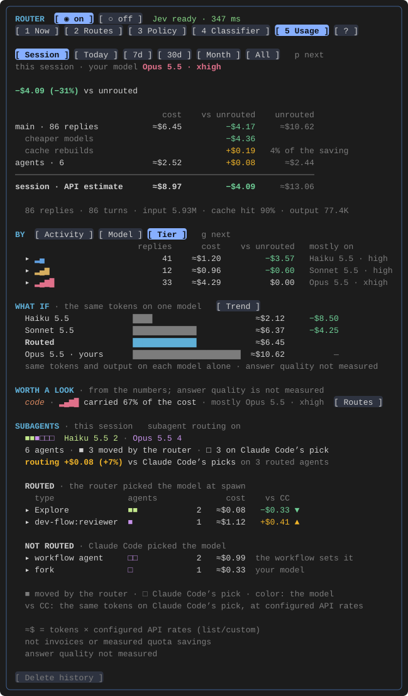

### Understand usage and estimates

- **Plan windows** are Claude Code's 5-hour and 7-day readings of the plan quota used. A reset time that has passed is not shown, because the reading is then stale.
- **Context** compares the larger available context reading with the configured window of the model that runs next. Values can be unknown when Claude does not provide the needed estimate. A route never moves to a model whose window the context would fill past 80%.
- **Cache** reuse is cache-read tokens divided by the last response's input counters.
- **Classifier support**, such as **Jev support**, is the probability the classifier gave each tier on the last classified turn. **why** on the Now tab compares the support for a switch with the bar the policy required, and shows the estimated switch cost.
- **Route switches** on the Now tab count the turns whose route differed from the turn before: a change of model or effort, so a move from Sonnet to Haiku inside `low` counts too, although its strip color stays. They are the switches the Usage tab counts, and a pin is not one. **Cache rebuilds** is the cache-write cost of those switches inside the saving.
- **Input per reply**, under **details** on the Now tab, scales the input sizes of the last 30 replies from the lowest to the highest reading. It is a scale comparison, not a forecast.
- **Cache hits saved** is a configured-price estimate for cached reads before write costs. It is not a measured saving.
- **Next-turn difference** compares the candidate with the current model under five-minute and one-hour cache-write scenarios. A negative number means the candidate is estimated to cost less for that request.
- **Payback** estimates later turns to recover an initial difference under assumed future cache reads and the last observed output size. It does not guarantee savings.

On the Usage tab, **SUBAGENTS** covers the same period as the rest of the tab: this session, or every session in every project that uses this router install (`all projects`), since the last **Delete history**. Each agent is one square, colored by the model it ran on: filled (`■`) when the router moved it off the model Claude Code would have picked, hollow (`□`) when it ran on Claude Code's pick, because the router agreed or did not route it. The models and their agents follow the squares, then how many the router moved, and what routing saved or cost on the routed agents against Claude Code's picks, in the session's words: `routing −$0.10 (−13%) vs Claude Code’s picks on 3 routed agents`. 7d, 30d, Month and All add the agents per day. **ROUTED** lists each agent type the router picked a model for: its squares, agents, cost, and **vs CC**, the same tokens on Claude Code's pick. A row opens to its models, each with how many agents the router kept, moved up or moved down, and to its requests per agent, respawns and classifier failures. **NOT ROUTED** lists the agents Claude Code picked a model for, by reason, with why: `the workflow sets it`, `your model` for a fork, `its agent file sets it`. A row without any priced request says `no price`. Records from before 1.14.0 have no date or model: Session and All add them as one line, and an empty Today or 7d says so. See [Subagent routing](configuration.md#subagent-routing). On the Now tab, **details** adds the context and cache counters, the output of the last reply, the input per reply, and the estimates above.

The router keeps no bill. Its dollars are estimates at configured API rates (list/custom) and leave out classifier charges and the side calls it does not see; run `/cost` for Claude Code's own session cost.

## Route by activity

A tier says how hard the work is. The goal says what the active task must deliver, while phase describes this step. The existing activity names describe goals:

| Goal      | The task produces                                               |
| --------- | --------------------------------------------------------------- |
| `code`    | Changed code or config, including tests                         |
| `debug`   | A found cause: failing tests, stack traces, "why does X..."     |
| `explore` | An answer: explain code, find where something happens, research |
| `plan`    | A decision or plan: design, task breakdown, trade-offs          |
| `review`  | Findings about existing code: a PR, a diff, an audit            |
| `ops`     | Executed commands: git, builds, test runs, CI, deploys          |
| `docs`    | Prose for people: README, docs, comments, commit messages       |

A mixed turn such as "fix it and commit" keeps goal `code`. Verification and delivery steps can retain that goal while changing phase. A positively supported verification-only or execution-only phase can use the `ops` cell; mixed checks and fixes cannot. For goal `ops`, accepted `reason` uses the same-tier `debug` preference and `produce` uses `code`, without changing
the durable goal. Report or unclear phase keeps an eligible continuation or uses the fresh generic baseline; it
does not introduce a new ops discount. All preferences still pass the usual switching gates.
The router then picks the route by tier and activity. With the default overrides, a `low` coding turn runs on Sonnet 5.5 at `high`, a `low` git turn stays on Haiku 5.5 at `high`, and a `medium` git turn moves from Opus 5.5 to Haiku 5.5 at `high`. [Activity routing](activity-routing.md) explains the default matrix, why each cell is there, and how to change it.

The mode decides what happens with the label:

| Mode  | What the router does                                                                       |
| ----- | ------------------------------------------------------------------------------------------ |
| `on`  | The default. Applies the activity overrides.                                               |
| `off` | Does not ask the activity: the classifier is asked for the tier only. The base routes run. |

To turn activity routing off, run `/router activities off`, or set **Activity routing** at the top of the Routes tab and press **Save**. Routing itself stays on: only the activity overrides stop. Upgrading from 1.6, which asked the activity but ran the base routes, run `/router activities off` to keep 1.6's routes. A `router.json` that still sets `"shadow"`, for activity or subagent routing, is read as not setting it, so the default, `on`, runs.

When an override runs, **NEXT TURN** on the Now tab adds a line with the tier's own route: `code at low runs on Sonnet 5.5 · high · tier route Haiku 5.5 · high`.

How the router moves inside a tier:

- It compares routes, not labels. If the new activity resolves to the route already running, nothing switches.
- A move to a stronger route needs the classifier's support, as an upgrade between tiers does. A move to a cheaper one must pay back its cache write within the payback horizon. One vote is enough for either, because this proposes a cell for the current step, not a new task goal.
- A goal applies only when the classifier gives it at least 60% probability (`policy.activityMass`). Phase must independently meet that same bar before a verification/execution step can propose `ops`; its support is capped at the lower of goal and phase support, not a multiplied probability. Below that, or on `uncertain`, a new task goes back to its base route if the move passes the same checks. On the running task the activity can move either way while the turn runs; see [Changes during a task](#changes-during-a-task).
- A pinned turn uses the pin's base route and shows no activity.
- When the classifier gives no answer at all (a timeout, a failure, a pause, or a missing key), the running route stays. When it answers the tier but gives no usable activity, only the running activity stays: the tier answer still applies, so the turn can change tier and keeps its activity there. In `off` the base route always runs.
- A fresh session starts with routing on when the session model is a tier's route. With activity routing `on`, a model that only an activity override uses also counts: Sonnet 5.5 on the defaults. In `off` it does not.

The band names the accepted goal and phase when available, and distinguishes the effective route activity: `code / verify → ops`. These are classifier estimates, not observed proof of the work done. The band shows the current activity only. The two-row band's second row and the Now tab's **tiers** strip show no activities. Past activities are in **RECENT DECISIONS** (`shadow` or `auto`) and in the Usage tab's breakdown by activity.

### Selection and request evidence

With no UI surface, `/router` distinguishes the selected model/effort, the **last recorded completed engine request**,
and the **response-reported model**. The completed-request snapshot changes only after an accepted reply, so it can
still name the previous request while the next one is pending or aborted. Delegation is not proof of API transmission or backend identity: Claude Code
can change or ignore settings, and a proxy can echo a requested model. API-transmitted and served effort remain
unknown; neither the band nor decision/usage records attest them. A record's effort is selected/delegated metadata,
not a response-reported setting.

Dollars use configured API-rate estimates (vendor list rates or custom profile rates), including tracked child
estimates where available. They are not invoices, measured subscription-quota savings, or cost per accepted task.
Missing pricing/comparison coverage stays visible in the existing Usage and classifier metrics. Decision `start`,
`review`, `observed`, and `end` rows describe routing events and coverage: `end` records requests, priced requests
and unpriced causes, not semantic success or task acceptance. A caller must evaluate task acceptance separately.

### Changes during a task

The route-table behavior below applies to the default `table` engine and to `shadow`. With opt-in `auto`, each
continuation reassesses context, images, availability and the cash cap; classifier reviews update demand, and observed
code or docs can end a bounded-execute discount. It does not use activity route-table moves. A tier pin retains its
demand for the turn but can be refitted when constraints change. If nothing fits, the native request runs with
`no-route-native`. See [automatic routing](configuration.md#routing-engine). Quality evaluation and cutover are pending.

The classifier labels a turn from its prompt, and the work can change after that: a brief that reads as `ops` may turn into an hour of coding, and a hard fix may end in routine commands. The router therefore checks the route again while a task runs, for the tier and the activity, in both directions.

- **On every later step of a turn** it reads the turn's tool calls. A turn labelled `ops` or `explore` that edits a code file moves at once to the tier's `code` route (`docs` when it edits only Markdown or `docs/` files). The tools are the evidence, so this needs no classifier support, and the cache cost does not hold it back; only the cash cap on a credits-billed model can. This move only goes up. The toast and the band show it as `↗ coding`.
- **Every 4 requests inside a turn** (`policy.reviewEveryRequests`) it asks the classifier again, in the background, with the turn's prompt and the recent dialogue. A step never waits for the answer: it applies at the first step after it arrives. Each review sends the classifier the same kind of text a new turn does. `0` turns reviews off.
- **A new prompt that continues the task** is decided the same way as a review. Claude Code stamps each prompt with where it came from. A task notification, observer report or automatic continuation is treated as progress, not as a new goal. It is asked about the known goal with the report as dialogue. Such a report may belong to an older task, so it cannot justify a downgrade. A message from you or another agent, or "go on", counts as the running task when the classifier scores it as a continuation. After a resume the router does not know your last request yet, so a notification is judged as it reads.

On the running task:

- A stronger tier takes the usual votes: two agreeing answers, or one for a clear two-tier jump. A stronger activity takes one answer whose probability clears the cache check. Repeated tool errors still escalate at once.
- A cheaper tier or activity also waits for a checkpoint: at least 8 requests since the last model change (`policy.minDwellRequests`), and a success since then that fits the work the route runs for. A passed test, build, lint or type-check always counts. A check is a test runner, type checker or linter (`pytest`, `tsc`, `eslint`), or a launcher running one (`npm test`, `go test`, `make lint`), alone or after `&&`. A check piped into another command (`npm test | tail`), followed by `;` or `|| true`, or sent to the background does not count, because its exit status can hide a failure or is not known yet. Without a passed check, the route's activity decides what counts:
  - `ops`: the last command that ran something succeeded, with no file edit or delegated agent since.
  - `docs`: the last edit succeeded and touched only Markdown, text or `docs/` files, with no command run beside it.
  - `explore`, `plan`, `review`: a turn finished, nothing was edited, written, run or delegated, and the last tool result was not an error.
  - `code`, `debug` and a route with no activity: only a passed check counts.

  A failed check blocks every one of these, and so does a check whose result is not the check's own (chained, redirected, piped, after `;` or `||`, or in the background). While no checkpoint is met, the route stays: for a tier the band shows `… down after a checkpoint`; a held activity keeps the running one and shows `= fits`. A cheaper activity also needs 90% probability (`policy.downgradeMass`; 65% in `cost`).

- A cheaper tier lands where the answer as a whole points: when the classifier says `micro` 63% and `low` 30%, the turn moves to `low`, which 93% of the answer supports, instead of staying until `micro` alone reaches 90%.
- A pinned turn does not move. A prompt not scored as a continuation is routed as a fresh turn. The bounded in-memory goal anchor is created or replaced only on positive new-task evidence, retained only on positive continuation, and dropped on ambiguity, history replacement or session end. A continuation without an anchor cannot seed a short reply as a new goal. Ollama provides neither phase nor continuity, so it does not retain this anchor; recent dialogue can still help its goal answer.

These thresholds are starting values. They are not tuned on data yet.

On Claude Code 2.1.322 an effort that the router changed inside a turn was not sent in the 6 cases found, while a changed model was, so the band and the decision record can name an effort that did not run. Claude Code sends an effort change on a tool-result step only when `CLAUDE_CODE_MODEL_CAPABILITIES=per_turn_effort` is set in its environment; the router does not set it. See [What we do not know yet](activity-routing.md#what-we-do-not-know-yet).

### When a model fails

When a turn ends on an API error that is the model's fault, the router holds something out of routing for a while, so the next turns run another model. Every engine holds: `table` and `shadow` stand a stand-in in for the held route, and `auto` never selects a held model as its target or keeps one as its incumbent. A toast says so once, such as `Opus 5.5 held out of routing: overloaded, 5 min` or `Claude plan held out of routing: usage limit, 4 h`.

The router sorts each failure into one of four kinds, from the plan's usage readings first, then the error's text (`error_details`, or else the error message Claude Code shows), then the error word:

| Kind           | Recognised by                                                                                                                                                                          | Held out                                              | Ends                                                                 |
| -------------- | -------------------------------------------------------------------------------------------------------------------------------------------------------------------------------------- | ----------------------------------------------------- | -------------------------------------------------------------------- |
| `availability` | `overloaded`, `server_error`, `model_not_found`, or `rate_limit` with no sign of a used-up quota, or a plan `rate_limit` that names credits                                            | The model                                             | After a fixed time, doubled on each failed retry (see below)         |
| `window`       | `rate_limit` while a `five_hour` or `seven_day` plan reading is at 100% or more and resets later                                                                                       | The account, which is the Claude plan for plan models | The latest reset time plus 1 minute, at most 7 days away             |
| `calendar`     | `rate_limit` or `billing_error` whose text names a spend cap: spend limit, individual usage limit, usage credit limit, pooled group budget, usage paused                               | The account                                           | The account's configured monthly reset, or 24 hours when none is set |
| `balance`      | `billing_error`, or a `rate_limit` whose text names a balance, a recharge, credit, being out of usage or adding funds (on the Claude plan such a `rate_limit` is an availability hold) | The account                                           | A release (`/router release`), or an answer from the account         |

A text that names a plan window (`session limit`, `5-hour limit`, `weekly limit`) is never `calendar` or `balance`, even when it also names a spend limit: it is a `window` when the readings show one, and otherwise an `availability` failure for a `rate_limit`.

An authentication or request error (`authentication_failed`, `oauth_org_not_allowed`, `account_on_hold`, `invalid_request`), a cut-off answer and an unknown error hold nothing: another model would not help. Claude Code reports no retry-after, so an availability hold uses a fixed time.

| Error Claude Code reports | First hold |
| ------------------------- | ---------- |
| `rate_limit`              | 5 minutes  |
| `overloaded`              | 5 minutes  |
| `server_error`            | 2 minutes  |
| `model_not_found`         | 1 hour     |

- **Availability, retries:** when the model fails again with the same error right after a hold ended, the next hold is twice as long, to at most 60 minutes. `overloaded` goes 5, 10, 20, 40, 60. A failure while a hold is still running is not a retry. A reply from that model clears the count.
- **A window needs one plan account.** Only the Claude plan reports `five_hour` and `seven_day` readings. A window applies when the failed model is on the plan account and every model with `billing: "plan"` is on that one account, so a session that also pays through a proxy or credits holds the plan, and a chain such as `opus → glm` moves to the credits model. When plan models sit in two or more accounts (`models.<alias>.account`), the readings cannot say which account is out, so a `rate_limit` is an availability failure there.
- **An account holds every model on it.** A model with `billing: "plan"` is on the account `plan`; any other model is its own account unless `models.<alias>.account` groups it with others ([Configuration](configuration.md#accounts-and-fallback-chains)). A quota failure of a model that no configured model ran holds nothing.
- **Account holds are kept in the plugin's store** (`holds/<account>`), so another session sees them and a restart keeps them. Model holds stay in the session. If two sessions write the same account hold at once, one write can be lost; both say the same account is out.
- **A spend cap or empty balance is tried again.** The limit can be raised or the balance recharged before the hold ends, so a `calendar` or `balance` hold has a next try: 1 hour after it was set, then each try that gets no reply doubles the wait (2, 4, 8, 16, then 24 hours). No try is scheduled at or after the hold's end. From that time the next main turn that routes to the account may run it; subagent spawns, the pane and the band keep treating it as held. A reply from any model of a held account, a subagent's included, ends the hold and says `<account> answered again: routing may use it`. `window` and model holds have no tries.
- **A model being tried again does not cost the turn.** Under `table` and `shadow`, when a request gets no reply from a model whose spend cap or balance try was due, or whose availability hold ended with no answer since, the router holds it again (the next try waits longer; the model hold doubles) and sends the same step once to the stand-in. The turn goes on, a toast says `Opus 5.5 still limited → GLM 5.3`, and `/router decisions` lists the failed try with the stand-in. With no other usable model the turn ends on the error as usual. `auto` does not send a request again.
- **A hold ending changes nothing by itself.** The next turn routes as usual, and a model that was held out can run again. The request of a model with no earlier failure is never sent again: the router cannot see why it failed until the turn ends.

While a model is held out, a turn whose route runs it, a pinned turn too, runs a stand-in (the `table` and `shadow` engines; `auto` instead excludes the held model from its candidates, so its next turn picks the best model that is still eligible):

1. The model's **fallback chain**, if `fallbacks` in `router.json` lists one: the first target that is allowed, not held (itself or through its account), not excluded this turn, able to take the turn's images and large enough for the context. While the context is unmeasured, a target with a smaller window than the last route is skipped. A bare target runs at the source's effort; an effort the target does not support moves down to the nearest one it does, or to its lowest when none is below (Opus at `medium` into GLM runs `low`, because the z.ai preset's GLM has `low`, `high` and `max`; write `glm@high` to pin it). `alias@effort` runs at its own effort. A target need not be in any tier.
2. When every target is skipped, or there is no chain, the nearest tier's route on another model at the turn's activity; of two tiers as near, the stronger.

The nearest-tier rule never switches into or out of a model that requires its own history (`requiresOwnHistory`, such as Kimi K3) from another model, and a chain cannot mix such a model with another.

The stand-in serves the turn and its tool calls, and never becomes the running route, so it does not stick: when the hold ends, the next turn returns to the route it held out without waiting for votes or a checkpoint. A route that is not its tier's configured route, kept from before a routing mode change or a route edit, or your own model when no tier routes to it, is the exception: when the tier's configured route runs another model, that route takes over at once and stays after the hold. The route line shows `! held out`. The band names who holds and until when, `↷ Claude plan 5h limit · back 19:00`, and the switch toast names the holder and the stand-in, `Claude plan 5h limit · back 19:00 → GLM 5.3 · max`; either falls back to `! held out` when no one hold can be named. If the stand-in fails, it gets the hold, not the model it stood in for. A subagent's API failure holds the model its last request ran, a reply from that model ends the streak, and it writes no main-turn decision row. A compaction keeps the holds; a new session starts without model holds and keeps account holds. Under `"routingEngine": "auto"` a held model is simply not a candidate, and when the hold ends it is one again: the ordinary demand, cost and cache gates decide whether the route moves back, and the shadow proposal in the decision rows respects holds the same way, so it never names a held model either.

Every main-turn failure also adds a `failure` row to the decision record: the error word, the first 300 characters of the error's text (`error_details`, or else the error message Claude Code shows; empty when it gives neither), the plan readings at that moment, the kind, and what was held. `/router decisions` lists the row without the text.

**HELD OUT on Now.** A **HELD OUT** section after **NEXT TURN** shows while something is held, and also when routing is off, because an account hold outlives routing being off. Each row names the holder, the cause and the end (`5h limit · back 19:00`, `no balance · until released`, `overloaded ×2 · back 14:32`), the next try of a spend cap or balance hold (`next try 14:00`), the models it covers, and a **Release** button. Release applies on click and **Undo** puts the hold back. The footer names `router.json → fallbacks` and `/router holds`. When the turn runs a chain target, **why** reads `↷ Opus 5.5 held · fallback 1 of 2`.

**FALLBACKS on Routes.** A read-only **FALLBACKS** section under the grid lists each model that has a chain: its status and its targets in order, a held target marked `✕`, and the one running `◀ runs`. A held model's cell in the grid gets `↷`. The pane has no chain editor; edit `fallbacks` in `router.json`.

**Commands.**

- `/router holds` lists each hold with its scope (`account` or `model`), kind, cause, end, next try when it has one and, for an account, the models it holds out: `plan (account) · window: 5h limit · back 19:00 · holds out …`.
- `/router release <model|account>` ends one early: an account name, a model's key in `router.json` or a model id. A model held only through its account is not released alone; the reply points to `/router release plan`. The prompt offers the words held now. Releasing is not a fix: if the model still fails, it is held again.

Not yet checked live: what `error_details` holds on a real failure (when it is present it is the text the `calendar` and `balance` rules read, and every path also works when it is absent), a real `rate_limit` at a 5h limit with a plan reading at 100% (the window kind relies on it), and a real `overloaded`. Tests use the shapes found in local transcripts.

### Read the activity on the pane

- **Now**: the first line of **NEXT TURN** names the classifier's activity with its share and the next answer, such as `code 84%  debug 8%`. An `uncertain` answer is shown dim: it applies no activity. In `on`, a line under it names the cell when the route is an override, such as `code at low runs on Sonnet 5.5 · high · tier route Haiku 5.5 · high`, and **why** reads `↑ code` or `↓ ops` when the activity moved the route; a refused move, a hold, or a tier change keeps its reason.
- **Routes**: see [Edit routes and policy](#edit-routes-and-policy). Each activity is a row of the grid, and a cell shows the model the activity runs at that tier.
- **Usage**: **BY** with **Activity** lists the period's replies, cost and difference against no routing per activity, and `mostly on`, the route most of its replies used, such as `Sonnet 5.5 · high`; opening a row lists its routes. Replies whose turn had no applied activity count as `no activity`. The **cache rebuilds** row counts the route switches by tier and by activity together. See [Compare routing with no routing](#compare-routing-with-no-routing).
- **Classifier**: **THIS SESSION** gives **Tool compatibility (not accuracy)**, how often the tools fit the classifier's goal (see [Evaluation](evaluation.md#tool-agreement)).

On the **Classifier** tab, **ACROSS SESSIONS · since the last reset** shows the counts kept across sessions, once there are any: the turns labelled from their tools, **Tool compatibility** over them, **Code/ops/explore**, the same agreement over the turns the classifier answered `code`, `ops` or `explore` (omitted when there are none), the two most frequent mismatches as `predicted → observed count` (`code → read 3`), **Activity moves**, the moves to another route inside a tier, taken and refused for any reason, **Escalations**, such as `after a cheaper activity move: 1 in 12 moves`, the tool-error escalations that followed a move to a cheaper route in `on` while the turns stayed on it in `on` (turning routing off, a turn with routing off, or a turn in `off` ends the watch, a pin in between does not, and an escalation the credits cap held counts). Each of these lines appears only when it has data. The active classifier's p95 wait across sessions shows on its **Deadline** line instead (not recorded with activity routing `off`). This agreement compares the classifier's raw answer, so it can differ from the session's. The pane reads these counts when the session starts and when it opens, and adds this session's turns as they finish; another session's new latency and escalation readings show the next time the pane opens. **Delete history** on the Usage tab deletes these counts with the usage and subagent records, for this session and across sessions.

`/router` without a UI surface distinguishes `Goal: code (95%)`, `Phase: verify` and `Route activity: ops`, followed by the resolved route. It labels tool compatibility explicitly as not accuracy. Goal-contract counters start a separate series; pre-change turn-label counters remain stored but are excluded until **Delete history** removes them. It also prints the session in the band's words, such as `Session: ≈$6.40 API estimate · −$1.84 (−22%) vs Opus 5.5 ≈$8.24 · 64 replies`, after a `Plan: 5h 48% · 7d 43%` line on a Claude plan.

## Change routing

| Command or action                                                                                                 | Result                                                                                                                                                         |
| ----------------------------------------------------------------------------------------------------------------- | -------------------------------------------------------------------------------------------------------------------------------------------------------------- |
| `/router`                                                                                                         | Open the pane.                                                                                                                                                 |
| `/router on`                                                                                                      | Turn routing on for this session using the selected engine.                                                                                                    |
| `/router engine <table\|shadow\|auto>`                                                                            | Select the routing engine and save it for this project and profile, with Undo. It applies from the next turn; on/off is unchanged. Engine values are case-sensitive. |
| `/router off`                                                                                                     | Turn routing off and keep Claude's selected model.                                                                                                             |
| `/router pin <micro\|low\|medium\|high>`                                                                          | Pin the next turn and its tool continuations. Routing on must already be enabled.                                                                              |
| `/router activities <off\|on>`                                                                                    | Set the [activity routing](#route-by-activity) mode. Saved as a project override at once; **Undo** reverts it.                                                       |
| `/router mode <cost\|balanced\|quality>`                                                                          | Set this session's [routing mode](routing-modes.md) from the next turn. A resume keeps it.                                                                     |
| `/router mode default`                                                                                            | Clear the session's mode: the project's or the profile's applies again.                                                                                        |
| `/router holds`                                                                                                   | List the models and accounts held out of routing, with the cause and the end. See [When a model fails](#when-a-model-fails).                                   |
| `/router release <model\|account>`                                                                                | End a hold early. **Release** on the Now tab does the same, with **Undo**.                                                                                     |
| `/router decisions [n]`                                                                                           | Print this session's last `n` routing decisions: 20 by default, `n` a whole number from 1 to 60. See [Routing decisions](#routing-decisions).                  |
| `/router line <off\|moves\|all>`                                                                                  | Choose when a turn leaves a [route line](#the-route-line) in the transcript. `moves` is the default. Kept across sessions.                                     |
| `/router trace export`                                                                                            | Export the shadow traces. See [routing engine](configuration.md#routing-engine).                                                                               |
| `/model <name>`                                                                                                   | Select a model and turn routing off. Use `/router on` to turn it back on. The model picker and a model set from the SDK, an IDE or Remote Control do the same. |
| **Turn on** / **Turn off** on the band                                                                            | The same as `/router on` and `/router off`.                                                                                                                    |
| **on** / **off** on the pane (`o` / `f`)                                                                          | The same as `/router on` and `/router off`.                                                                                                                    |
| **pin** on the Now tab                                                                                            | Pin that tier for the next turn. Routing on must already be enabled.                                                                                           |
| A prompt that starts with `maxthink`, `nothink` or another [prompt keyword](#move-one-turn-with-a-prompt-keyword) | Move that turn up or down, keeping the routing mode and the activity.                                                                                          |

Type `/router` and a space, then a letter, and the prompt offers the commands that start with it: `on`, `off`, `holds` and `decisions [n]`, and a word that takes a value once per value, each with what it does (`engine table`, `engine shadow`, `pin high`, `mode cost`, `mode default`, `activities on`, `line moves`, `trace export`, and `release` with each model and account held now). `pin` names the model each tier runs. After a word and a space, a letter narrows its values (`/router mode q` offers `quality`). The rows come after Claude Code's own. They are drawn by the surface's prompt box, so a surface that does not raise the typeahead shows none.

With `table` or `shadow`, a routing mode moves each tier's route one step toward cost or quality; pins and `micro` turns are not moved. With opt-in `auto`, the mode changes the demand margin instead, and a tier pin uses exact demand without a margin. The band and the Now tab show the mode and where it comes from, such as `cost (session)`. When the mode kept the cell's model and changed only its effort, as `cost` does for Opus at `high`, the band adds `effort only`: the cost estimates price the same tokens on both routes, so that change shows no difference there, though real output length can differ. A change applies from the next turn, and the route in use moves only through the usual checks, so on a running task a cheaper route can wait a few requests and for a checkpoint. **Mode** on the Policy tab saves a mode override for this project and profile at once, with **Undo**. See [Routing modes](routing-modes.md).

### Move one turn with a prompt keyword

Start a prompt with a keyword to move that turn and its tool continuations up or down, without a pin:

| Keyword     | The turn runs                              |
| ----------- | ------------------------------------------ |
| `morethink` | the router's choice, one effort level up   |
| `highthink` | one tier above the router's choice         |
| `maxthink`  | the top tier, `high`                       |
| `lessthink` | the router's choice, one effort level down |
| `lowthink`  | one tier below the router's choice         |
| `nothink`   | the bottom tier, `micro`                   |

- Only the first word counts, in any case, followed by a space, punctuation or nothing: `maxthink: fix the race`. `please maxthink` and `maxthinking` do nothing. The words are made up, so a sentence does not start with one by accident, and Claude Code does not read any of them (`ultrathink` is its own).
- Unlike a pin, the classifier still answers, so the routing mode and the turn's activity choose the route of the tier the keyword lands on. On the default routes `maxthink` runs Opus at `high` in `cost`, `xhigh` in `balanced` and `max` in `quality`. With `auto`, the keyword sets the turn's demand and the mode adds its margin.
- The keyword skips the switching checks, not the context and availability checks: a conversation too large for the tier's model, or a held-out model, still sends the turn elsewhere.
- An effort keyword moves to the next level the model lists. At the model's top or bottom level, or on the session's effort, the effort stays. With `auto`, it also stays when the moved route is not eligible, for example a credits model whose cold cache write at that effort is above the cash cap.
- The next turn routes as if the keyword turn had not run. On a long conversation, a model switch and the switch back each write the prompt cache again.
- The router reads a keyword only from a prompt a person or another agent sent, never from a task notification or another progress report. A pin outranks a keyword. The keyword stays in the prompt, so the model reads it too.
- The band and the toast give the keyword as the reason: `↑ maxthink`, `↓ nothink`.

### The route line

After a routed turn, Router can add one dim row at the end of the transcript that says which model and effort ran and why, in the band's words: `▂▄▆█ Sonnet 5.5 · high  ↓ cheaper fits  code`. A narrow window drops the classifier's support, then the activity, then the reason; the route stays.

- `/router line moves` (the default) adds the row only when the turn ran another model or effort than the last routed turn, and on a session's first routed turn.
- `/router line all` adds it after every routed turn, and `/router line off` never.

No row is added for an interrupted turn, a subagent's turn, or a turn while routing is off. The row is for you: the model never reads it, `claude --resume` does not bring earlier rows back, and a compaction ends the rows above it. The setting has no control in the pane; it is kept in the plugin's store across sessions, not in `router.json`.

### Routing decisions

Each routed turn adds rows to the session's decision record in `$.store` (`decisions:v1:<session id>`): one when the turn starts, one per classifier review or tool-based move inside it, and one when it ends. A row holds the prompt's origin (`composer`, `task-notification`, …, or `unknown`), the classifier's tier and activity with their shares, whether it counted as the running task, the tier, activity, route and reason chosen, and at the end the turn's tool bucket and how many replies were priced. It holds no prompt, tool or file text. The route is the one chosen, which is not always the one sent; see [Changes during a task](#changes-during-a-task). `/router decisions [n]` prints them. For a tier move or an activity move up, taken or held, the row also holds the probability mass the policy compared and the bar it compared it with, printed after the reason: `(upgrade-pending 52% vs bar 79%)`. A held move can show a mass above its bar: it then waits for a second vote or for a checkpoint. On `downgrade-pending` the mass is the support for the classifier's own choice; a tier between it and the running one can be closer to its bar. A `jump`, a move on the turn's own tool calls and a context or availability override show neither number. A review that changes nothing (the same tier, route, reason, activity and shadow proposal as the review before it) joins that row: the row counts the checks and keeps the best support, and `/router decisions` prints `3 checks until 19:18:12`. A turn keeps at most 10 rows; past that, reviews that left the route as it was go first, so the start and every move stay. Each session keeps its newest 60 rows; records of the 20 most recent other sessions stay, for at most 30 days. **Delete history** deletes them all.

For `auto`, decision rows also show demand, target, outcome, move reason and a conditional next-turn cost estimate,
not measured savings. A tier pin does not change the next turn after the pinned turn finishes. With `table` or `shadow`, a fresh session starts with routing on for a model a tier routes to, or, with activity routing `on`, a model an activity override uses (Sonnet 5.5 on the defaults). With `auto`, any model in the configured catalog starts with routing on, even if no table route names it. A fresh session on any other model starts with routing off. `/clear` starts the new session with routing on. Resuming a saved session restores its saved routing on or off.

## Edit routes and policy


The **Routes** tab is one grid. Columns are tiers, from `micro` to `high`. The **every turn** row holds each tier's own model and effort. Each activity below it is a row: a cell shows the model the activity runs at that tier, or `·` when it runs the tier's model. Cells read as `models key·effort`, such as `sonnet·high`; a narrow pane shortens the effort (`opus·xh`). `°` marks a built-in default override and **●** an unsaved edit. In the picture, `medium` was changed to Sonnet 5.5 at `xhigh` and `coding` at `high` to Opus 5.5 at `max`.

Select a cell, with the pointer or Tab and Enter, to edit it under the grid:

- **A tier cell** (every turn) has a model and an effort, with the model's list prices and window.
- **An activity cell** has a model and an effort, and says what the cell is: `built-in default`, `your override`, `runs the tier’s model`, or `same as the tier’s model: no effect`. **Use tier model** explicitly follows the tier's model and effort even when a lower layer declares an activity override. **Restore default** puts a changed or dropped built-in override back. A yellow note flags a cell stronger than the tier above, and a cell that is the only one on its cache.

The model list comes from the aliases in `router.json` `models`, limited by the `availableModels` setting. `inherit` keeps the effort Claude Code sends. A model without effort levels, such as a custom one with `"efforts": []`, shows `none`.

**Activity routing** at the top sets `off` or `on`, and says what the mode does. A yellow line says when the overrides do not run: activity routing `off`, or routing off or unavailable.

The Routes tab describes the selected profile's cache policy. With Anthropic explicit caching, it counts the cache identities used by the routes. A model switch can require a cold write of the conversation.

Automatic-cache profiles, including DeepSeek and z.ai, do not assume a fixed lifetime or guaranteed sharing across efforts. They use hit/miss input prices without a separate write premium. See [cache settings](configuration.md#provider-cache-behavior).

A yellow line flags neighbouring tiers with the same model and effort. That step changes nothing.

**Inherit tiers** (`r`) immediately removes stored tier routes and the start tier, revealing the next lower layer. Pending activity edits stay in the draft.

A new model ID needs an entry in `router.json` `models` with its price, context window, and effort levels. See [Configuration](configuration.md).

### Tune future decisions


The **Policy** tab writes each control inside the sentence it completes, and names the default beside a value that differs from it. One **Save** writes them with any route changes:

- **Start** at a tier: the tier a session starts from when its model is no tier's model (`baselineTier`). The session's model runs until a decision moves it to that tier's route or another tier.
- **Going down** after 1, 2, or 3 agreeing turns in a row, and only if a cache write pays back within 1, 3, 5, or 10 later turns. A new or reset history needs one vote.
- **Going up** needs the classifier's support at 75%, raised up to 90% as the switch costs more. Read-only here; see [Configuration](configuration.md).
- **Activities** apply at 50%, 60%, 70%, or 80% certainty or more. Below it a new task runs its tier's model; the running task follows [Changes during a task](#changes-during-a-task). See [Activity routing](activity-routing.md#change-a-cell).
- **Credits** caps one cold cache write on a `credits` model at $0.50, $1, $2, or $5. With no `credits` model in `router.json`, the tab says the cap has no effect.

**Inherit policy** removes the stored policy overrides immediately, revealing the next lower layer; the current turn is unchanged. The tab shows the read-only profile path and a **copy** button. [Subagent routing](configuration.md#subagent-routing) is still configured in the profile.

## Choose the classifier

Router asks one classifier per turn. Six are built in:

| Classifier | Service                        | Credentials                                    | Deadline |
| ---------- | ------------------------------ | ---------------------------------------------- | -------: |
| Jev        | typesafe.ai                    | Jev API key                                    | 1,500 ms |
| Clef       | Cloudflare Workers AI, 27B     | Cloudflare API token and Cloudflare account ID | 3,000 ms |
| Clef Flash | Cloudflare Workers AI, 9B      | Cloudflare API token and Cloudflare account ID | 3,000 ms |
| Clef Omni  | Cloudflare Workers AI, 30B MoE | Cloudflare API token and Cloudflare account ID | 3,000 ms |
| OpenAI     | OpenAI, `gpt-6-luna`           | OpenAI API key                                 | 3,000 ms |
| Ollama     | Local Ollama, `qwen3.5:9b`     | None                                           | 5,000 ms |

The three Clef models take the same request and the same Cloudflare credentials, so a switch between them changes only cost, speed and answers. Cloudflare bills input tokens only, per million: Clef Flash $0.038, Clef Omni $0.15, Clef $0.24 (list prices on 2026-10-13). A routing request is a few thousand tokens. In Cloudflare's own benchmarks no one model wins every task: Clef Omni leads on intent classification (BANKING77, CLINC150 with out-of-scope prompts), Clef on most of TypeSafe's workflow evals, and Clef Flash on tool-call tasks. Router has not measured Clef Omni on its own prompts yet. Clef Omni also reads images, audio and video; Router sends it text only.


You can save credentials for all of them; only the active one is asked. The **Classifier** tab has one row per classifier, as columns to compare: `◉` marks the active one; then where the prompt goes (`this machine` for Ollama); its last checked-in [activity probe](evaluation.md#activity-probe-set), the test prompts with a known activity it answered right, such as `70/70`, and their p95 wait; and whether its credentials are complete. A row that lacks one names it, such as `○ no API token`, and has its own **Set up** button. In a pane too narrow for the widest row, about 80 columns, each classifier takes two lines instead: its name, status and **Set up**, then where the prompt goes and its probe result, such as `api.cloudflare.com · 69/70 · p95 883 ms`. The probe columns read `—` when you configured a model other than the probed one.

Select a row to switch. The choice is saved as a project override at once and applies from the next turn. **Undo** in the status bar returns to the previous classifier. A turn that is already being classified finishes with the classifier it started with. The new classifier starts with a clean failure count.

Under the rows, a block for the active classifier:

- **Deadline:** 500, 1,000, 1,500, 3,000, or 5,000 ms for the active classifier's total advice attempt, including any retry. Each classifier keeps its own deadline, saved at once, with **Undo**. Beside it is the classifier's p95 wait: across sessions, such as `p95 ≤ 400 ms over 15 turns`, or from its probe before any turn. It turns yellow when the wait is slower than the deadline. Past the deadline the turn keeps its model.
- **Sends** names the service that receives prompt text. **Health** shows a pause, recent failures, and the last wait.
- **Credentials**: **Edit** opens Claude Code's secure plugin configuration, where you enter them. On the desktop app, VS Code and mobile it shows the card with the command to run in a terminal instead.

With activity routing `on`, the activity question goes in the same request as the tier question (Ollama makes a second call), with the same text and nothing more. **Sends** names the service that receives the prompt and recent dialogue. With Clef, Clef Flash or Clef Omni that is Cloudflare, not typesafe.ai; with OpenAI it is OpenAI; with Ollama it stays on this machine. Give the Cloudflare token Workers AI permissions only.

The routing policy thresholds were tuned against Jev's probabilities. Clef's, OpenAI's, and Ollama's probabilities have not been compared with Jev's, so the same prompt can switch tiers at a different point. Watch **Classifier support** for a few sessions before you rely on a new classifier.

### Use Ollama

This section configures Ollama as the **classifier**, not the model that answers your prompts. To route coding models on Ollama, use a [custom execution-provider profile](providers.md#add-another-provider).

Ollama runs the classifier on this machine, so classification text stays local. It needs no key.

1. Install Ollama and pull a model: `ollama pull qwen3.5:9b`.
2. Start the server: `ollama serve`. The router calls `http://127.0.0.1:11434`.
3. On the pane's **Classifier** tab, select the **Ollama** row, or set `"classifier": "ollama"` in `router.json`.

The model is the `model` field of `classifiers.ollama` in [Configuration](configuration.md#ollama). To use another tag, pull it and set `"classifiers": { "ollama": { "model": "<tag>" } }`.

## Move from v0.8 gateway setup

The v1 plugin has the same plugin ID, `router@alexei-led-claude-router`, but it does not start the v0.8 local gateway. With auto-update on, Claude Code installs v1 at the next start. Before the first v1 session:

1. Update the plugin: `claude plugin marketplace update alexei-led-claude-router`, then `claude plugin update router@alexei-led-claude-router`.
2. Remove the settings that v0.8 `/router:setup` wrote, or requests go to a gateway that v1 no longer starts. The [migration checklist](configuration.md#convert-a-v08-configuration) lists them: the `jev-router[1m]` model and picker row, the loopback `ANTHROPIC_BASE_URL`, the hint header, and the router status line.
3. Convert `router.json` if you created one.
4. Restart Claude Code with a full baseline model, such as `claude-haiku-5-5`.

Keep the plugin enabled: in v1 it is the Mod. The Jev key option keeps its saved value. If the band reads `v0.8 gateway settings remain`, step 2 is incomplete.

## Update or stop

Claude Code updates a marketplace install at startup when auto-update is on for the marketplace. To update now, run `claude plugin marketplace update alexei-led-claude-router`, then `claude plugin update router@alexei-led-claude-router`, and restart. For a local checkout, update the files and restart Claude Code with the same `--plugin-dir`.

To stop routing for a session, run `/router off`. To keep tier routing but stop the activity overrides, run `/router activities off`. To stop loading the Mod, run `claude plugin disable router@alexei-led-claude-router`, or restart without `--plugin-dir` for a checkout. The Mod keeps no session ledger and starts no process.

## Troubleshooting

| Symptom                                    | Cause                                                                                                  | Fix                                                                                                                                                                                                                                            |
| ------------------------------------------ | ------------------------------------------------------------------------------------------------------ | ---------------------------------------------------------------------------------------------------------------------------------------------------------------------------------------------------------------------------------------------- |
| Status says `no API key` or `no API token` | The active classifier's plugin option is unset or unavailable to this process.                         | Select **Set up** in the pane, or run `/plugin configure router`. Save the option and start a new turn.                                                                                                                                        |
| Status says `no account ID`                | Clef, Clef Flash or Clef Omni is active without the Cloudflare account ID.                             | Run `/plugin configure router` and save the Cloudflare account ID.                                                                                                                                                                             |
| Route stays on the current model           | The classifier timed out, failed, is paused, or network policy refused it.                             | Read the status band and the pane header. Network policy refusal is not bypassed.                                                                                                                                                              |
| `/model` changed but routing stopped       | Choosing a model (`/model`, the model picker, or the SDK, an IDE or Remote Control) turns routing off. | Run `/router on` to turn routing back on.                                                                                                                                                                                                      |
| Selected provider file is missing          | The provider name selects a file that does not exist.                                                  | Create that file in the active Claude Code profile directory. Use `{}` only for built-in profiles. See [Providers](providers.md).                                                                                                              |
| A custom profile containing `{}` fails     | No built-in model catalog exists for that provider name.                                               | Define all four routes and their model entries. See the [custom profile example](providers.md#add-another-provider).                                                                                                                           |
| Router reports invalid configuration       | The selected file is invalid, or project/local settings redirect the profile.                          | Inspect the file shown in the pane. Remove project/local `HOME`, `CLAUDE_CONFIG_DIR`, or `CLAUDE_ROUTER_PROVIDER` overrides.                                                                                                                   |
| Router says old settings need migration    | `router.json` still contains v0.8 gateway keys or the 1.1 `jev` section.                               | Run the [migration command](configuration.md#convert-an-older-routerjson).                                                                                                                                                                     |
| `⚠ OpenAI rejected the key`                | The OpenAI key is wrong, revoked, or lacks access to `gpt-6-luna`.                                     | Run `/plugin configure router` and save a valid OpenAI API key.                                                                                                                                                                                |
| `⚠ Ollama unreachable`                     | No Ollama server listens on `127.0.0.1:11434`.                                                         | Run `ollama serve`, then start a new turn.                                                                                                                                                                                                     |
| `⚠ Ollama timed out`                       | The model is loading after an idle period, or the machine is slow.                                     | Wait for one more turn. If it recurs, raise `classifiers.ollama.timeoutMs` in `router.json`.                                                                                                                                                   |
| `⚠ Ollama request failed`                  | The tag in `model` is not pulled, or Ollama rejected a request setting.                                | Run `ollama pull <model>` for the tag in `model`, or choose another model.                                                                                                                                                                     |
| Band reads `v0.8 gateway settings remain`  | The `jev-router[1m]` model or the `127.0.0.1:43170` base URL is still set.                             | Run `/router`: it lists the keys. Remove them as in the [migration checklist](configuration.md#convert-a-v08-configuration) and restart.                                                                                                       |
| Router controls are unavailable            | Claude Code is older than 2.1.321.                                                                     | Update Claude Code.                                                                                                                                                                                                                            |
| Pane reads `ROUTER  unavailable`           | Old gateway settings, an old Claude Code, or an invalid `router.json`. The line under it names which.  | Fix the cause it names and restart (an invalid `router.json` is read once per session start). Until then every turn keeps Claude's model, and `/router on`, `off`, `engine`, `pin`, and `activities` reply with the reason and change nothing. |
| Context reads as unknown                   | The router lacks a reliable local estimate or current-history measurement.                             | Keep using the current model, or start a new history with a supported context estimate.                                                                                                                                                        |

When a session starts with the router unavailable, a toast says why (`Routing off: requires Claude Code 2.1.321 or newer. Claude’s model is kept.`). A desktop, VS Code or mobile surface that attaches later gets it once as well. It shows once a day for each cause (old Claude Code, v0.8 gateway settings, a `router.json` that does not load) and never under `claude -p`. The band and the pane keep saying it.

For the internal event flow and network deadline behavior, see [Architecture](architecture.md). For what the test traces do and do not show, see [Evaluation](evaluation.md).
