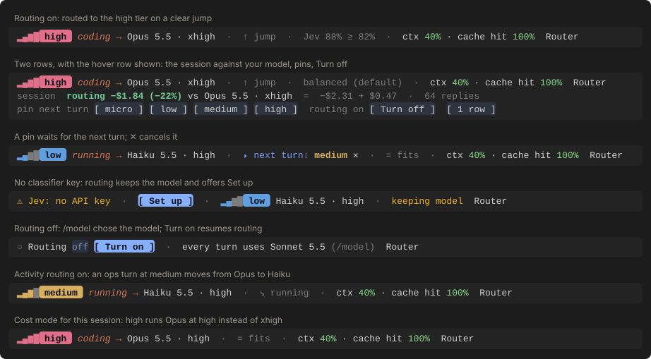
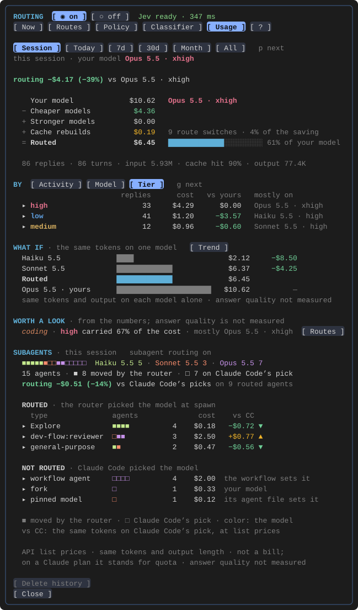

# User guide

## Start a session

Install the plugin from its marketplace, or load a checkout with `--plugin-dir /path/to/claude-router`:

```sh
claude plugin marketplace add alexei-led/claude-router
claude plugin install router@alexei-led-claude-router
```

Start with the full baseline model so routing has a known starting point:

```sh
claude --model claude-haiku-5-5
```

In Claude Code:

1. Run `/plugin configure router`.
2. Enter the credentials of the classifier you use, and save them:
   - **Jev** (the default): the Jev API key from typesafe.ai.
   - **Clef**, **Clef Flash** or **Clef Omni** on Cloudflare Workers AI: the Cloudflare API token and the Cloudflare account ID. One token covers all three models.
   - **OpenAI**: an OpenAI API key. The prompt text goes to OpenAI.
   - **Ollama**: no credential. Run `ollama serve` and pull the model; the prompt text stays on this machine.
3. To use another classifier, open the pane's **Classifier** tab and select its row. See [Choose the classifier](#choose-the-classifier).
4. Check the band above the prompt: `Routing on · ready`. On a model that no tier routes to, and that no activity override uses with activity routing `on`, the session starts with routing off and the band says why; run `/router auto` to route.

Keys are stored as sensitive plugin options. Do not paste them into a model conversation. The [configuration guide](configuration.md) covers optional settings and migrations.

## Read the status band

Router draws one line above the prompt. The line ends with a **Router** button that opens the pane. When the band is narrow, the less important parts drop first: classifier figures, then context and cache, then the activity, then the reason. The tier and model always stay, except behind a classifier warning: the warning and its **Set up** button come first, and the route gives way to them.



Read the first line of the picture from left to right:

- **Tier meter** `▂▄▆█`: one bar per tier, lit up to the current tier in its color, like signal strength.
- **Tier, activity, and model**: the route for this turn. The activity sits between the tier and the model as a verb in orange italic, such as `coding →`: `coding`, `debugging`, `exploring`, `planning`, `reviewing`, `running` (commands: git, builds, tests, CI) or `documenting`. See [Route by activity](#route-by-activity). **fallback** means Claude Code answered with another model.
- **Reason**: one or two words with a direction, such as `↑ jump`, `↓ downgrade`, `= fits`, or `… waiting to go down`. An activity move reads `↗ coding` or `↘ running`, and a refused one `… running: not worth a switch`.
- **Classifier support**: what the active classifier, such as Jev or Clef Flash, gave the switch against the bar the policy required, such as `Jev 88% ≥ 82%`. When whole percents would read as equal, it shows tenths: `Jev 81.0% < 81.4%`.
- **Switch cost**: `switch cost ≈ $0.37`, the policy's price for the switch it weighed this turn, mostly the prompt cache the other model must write. For a move to a cheaper model it is net of what that model saves over the next turns. The higher the cost, the higher the bar a stronger model must clear.
- **ctx** and **cache hit**: context use and the share of input read from the cache on the last reply. They turn yellow at 60% context and red at 80%.

| Band shows                                      | Meaning                                                                                                                     |
| ----------------------------------------------- | --------------------------------------------------------------------------------------------------------------------------- |
| `Routing on · ready`                            | Routing is on and ready for a new turn.                                                                                     |
| `choosing for this turn…`                       | The classifier and local policy are running. The spinner says `Choosing model`.                                             |
| `⏵ next turn: high ✕`                           | A pin is set. **✕** cancels it.                                                                                             |
| `⚠ Jev: no API key · keeping model`             | The active classifier lacks a setting. **Set up** opens the secure plugin dialog.                                           |
| `⚠ Clef: no account ID · keeping model`         | Clef has its API token but no Cloudflare account ID. **Set up** opens the dialog.                                           |
| `⚠ Jev timed out · keeping model`               | The classifier failed: timed out, unreachable, rejected the key, or paused.                                                 |
| `○ Routing off [ Turn on ] · every turn uses …` | Routing is off: Claude's model answers every turn. **Turn on** turns it back on. The footer also shows `routing off`.       |
| `✕ Routing unavailable`                         | Nothing routes: an old Claude Code or leftover v0.8 settings. **Fix** opens the pane.                                       |
| `○ Router · ■ Haiku 5.5 · moved down by the router` | You are viewing a subagent's transcript. The model it runs on, and who picked it; see below.                            |

The band shows one routing control at a time. While routing is on, hover over the band for a second row: pin a tier for the next turn, **Turn off** routing, or show two rows. While routing is off, **Turn on** sits on the first line next to `Routing off` and stays at any width: a narrow band drops the explanation and the model first. On a narrow band the hover row drops `routing on`, then **2 rows**, then `pin next turn`, then the pins; it keeps **Turn off**, and **1 row** when the band shows two. The hover row needs a pointer: from the keyboard, run `/router off`, or open the pane and press `f`. The two-row band adds this session against your model, the one `/model` selects now: `session  saved $1.84 (22%) vs Opus 5.5 · xhigh  ·  64 replies  ·  cold-cache writes +$0.47`, or `session  extra $2.48 (×5.0) vs Haiku 5.5 · high  ·  41 replies  ·  stronger models +$2.31` when routing cost more. The last part names the larger of the two costs behind the result, when there is one. After a `/model` change the row shows the whole session against the new model. Before the tenth routed reply it reads `session  3 replies · too early to compare`. When the row is short, the cost part drops first, then the reply count. Router remembers that choice across sessions. When Router changes the model between turns, a toast reads `Model changed: old → new · reason`. A pin does not raise one, and neither does a change of effort alone.

The band steps aside while a survey needs the space.

Inside a turn the router checks the route again as the work changes; see [Changes during a task](#changes-during-a-task). A subagent gets at most one model, when it starts, and keeps it for every step: Haiku for exploration, Opus for clearly hard tasks, Sonnet for the rest. An agent that pins a model in its definition keeps it, unless it sets `modelRouting: auto`. The Usage tab's **SUBAGENTS** section shows what each agent type ran on and cost, and the Now tab shows this session's agents. See [Subagent routing](configuration.md#subagent-routing).

In a subagent's transcript the band names the model the agent runs on and who picked it. `■ Haiku 5.5 · moved down by the router · Claude Code: Opus 5.5` means the router chose a cheaper model than Claude Code would have; `up` means a stronger one. `□ Sonnet 5.5 · the router kept Claude Code’s pick` means the router agreed. `□ Opus 5.5 · Claude Code’s pick: the workflow sets it` means the router did not route the agent, and says why. A narrow band drops the `Claude Code:` part first. The band falls back to `subagent model chosen at spawn` when the router has no record of the agent, such as after a plugin reload, and to `subagents keep their own model` with subagent routing off.

## Open the router pane

Run `/router` or select **Router** above the prompt. Without a UI surface, as in `claude -p`, `/router` prints a short status instead. The pane has five tabs. Select a tab or press its digit while the pane has focus.

| Tab          | What it answers                                                                                                                                             |
| ------------ | ----------------------------------------------------------------------------------------------------------------------------------------------------------- |
| 1 Now        | What runs next turn, and why, with a **pin** per tier; this session and today at a glance; the first finding worth a look.                                 |
| 2 Routes     | Which model runs: one grid of tiers by activities, the activity routing mode, and an editor for the selected cell.                                          |
| 3 Policy     | How readily the router changes models: the start tier, going down, going up, the activity threshold, the credits cap; the `router.json` path.               |
| 4 Classifier | Which classifier to ask: one row per classifier to compare, the active one's deadline, wait, health and credentials, and the counts kept across sessions.   |
| 5 Usage      | What routing cost against your model this session, today, over 7 or 30 days, this month or in all: by activity, model or tier, and what is worth a look.    |

The top line of every tab, `ROUTING [ ◉ on ] [ ○ off ]  Jev ready · 347 ms`, shows the routing mode, switches it, and says whether the classifier is ready. Press `o` or `f` while the pane has focus. **?** shows what the estimates leave out. When routing is unavailable, the top line reads `ROUTING  unavailable  Claude’s model is kept` with the reason under it, and offers no on or off: see [Troubleshooting](#troubleshooting).


The **Now** tab answers "what runs next turn, and why". **Next turn** names the tier, the model and effort, and, when an activity override runs, the tier's own model beside it. **Activity** names the classifier's activity as a verb, such as `coding 84%`, with the two next answers and the threshold at which an activity applies. **Why** gives the reason; under it, `Jev gave stronger tiers 88% (needs 82%) · switch ≈ $0.48` compares the classifier's support for the switch with the bar the policy set, and gives the estimated switch cost. **Pin next** has one button per tier, strongest first, with the support the classifier gave it on the last turn; `▶` marks the tier that runs now. A press forces that tier for the next turn only.

**SESSION** sums this session from its first routed reply: `since 14:18 · 86 routed replies · 9 route switches`. The strip under it colors every reply since Claude Code started the session by the tier that served it; a dot marks replies routing did not serve, such as those with routing off. Each cell is one reply up to 48 cells. Past that, and on a pane too narrow for the cells, pairs of cells merge and the strip says how many replies a cell holds, so it spans all those replies on one line. After Claude Code restarts a resumed session, the strip starts again and says since when, such as `since 15:02`, while the heading still counts the whole session. The replies per tier, `■ low 41  ■ medium 12  ■ high 33`, double as the color key, and the routed replies per activity follow. **last switch** says when the route last changed and between which tiers, or between which routes when a switch stayed inside a tier, with the activity it ran for. The last line is what routing saved, or cost, against your model this session, with the switch cache writes in it; **Usage** opens the Usage tab on this session.

**TODAY** appears once another session added to today, with the same line for every session today and its own **Usage** link. **SUBAGENTS** appears once this session started a subagent: how many are in the middle of a turn now (`● 1 running`; an agent that waits on its own background command is not counted until it resumes), the same squares as on the Usage tab, and what routing saved on them; **Usage** opens the Usage tab on this session. **WORTH A LOOK** shows today's first finding from the Usage tab, from 20 routed replies, with the tab that changes it. The last lines give the context gauge, the cache reuse and the cost Claude reports; **details** adds the counters and estimates in [Understand usage and estimates](#understand-usage-and-estimates).

### Save and undo changes

The settings tabs follow one of two rules, and the section captions say which:

- **Routes** and **Policy**: one draft for both, edited as a set, then saved. Changes stay a draft until **Save** (`s`). **Discard** (`d`) drops them. The draft stays when you change tab or close the pane: the tab whose settings changed reads **Routes ●** or **Policy ●**. Those two tabs list the `router.json` lines that **Save** will write; the other tabs show the count with **Save** and **Discard**. A new session drops the draft.
- **Classifier**: a row or a deadline is written to `router.json` when you select it.

Every write applies from the next turn and can be undone. **Undo** (`u`) puts back the settings the last write changed, from any tab, and leaves any other edit to `router.json` alone. A new session clears it. Green notices confirm a write or an undo; a red one names why nothing was written.

### Compare routing with your model


The Usage tab answers what routing cost against your model. Your model is the model `/model` (or `--model`) selected, at the session effort, when a reply ran. The router prices each routed reply's tokens twice at the list prices in `router.json`: on the model that served it, and on your model.

The top row picks the period: **Session**, **Today**, **7d** (today and the six days before), **30d**, **Month** (since the first of this month) and **All**. Press `p` for the next one. The pane remembers the choice across sessions. Session holds this session's replies, and the line under the row names your model, or every model when `/model` changed during the session. The other periods add up the replies of every session on those calendar days. Each session counts against its own model, and the line reads `all sessions · Oct 7 – Oct 13 · each session vs its own model`.

The answer comes first: `Routing saved $7.96 (46%) vs your model`, or `Routing cost $2.48 (×5.0) more than your model`. Below 10 routed replies it adds `early sample`, because one switch and its cache write can decide a short run. The ledger under it adds up to the routed cost in whole cents:

| Line                  | What it is                                                                                     |
| --------------------- | ---------------------------------------------------------------------------------------------- |
| Your model            | What the same input and output tokens cost on your model, with one cache that never switched.  |
| − Cheaper models      | What routing saved on replies that ran on models cheaper than yours.                           |
| + Stronger models     | What replies on models stronger than yours cost on top.                                        |
| + Switch cache writes | What rewriting the prompt cache after a model switch cost, and its share of the saving.        |
| = Routed              | What the routed replies cost, with a bar against your model: `54% of your model`, or `×2.1`.   |

A line of counts follows: replies, turns, input tokens, the share of the input read from the cache, and output tokens. With routing off or unavailable and no routed reply this session, the tab says the replies use your model and are not counted.

**BY** splits the period's cost by **Activity**, **Model** or **Tier**. Press `g` for the next grouping. Each row gives the replies, the routed cost and `vs yours`, the difference against your model. The last column is the route most of the row's replies used, or, by model, the row's share of the cost. Select **▸** to open a row. An activity lists its routes, and a model or a tier lists its activities. A line under them gives the row's cheaper, stronger and switch parts and its tokens. A narrow pane drops the last column first.

The next line draws the routed cost as blocks: **COST BY HOUR** over today's hours for Session and Today, **COST BY WEEK** for a period longer than 45 days, and **COST BY DAY** otherwise. A dot is a bucket without replies. **What if** (`c`) shows instead the period's tokens priced on each model alone, beside the routed cost and your model. It answers whether a cheaper default would have cost less than routing. A model without a price for some reply is left out. **Trend** (`c`) goes back.

From 20 routed replies in the period, **WORTH A LOOK** lists up to three findings:

- the activity and tier that carried a quarter or more of the cost
- the switch cache writes, when they used 15% or more of the cheaper-model saving
- the activity and tier that ran most above your model

Each line has a button to the tab that changes it. **Routes** opens that cell in the grid, and **Policy** the switching thresholds. The tab never says which model to use, because it does not measure answer quality.

**All** also counts the totals that earlier versions kept without dates, and says so: `includes $4.10 routed before dated records, kept without a breakdown`. The breakdown and the trend start at the first dated day. The router keeps the daily records for 400 days.

**Delete history**, at the bottom, asks once more, then deletes the usage, activity and subagent records of every session and clears this session's counts. Nothing brings them back. To look at a shorter span, pick a period instead.

These are estimates, not a bill. They hold the tokens and the output length the same, although another model may write more or less, and they do not measure answer quality. On a Claude plan the dollars stand for quota. Your model's cache reads the previous prompt inside the cache lifetime Claude Code uses, one hour on a Claude plan, and never less than the API actually read. A route that changes only the effort, such as Opus at `xhigh` to Opus at `medium`, costs no less per token: it shows only its cache writes. [Evaluation](evaluation.md#routing-vs-your-model) explains the method.



### Understand usage and estimates

- **Cost** comes from Claude Code's native usage API. If the account is on a plan, a configured list-price estimate is not the subscription cash charge.
- **Context** compares the larger available context reading with the routed model's configured window. The router reserves 20% of that window. Values can be unknown when Claude does not provide the needed estimate.
- **Cache** reuse is cache-read tokens divided by the last response's input counters.
- **Classifier support**, such as **Jev support**, is the probability the classifier gave each tier on the last classified turn. The line under **Why** compares the support for a switch with the bar the policy required, and shows the estimated switch cost.
- **Route switches** on the Now tab count the turns whose route differed from the turn before: a change of model or effort, so a move from Sonnet to Haiku inside `low` counts too, although its strip color stays. They are the switches the Usage tab counts, and a pin is not one. **Switch writes** is the cache-write cost of those switches inside the saving.
- **Input per reply**, under **details** on the Now tab, scales the input sizes of the last 30 replies from the lowest to the highest reading. It is a scale comparison, not a forecast.
- **Cache hits saved** is a configured-price estimate for cached reads before write costs. It is not a measured saving.
- **Next-turn difference** compares the candidate with the current model under five-minute and one-hour cache-write scenarios. A negative number means the candidate is estimated to cost less for that request.
- **Payback** estimates later turns to recover an initial difference under assumed future cache reads and the last observed output size. It does not guarantee savings.

On the Usage tab, **SUBAGENTS** covers the same period as the rest of the tab: this session, or every session in every project that uses this router install (`all projects`), since the last **Delete history**. Each agent is one square, colored by the model it ran on: filled (`■`) when the router moved it off the model Claude Code would have picked, hollow (`□`) when it ran on Claude Code's pick, because the router agreed or did not route it. The models and their agents follow the squares, then how many the router moved, and what routing saved or cost on the routed agents against Claude Code's picks. 7d, 30d, Month and All add the agents per day. **ROUTED** lists each agent type the router picked a model for: its squares, agents, cost, and **vs CC**, the same tokens on Claude Code's pick. A row opens to its models, each with how many agents the router kept, moved up or moved down, and to its requests per agent, respawns and classifier failures. **NOT ROUTED** lists the agents Claude Code picked a model for, by reason, with why: `the workflow sets it`, `your model` for a fork, `its agent file sets it`. A row without any priced request says `no price`. Records from before 1.14.0 have no date or model: Session and All add them as one line, and an empty Today or 7d says so. See [Subagent routing](configuration.md#subagent-routing). Plan quota is not on the pane: Claude Code shows it in `/usage`. On the Now tab, **details** adds the context and cache counters, the output of the last reply, the input per reply, and the estimates above.

The router keeps no bill. Routing vs your model is an estimate at configured list prices. The pane does not include classifier charges. Claude's native `/cost` is the source for its reported API cost.

## Route by activity

A tier says how hard the work is. The activity says what kind of work it is. The classifier names it for each new turn, by what the turn produces:

| Activity  | The turn produces                                               |
| --------- | --------------------------------------------------------------- |
| `code`    | Changed code or config, including tests                         |
| `debug`   | A found cause: failing tests, stack traces, "why does X..."     |
| `explore` | An answer: explain code, find where something happens, research |
| `plan`    | A decision or plan: design, task breakdown, trade-offs          |
| `review`  | Findings about existing code: a PR, a diff, an audit            |
| `ops`     | Executed commands: git, builds, test runs, CI, deploys          |
| `docs`    | Prose for people: README, docs, comments, commit messages       |

A mixed turn such as "fix it and commit" takes the hardest part, here `code`. The router then picks the route by tier and activity. With the default overrides, a `low` coding turn runs on Sonnet 5.5 at `high`, a `low` git turn stays on Haiku 5.5 at `high`, and a `medium` git turn moves from Opus 5.5 to Haiku 5.5 at `high`. [Activity routing](activity-routing.md) explains the default matrix, why each cell is there, and how to change it.

The mode decides what happens with the label:

| Mode  | What the router does                                                                       |
| ----- | ------------------------------------------------------------------------------------------ |
| `on`  | The default. Applies the activity overrides.                                               |
| `off` | Does not ask the activity: the classifier is asked for the tier only. The base routes run. |

To turn activity routing off, run `/router activities off`, or set **Activity routing** at the top of the Routes tab and press **Save**. Routing itself stays on: only the activity overrides stop. Upgrading from 1.6, which asked the activity but ran the base routes, run `/router activities off` to keep 1.6's routes. A `router.json` that still sets `"shadow"`, for activity or subagent routing, is read as not setting it, so the default, `on`, runs.

When an override runs, the **Next turn** line adds the tier's own model: `override · low runs Haiku 5.5 · high`.

How the router moves inside a tier:

- It compares routes, not labels. If the new activity resolves to the route already running, nothing switches.
- A move to a stronger route needs the classifier's support, as an upgrade between tiers does. A move to a cheaper one must pay back its cache write within the payback horizon. One vote is enough for either, because the activity is a fact about this turn.
- An activity applies only when the classifier gives it at least 60% probability (`policy.activityMass`). Below that, or on `uncertain`, a new task goes back to its base route if the move passes the same checks. On the running task the activity can move either way while the turn runs; see [Changes during a task](#changes-during-a-task).
- A pinned turn uses the pin's base route and shows no activity.
- When the classifier gives no answer at all (a timeout, a failure, a pause, or a missing key), the running route stays. When it answers the tier but gives no usable activity, only the running activity stays: the tier answer still applies, so the turn can change tier and keeps its activity there. In `off` the base route always runs.
- A fresh session starts with routing on when the session model is a tier's route. With activity routing `on`, a model that only an activity override uses also counts: Sonnet 5.5 on the defaults. In `off` it does not.

The band's activity label appears only when the activity applies, so a weak or `uncertain` answer shows none. The two-row band and the **Replies** strip show the activities of recent replies.

### Changes during a task

The classifier labels a turn from its prompt, and the work can change after that: a brief that reads as `ops` may turn into an hour of coding, and a hard fix may end in routine commands. The router therefore checks the route again while a task runs, for the tier and the activity, in both directions.

- **On every later step of a turn** it reads the turn's tool calls. A turn labelled `ops` or `explore` that edits a code file moves at once to the tier's `code` route (`docs` when it edits only Markdown or `docs/` files). The tools are the evidence, so this needs no classifier support, and the cache cost does not hold it back; only the cash cap on a credits-billed model can. This move only goes up. The toast and the band show it as `↗ coding`.
- **Every 4 requests inside a turn** (`policy.reviewEveryRequests`) it asks the classifier again, in the background, with the turn's prompt and the recent dialogue. A step never waits for the answer: it applies at the first step after it arrives. Each review sends the classifier the same kind of text a new turn does. `0` turns reviews off.
- **A new prompt that continues the task**, such as a task notification, a message from another agent, or "go on", is decided the same way as a review.

On the running task:

- A stronger tier takes the usual votes: two agreeing answers, or one for a clear two-tier jump. A stronger activity takes one answer whose probability clears the cache check. Repeated tool errors still escalate at once.
- A cheaper tier or activity also waits for a checkpoint: at least 8 requests since the last model change (`policy.minDwellRequests`), and the last test, build, lint or type-check command since then passed. A check is a test runner, type checker or linter (`pytest`, `tsc`, `eslint`), or a launcher running one (`npm test`, `go test`, `make lint`), alone or after `&&`. A check piped into another command (`npm test | tail`), followed by `;` or `|| true`, or sent to the background does not count, because its exit status can hide a failure or is not known yet. While none ran, or the last one failed, the route stays: for a tier the band shows `… down after a passed check`; a held activity keeps the running one and shows `= fits`. A cheaper activity also needs 90% probability (`policy.downgradeMass`).
- A cheaper tier lands where the answer as a whole points: when the classifier says `micro` 63% and `low` 30%, the turn moves to `low`, which 93% of the answer supports, instead of staying until `micro` alone reaches 90%.
- A pinned turn does not move. A new task, a prompt the classifier does not score as a continuation, is routed as a fresh turn. Ollama does not answer the continuation question, so every prompt is a new task to it; reviews inside a turn still apply.

These thresholds are starting values. They are not tuned on data yet.

### Read the activity on the pane

- **Now**: the **Activity** line names the classifier's choice as a verb with its share, the two next-best answers, and the threshold at which an activity applies, such as `coding 84%   debugging 8% · planning 5%   applies at 60%+`. An `uncertain` answer is shown dim: it applies no activity. In `on`, **Why** names the cell when the activity moved the route or the route is an override, such as `coding at low runs on Sonnet 5.5 · high`, or `low runs on its base route, Haiku 5.5 · high` for a move without an activity; a refused move, a hold, or a tier change keeps its reason. **SESSION** counts the routed replies per activity under the strip.
- **Routes**: see [Edit routes and policy](#edit-routes-and-policy). Each activity is a row of the grid, and a cell shows the model the activity runs at that tier.
- **Usage**: **BY** with **Activity** lists the period's replies, cost and difference against your model per activity, and `mostly on`, the route most of its replies used, such as `Sonnet 5.5 · high`; opening a row lists its routes. Replies whose turn had no applied activity count as `no activity`. The ledger's switch line counts the route switches by tier and by activity together. See [Compare routing with your model](#compare-routing-with-your-model).
- **Classifier**: **THIS SESSION** gives **Agreement**, how often the tools a turn used fit the classifier's activity (see [Evaluation](evaluation.md#tool-agreement)).

On the **Classifier** tab, **ACROSS SESSIONS · since the last reset** shows the counts kept across sessions, once there are any: the turns labelled from their tools, **Agreement** over them, **Code/ops/explore**, the same agreement over the turns the classifier answered `code`, `ops` or `explore` (omitted when there are none), the two most frequent mismatches as `predicted → observed count` (`code → read 3`), **Activity moves**, the moves to another route inside a tier, taken and refused for any reason, **Escalations**, such as `after a cheaper activity move: 1 in 12 moves`, the tool-error escalations that followed a move to a cheaper route in `on` while the turns stayed on it in `on` (turning routing off, a turn with routing off, or a turn in `off` ends the watch, a pin in between does not, and an escalation the credits cap held counts). Each of these lines appears only when it has data. The active classifier's p95 wait across sessions shows on its **Deadline** line instead (not recorded with activity routing `off`). This agreement compares the classifier's raw answer, so it can differ from the session's. The pane reads these counts when the session starts and when it opens, and adds this session's turns as they finish; another session's new latency and escalation readings show the next time the pane opens. **Delete history** on the Usage tab deletes these counts with the usage and subagent records, for this session and across sessions.

`/router` without a UI surface adds an `Activity: ops (81%)` line, the resolved route, and `Agreement across sessions: 19 of 22 turns (86%) · code/ops/explore 9 of 10 (90%)`. It also prints the session against your model, such as `vs your model (Opus 5.5 · xhigh): −$1.84 (−22%) this session, 64 replies, est. at list prices`.

## Change routing

| Command or action                        | Result                                                                                                    |
| ---------------------------------------- | --------------------------------------------------------------------------------------------------------- |
| `/router`                                | Open the pane.                                                                                            |
| `/router auto`                           | Resume automatic routing.                                                                                 |
| `/router off`                            | Turn routing off and keep Claude's selected model.                                                        |
| `/router pin <micro\|low\|medium\|high>` | Pin the next turn and its tool continuations. Routing on must already be enabled.                         |
| `/router activities <off\|on>`           | Set the [activity routing](#route-by-activity) mode. Saved to `router.json` at once; **Undo** reverts it. |
| `/model <name>`                          | Select a model and turn routing off. Use `/router auto` to turn it back on.                               |
| **Turn on** / **Turn off** on the band   | The same as `/router auto` and `/router off`.                                                             |
| **on** / **off** on the pane (`o` / `f`) | The same as `/router auto` and `/router off`.                                                             |
| **pin** on the Now tab                   | Pin that tier for the next turn. Routing on must already be enabled.                                      |

A pin does not change the next turn after the pinned turn finishes. A fresh session on a model that a tier routes to, or with activity routing `on` a model an activity override uses (Sonnet 5.5 on the defaults), starts with routing on. A fresh session on any other model starts with routing off. `/clear` starts the new session with routing on. Resuming a saved session restores its saved routing on or off.

## Edit routes and policy


The **Routes** tab is one grid. Columns are tiers, from `micro` to `high`. The **every turn** row holds each tier's own model and effort. Each activity below it is a row: a cell shows the model the activity runs at that tier, or `·` when it runs the tier's model. Cells read as `models key·effort`, such as `sonnet·high`; a narrow pane shortens the effort (`opus·xh`). `°` marks a built-in default override and **●** an unsaved edit. In the picture, `medium` was changed to Sonnet 5.5 at `xhigh` and `coding` at `high` to Opus 5.5 at `max`.

Select a cell, with the pointer or Tab and Enter, to edit it under the grid:

- **A tier cell** (every turn) has a model and an effort, with the model's list prices and window.
- **An activity cell** has a model and an effort, and says what the cell is: `built-in default`, `your override`, `runs the tier’s model`, or `same as the tier’s model: no effect`. **Use tier model** drops the override, so the cell runs the tier's model; for a built-in default, Save writes the tier's route for that cell, because the built-in one would come back otherwise. **Restore default** puts a changed or dropped built-in override back. A yellow note flags a cell stronger than the tier above, and a cell that is the only one on its cache.

The model list comes from the aliases in `router.json` `models`, limited by the `availableModels` setting. `inherit` keeps the effort Claude Code sends. A model without effort levels, such as a custom one with `"efforts": []`, shows `none`.

**Activity routing** at the top sets `off` or `on`, and says what the mode does. A yellow line says when the overrides do not run: activity routing `off`, or routing off or unavailable.

Under the grid, `3 prompt caches in use` counts the caches the grid can run on. Opus 5.5, Sonnet 5.5, Haiku 5.5 and Fable 5.1 keep one cache per model across efforts with an API key or a Claude subscription; on Amazon Bedrock, Google Cloud, Microsoft Foundry or a custom `ANTHROPIC_BASE_URL`, each (model, effort) pair has its own. Moving to a model without a warm cache writes the whole conversation into a new cache, which is the switch cost on the Now tab. More caches mean more of those writes. A yellow line flags two neighbouring tiers that run the same model and effort, since that step changes nothing.

**Reset routes to defaults** (`r`) loads the built-in tier routes and start tier into the draft; **Save** then removes your route overrides from `router.json`. Activity edits and the mode stay in the draft.

A new model ID needs an entry in `router.json` `models` with its price, context window, and effort levels. See [Configuration](configuration.md).

### Tune future decisions


The **Policy** tab writes each control inside the sentence it completes, and names the default beside a value that differs from it. One **Save** writes them with any route changes:

- **Start** at a tier: the tier a session starts from when its model is no tier's model (`baselineTier`).
- **Going down** after 1, 2, or 3 agreeing turns in a row, and only if a cache write pays back within 1, 3, 5, or 10 later turns. A new or reset history needs one vote.
- **Going up** needs the classifier's support at 75%, raised up to 90% as the switch costs more. Read-only here; see [Configuration](configuration.md).
- **Activities** apply at 50%, 60%, 70%, or 80% certainty or more. Below it a new task runs its tier's model; the running task follows [Changes during a task](#changes-during-a-task). See [Activity routing](activity-routing.md#change-a-cell).
- **Credits** caps one cold cache write on a `credits` model at $0.50, $1, $2, or $5. With no `credits` model in `router.json`, the tab says the cap has no effect.

**Reset policy to defaults** loads the built-in values; **Save** then removes your policy overrides. The current turn keeps the settings it started with. A save preserves unrelated `router.json` keys and refuses to write through a symlink. When validation fails, the pane names the setting and leaves the file unchanged. The tab ends with the `router.json` path, a **copy** button, and the [subagent routing](configuration.md#subagent-routing) mode, which is set in `router.json`.

## Choose the classifier

Router asks one classifier per turn. Six are built in:

| Classifier | Service                        | Credentials                                    | Deadline |
| ---------- | ------------------------------ | ---------------------------------------------- | -------: |
| Jev        | typesafe.ai                    | Jev API key                                    | 1,500 ms |
| Clef       | Cloudflare Workers AI, 27B     | Cloudflare API token and Cloudflare account ID | 3,000 ms |
| Clef Flash | Cloudflare Workers AI, 9B      | Cloudflare API token and Cloudflare account ID | 3,000 ms |
| Clef Omni  | Cloudflare Workers AI, 30B MoE | Cloudflare API token and Cloudflare account ID | 3,000 ms |
| OpenAI     | OpenAI, `gpt-6-luna`           | OpenAI API key                                 | 3,000 ms |
| Ollama     | Local Ollama, `qwen3.5:9b`     | None                                           | 5,000 ms |

The three Clef models take the same request and the same Cloudflare credentials, so a switch between them changes only cost, speed and answers. Cloudflare bills input tokens only, per million: Clef Flash $0.038, Clef Omni $0.15, Clef $0.24 (list prices on 2026-10-13). A routing request is a few thousand tokens. In Cloudflare's own benchmarks no one model wins every task: Clef Omni leads on intent classification (BANKING77, CLINC150 with out-of-scope prompts), Clef on most of TypeSafe's workflow evals, and Clef Flash on tool-call tasks. Router has not measured Clef Omni on its own prompts yet. Clef Omni also reads images, audio and video; Router sends it text only.


You can save credentials for all of them; only the active one is asked. The **Classifier** tab has one row per classifier, as columns to compare: `◉` marks the active one; then where the prompt goes (`this machine` for Ollama); its last checked-in [activity probe](evaluation.md#activity-probe-set), the test prompts with a known activity it answered right, such as `70/70`, and their p95 wait; and whether its credentials are complete. A row that lacks one names it, such as `○ no API token`, and has its own **Set up** button. The probe columns read `—` when you configured a model other than the probed one.

Select a row to switch. The choice is written to `router.json` at once and applies from the next turn. **Undo** in the status bar returns to the previous classifier. A turn that is already being classified finishes with the classifier it started with. The new classifier starts with a clean failure count.

Under the rows, a block for the active classifier:

- **Deadline:** 500, 1,000, 1,500, 3,000, or 5,000 ms for the active classifier's total advice attempt, including any retry. Each classifier keeps its own deadline, saved at once, with **Undo**. Beside it is the classifier's p95 wait: across sessions, such as `p95 ≤ 400 ms over 15 turns`, or from its probe before any turn. It turns yellow when the wait is slower than the deadline. Past the deadline the turn keeps its model.
- **Sends** names the service that receives prompt text. **Health** shows a pause, recent failures, and the last wait.
- **Credentials**: **Edit** opens Claude Code's secure plugin configuration, where you enter them.

With activity routing `on`, the activity question goes in the same request as the tier question (Ollama makes a second call), with the same text and nothing more. **Sends** names the service that receives the prompt and recent dialogue. With Clef, Clef Flash or Clef Omni that is Cloudflare, not typesafe.ai; with OpenAI it is OpenAI; with Ollama it stays on this machine. Give the Cloudflare token Workers AI permissions only.

The routing policy thresholds were tuned against Jev's probabilities. Clef's, OpenAI's, and Ollama's probabilities have not been compared with Jev's, so the same prompt can switch tiers at a different point. Watch **Classifier support** for a few sessions before you rely on a new classifier.

### Use Ollama

Ollama runs the classifier on this machine, so the prompt text does not leave it. It needs no key.

1. Install Ollama and pull a model: `ollama pull qwen3.5:9b`.
2. Start the server: `ollama serve`. The router calls `http://127.0.0.1:11434`.
3. On the pane's **Classifier** tab, select the **Ollama** row, or set `"classifier": "ollama"` in `router.json`.

The model is the `model` field of `classifiers.ollama` in [Configuration](configuration.md#ollama). To use another tag, pull it and set `"classifiers": { "ollama": { "model": "<tag>" } }`.

## Move from v0.8 gateway setup

The v1 plugin has the same plugin ID, `router@alexei-led-claude-router`, but it does not start the v0.8 local gateway. With auto-update on, Claude Code installs v1 at the next start. Before the first v1 session:

1. Update the plugin: `claude plugin marketplace update alexei-led-claude-router`, then `claude plugin update router@alexei-led-claude-router`.
2. Remove the settings that v0.8 `/router:setup` wrote. The [migration checklist](configuration.md#convert-a-v08-configuration) lists them: the `jev-router[1m]` model and picker row, the loopback `ANTHROPIC_BASE_URL`, the hint header, and the router status line.
3. Convert `router.json` if you created one.
4. Restart Claude Code with a full baseline model, such as `claude-haiku-5-5`.

Keep the plugin enabled: in v1 it is the Mod. The Jev key option keeps its saved value. If the band reads `v0.8 gateway settings remain`, step 2 is incomplete.

## Update or stop

Claude Code updates a marketplace install at startup when auto-update is on for the marketplace. To update now, run `claude plugin marketplace update alexei-led-claude-router`, then `claude plugin update router@alexei-led-claude-router`, and restart. For a local checkout, update the files and restart Claude Code with the same `--plugin-dir`.

To stop routing for a session, run `/router off`. To keep tier routing but stop the activity overrides, run `/router activities off`. To stop loading the Mod, run `claude plugin disable router@alexei-led-claude-router`, or restart without `--plugin-dir` for a checkout. The Mod keeps no session ledger and starts no process.

## Troubleshooting

| Symptom                                     | Cause                                                                                                 | Fix                                                                                                                                                                          |
| ------------------------------------------- | ----------------------------------------------------------------------------------------------------- | ---------------------------------------------------------------------------------------------------------------------------------------------------------------------------- |
| Status says `no API key` or `no API token`  | The active classifier's plugin option is unset or unavailable to this process.                        | Select **Set up** in the pane, or run `/plugin configure router`. Save the option and start a new turn.                                                                      |
| Status says `no account ID`                 | Clef, Clef Flash or Clef Omni is active without the Cloudflare account ID.                            | Run `/plugin configure router` and save the Cloudflare account ID.                                                                                                           |
| Route stays on the current model            | The classifier timed out, failed, is paused, or network policy refused it.                            | Read the status band and the pane header. Network policy refusal is not bypassed.                                                                                            |
| `/model` changed but routing stopped        | Choosing a model turns routing off.                                                                   | Run `/router auto` to turn routing back on.                                                                                                                                  |
| Router reports invalid configuration        | `router.json` is invalid, or project/local settings redirect the router profile.                      | Inspect `router.json`, remove project/local `HOME` or `CLAUDE_CONFIG_DIR` overrides, or run the [migration command](configuration.md#convert-an-older-routerjson).           |
| Router says old settings need migration     | `router.json` still contains v0.8 gateway keys or the 1.1 `jev` section.                              | Run the [migration command](configuration.md#convert-an-older-routerjson).                                                                                                   |
| `⚠ OpenAI rejected the key · keeping model` | The OpenAI key is wrong, revoked, or lacks access to `gpt-6-luna`.                                    | Run `/plugin configure router` and save a valid OpenAI API key.                                                                                                              |
| `⚠ Ollama unreachable · keeping model`      | No Ollama server listens on `127.0.0.1:11434`.                                                        | Run `ollama serve`, then start a new turn.                                                                                                                                   |
| `⚠ Ollama timed out · keeping model`        | The model is loading after an idle period, or the machine is slow.                                    | Wait for one more turn. If it recurs, raise `classifiers.ollama.timeoutMs` in `router.json`.                                                                                 |
| `⚠ Ollama request failed · keeping model`   | The tag in `model` is not pulled, or Ollama rejected a request setting.                               | Run `ollama pull <model>` for the tag in `model`, or choose another model.                                                                                                   |
| Band reads `v0.8 gateway settings remain`   | The `jev-router[1m]` model or the `127.0.0.1:43170` base URL is still set.                            | Run `/router`: it lists the keys. Remove them as in the [migration checklist](configuration.md#convert-a-v08-configuration) and restart.                                     |
| Router controls are unavailable             | Claude Code is older than 2.1.289.                                                                    | Update Claude Code.                                                                                                                                                          |
| Pane reads `ROUTING  unavailable`           | Old gateway settings, an old Claude Code, or an invalid `router.json`. The line under it names which. | Fix the cause it names and restart. Until then every turn keeps Claude's model, and `/router auto`, `off`, `pin`, and `activities` reply with the reason and change nothing. |
| Context reads as unknown                    | The router lacks a reliable local estimate or current-history measurement.                            | Keep using the current model, or start a new history with a supported context estimate.                                                                                      |

For the internal event flow and network deadline behavior, see [Architecture](architecture.md). For what the test traces do and do not show, see [Evaluation](evaluation.md).
